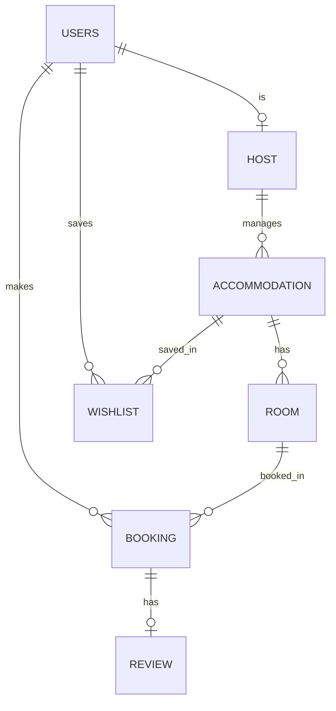

# 2026-10-08_숙소_예약_서비스_ERD_설계(기능_정의,_ERD_점검,_설계_결정)
> 작성일: 2026-10-08

## 🔗 관련 글

- [데이터베이스 설계(키, 무결성, 정규화, ERD 작성)](2026-10-07%20(5)데이터베이스_설계(키,_무결성,_정규화,_ERD_작성).md) — ERD 작성 순서(요구사항 → 개체 → 상세 설계 → 정규화), 키, 무결성, 정규화(1NF~3NF), 반정규화. 이 글의 설계 점검이 그 개념을 실제 ERD에 적용한 것이다.
- [ERD 실습(draw.io, ERDCloud 사용법)](2026-10-07%20(6)ERD_실습(draw.io,_ERDCloud_사용법).md) — ERDCloud로 ERD를 그리는 방법, 식별/비식별 관계.
- [스키마와 ERD](2026-10-02%20(2)스키마와_ERD(엔티티,_까마귀_발_표기법).md) — 까마귀 발 표기법, 필수/선택 관계 읽기.
- [데이터베이스 기초와 관계(RDB, PK/FK, 1:N, M:N)](2026-10-02%20(1)데이터베이스_기초와_관계(RDB,_PK_FK,_1대N,_M대N).md) — 1:N, M:N(연관 테이블), 1:1은 FK에 `UNIQUE`가 필요하다는 보충.
- 이어지는 글: [DDL](2026-10-09%20(1)숙소_예약_서비스_DDL(PostgreSQL,_제약조건,_타입).md), [화면별 쿼리](2026-10-09%20(2)숙소_예약_서비스_화면별_쿼리(JOIN_추적,_GROUP_BY).md)

## ❓ 아직 모르겠는 것

- 내보낸 SQL에 **FK가 3개뿐**이고 점선(비식별) 관계의 FK가 빠진 **원인은 확인하지 못했다.** (ERDCloud에서 관계선의 식별/비식별, 필수/선택 설정을 확인해야 한다.)
- 기능 정의의 **"박수"**(마이페이지 찜한 숙소)가 무엇을 뜻하는지 확인하지 못했다. "최근예약3개"는 "최근 등록 3개"의 오타로 보이나 확정하지 않았다.
- **예약금액의 의미**(예약 당시 1박 요금인지, 총액인지), **예약번호 처리 방식**(별도 컬럼인지)은 이 글 시점에 최종 확정되지 않았다. DDL 글에서는 각각 "1박 요금 스냅샷", "별도 컬럼"으로 가정했다.
- 화면 예시는 **이미지**라서 낮은 해상도 캡처로 읽었다. 글자를 잘못 읽었을 가능성이 있다.
- 강사님이 알려 준 **세 번째 ERD 사이트**를 확인하지 못했다.

---

## 주제 1: ERD 및 SQL 작성 실습 (수업 1290)

**화면 예시를 보고** 다음 작업을 수행한다. (수업 원문)

1. **ERD 설계**
   - 화면에 필요한 데이터를 저장할 **테이블과 컬럼**을 구성한다.
   - **기본키(PK), 외래키(FK)** 를 정하고 테이블 간 **관계를 표현**한다.
2. **화면별 조회 SQL 작성**
   - 설계한 ERD를 기준으로 각 화면에 필요한 데이터를 조회하는 SQL을 작성한다.
   - **한 화면에 여러 개의 SQL을 사용해도 된다.**
3. **데이터 생성 및 조회 확인**
   - 설계한 ERD를 바탕으로 **AI를 활용해** 테이블을 생성하고 샘플 데이터를 입력한다. **AI가 작성한 DDL을 확인**하여 ERD와 일치하는지 확인한다.
   - 화면별 조회 SQL을 실행해 결과를 **검증**한다.

### 화면 예시 6개 (숙소 예약 서비스)

> 화면 예시는 이미지이며 확인한 내용을 옮긴 것이다. 숙소 주소 끝의 "(가상 주소)"는 화면에 적힌 표기이다.

| 화면 | 보이는 데이터 |
|---|---|
| **① 메인 페이지** | **최근 등록한 숙소**: 숙소명, 주소(시·도, 시·군·구, 읍·면·동), **"1박 ○○원부터"**, **평균 평점**(후기가 없으면 "아직 후기가 없습니다"), 등록일 |
| **② 숙소 목록** | **"제주 지역 · 숙소 2개"**, 숙소별 주소, **최저 1박 요금**, 평균 평점 |
| **③ 숙소 상세 페이지** | 숙소명, 상세 주소, 소개글, **편의시설**(무선 인터넷, 무료 주차, 에어컨, 주방), **객실 및 요금**(객실, 설명, 최대 인원, 1박 요금), **후기**(평균 평점 · 후기 수, 작성자, 평점, 내용, 어느 객실, 작성일) |
| **④ 예약 확인 페이지** | "예약이 확정되었습니다." 예약 번호, 숙소, 주소, 객실, 체크인, 체크아웃 · **박 수**, 투숙 인원, 예약자, **예약 금액(1박 요금 × 박 수)**, 예약 상태, 예약일 |
| **⑤ 마이페이지** | 유저 이름·이메일, **내 예약**(예약 번호, 숙소/객실, 숙박 기간·박 수, 인원, 금액, 상태: 확정 / 이용 완료), **찜한 숙소**, **내가 작성한 후기**(숙소·객실, 평점, 내용, 작성일, 예약 번호) |
| **⑥ 호스트 페이지** | "○○ 님의 숙소 관리": **내가 등록한 숙소와 객실**(주소, 소개, 등록일, 객실 표), **예약 현황과 예약자 정보**(예약 번호 / 숙소 / 객실, 예약자 이름·이메일·연락처, 숙박 기간 / 인원, 예약 금액, 상태) |

**예시 데이터 값**(검증용): 제주 바람집(바람 101호 85,000원 · 바다 201호 130,000원, 평균 평점 4.5, 후기 2개), 부산 파도하우스(파도 101호 95,000원 · 파도 201호 150,000원, 후기 없음), 제주 돌담스테이(돌담 1호 110,000원, 평균 평점 4.0).

> ➕ **더 알아두기 — 화면에서 찾은 설계 단서**
> (대화 중 정리한 해석이며 정답이 아니다.)
>
> - **"김민수"가 두 화면에 나온다.** ④에서는 **예약자**, ⑥에서는 **호스트**이다. 같은 사람이 손님이면서 호스트이므로 사용자 테이블을 따로 두지 않고 **유저 테이블 하나**에 두고 역할만 구분한다.
> - **계산해서 보여주는 값**이 많다. 평균 평점, 최저 1박 요금, 숙소 수, 예약 금액은 저장된 컬럼이 아니라 **조회할 때 집계**(`AVG`, `MIN`, `COUNT`)로 만들 수 있다. **저장할지 매번 계산할지**는 반정규화와 이어지는 선택이다.
> - **"예약 금액 = 85,000원 × 2박"** 은 중요한 힌트이다. **예약한 시점의 요금**을 저장해 두지 않으면 나중에 객실 요금이 바뀔 때 과거 예약 금액도 같이 바뀐다.

---

## 주제 2: 기능 정의

직접 정리한 기능 정의이다. (원문 표현을 그대로 옮겼다.)

**메인페이지**
- 최근등록한숙소: 최근예약3개, 숙소의 객실 최저금액, 리뷰에서 전체평점계산, 등록일

**숙소목록페이지**
- 숙소의 지역, 지역의 숙소목록
- 각 숙소의 이름, 주소, 객실 최저요금, 평균평점

**숙소상세페이지**
- 숙소 이름, 주소, 설명, 찜여부
- 호스트 이름, 설명
- 숙소 편의시설
- 객실 정보(이름, 요금, 설명, 인원)
- 후기(작성자이름, 내용, 평점, 숙소 후기갯수)

**예약확인 페이지**
- 예약테이블 정보 전체
- 체크인 체크아웃 비교해서 박수계산
- 최종 예약금액(기본금액 × 박수)

**마이페이지**
- 내 예약(유저본인ID의 예약정보 - 예약번호, 숙소/객실, 숙박기간, 인원, 총예약금액, 상태)
- 찜한숙소(숙소정보 - 이름, 주소, 박수, 평점, 최저객실가격)
- 작성후기(숙소/객실이름, 후기평점, 후기내용, 작성일, 예약번호)

**호스트페이지**
- 호스트 정보
- 호스트가 가지고 있는 숙소정보(숙소명, 주소, 숙소설명, 등록일), 객실정보(객실명, 객실설명, 인원, 1박요금)
- 예약현황(예약번호별 숙소, 객실, 예약자, 예약자이메일, 예약자연락처, 숙박기간, 예약인원, 예약금액, 상태)
- 숙소별 취소제외 예약집계(숙소명, 총 예약 수, 총 예약금액 합계)
- 숙소별후기(숙소이름, 평균평점, 후기총갯수, 작성된후기내용(숙소명, 평균평점, 후기갯수, 후기작성자, 객실명, 평점, 내용, 작성일, 예약번호))

> ➕ **더 알아두기 — 기능 정의에서 읽은 설계 결정**
> - **"취소제외 예약집계"** 가 있어서 예약 상태에 **`취소`가 반드시 있어야** 한다. 예약을 삭제하지 않고 상태만 `취소`로 바꾸는 설계라는 뜻이다.
> - **"찜 여부"**(숙소 상세), **"찜한 숙소"**(마이페이지)는 **숙소 단위**의 찜이다.
> - **"최종 예약금액(기본금액 × 박수)"** 는 박 수를 **저장하지 않고 체크인·체크아웃을 비교해 계산**한다는 뜻이다.

---

## 주제 3: 직접 만든 ERD와 내보낸 SQL

ERDCloud에서 직접 만든 ERD이다. 컬럼의 **물리 이름·도메인·타입을 정하기 전**이라 키 이름만 정한 상태였고, 관계선의 식별/비식별도 확신 없이 연결한 초안이었다.

| 테이블 | 컬럼 | PK |
|---|---|---|
| **숙소** | 숙소id, 주소, 지역, 설명, 전화번호, 이름, **편의시설**, 호스트ID(FK) | 숙소id |
| **객실** | 객실ID, 객실명, 최대숙박인원, 가격, 크기, 방갯수, 설명, 숙소id(FK) | 객실ID |
| **유저** | 유저ID, 이름, 연락처, 이메일 | 유저ID |
| **호스트** | 호스트ID, 소개, 유저ID(FK) | 호스트ID |
| **예약** | 예약id, 체크인시간, 체크아웃시간, 예약일, 예약금액, 예약인원, 상태, 유저ID(FK), 객실ID(FK) | 예약id |
| **후기** | 후기id, 객실ID, 숙박기간, 후기내용, 예약id, 유저ID, 평점 | (후기id, 객실ID) **복합** |
| **찜** | 유저ID, 객실ID | (유저ID, 객실ID) **복합** |

**내보낸 SQL에서 확인한 점**

| 항목 | 내용 |
|---|---|
| **FK가 3개뿐** | 찜의 FK 2개와 후기 → 객실 FK 1개만 있다. 그림의 점선(비식별) 관계는 SQL에 FK로 나오지 않았다. (원인 미확인) |
| **백틱 `` ` ``** | `` `Key` `` 같은 표기는 **MySQL 방식**이다. **PostgreSQL에서는 쓸 수 없다.** 이 SQL은 그대로 실행하지 않고 AI에게 PostgreSQL용 DDL을 만들게 하는 방향이 맞다. |
| **모든 타입이 `VARCHAR(255)`** | 타입을 정하지 않아 기본값이 들어갔다. id는 정수, 가격은 숫자, 날짜는 `DATE`/`TIMESTAMP`, 평점은 정수 + `CHECK`로 바꿔야 한다. |
| **물리 이름이 `Key`, `Field`…** | ERDCloud에서 왼쪽(논리 이름)은 한글이고 오른쪽(물리 이름)이 `Key`, `Field`이다. DDL을 만들기 전에 영문 물리 이름이 필요하다. |
| **테이블 이름이 `Untitled…`** | 물리 테이블 이름을 정하지 않은 상태이다. |

---

## 주제 4: ERD 점검 결과

### 잘한 점

- **호스트를 유저와 분리**했다. 김민수가 손님이면서 호스트인 상황이 **호스트 → 유저(FK)** 로 자연스럽게 풀린다.
- **숙소 → 객실 → 예약**의 **1:N 계층**을 정확히 잡았다.
- **예약금액을 예약 테이블에 저장**했다. 요금이 나중에 바뀌어도 **예약 시점 금액**이 남는다.
- **찜을 연관 테이블(복합 PK)** 로 만들었다. 유저와 대상의 M:N을 정석대로 풀었다.
- **마이페이지의 "후기 + 예약 번호"** 를 후기가 `예약id`를 가지는 것으로 반영했다.

### 고칠 점

| # | 문제 | 설명 |
|---|---|---|
| ① | **후기의 복합 PK `(후기id, 객실ID)`** | 후기는 `후기id` 하나로 식별되는데 `객실ID`가 PK에 섞여 있다 |
| ② | **후기의 `객실ID`, `유저ID`, `숙박기간` 중복** | 후기는 `예약id`를 가지고, **예약이 이미 유저·객실·체크인·체크아웃을 안다.** 같은 정보를 두 곳에 두면 어긋날 수 있다 (3NF) |
| ③ | **후기에 작성일 없음** | 화면 ③⑤에 후기 작성일이 나온다 |
| ④ | **숙소의 `편의시설`** | 한 컬럼에 여러 값이면 1NF 위반 (아래 설계 결정에서 텍스트로 단순화하기로 함) |
| ⑤ | **숙소에 `등록일` 없음** | 화면 ①(최근 **등록한** 숙소)과 ⑥이 이 값을 쓴다 |
| ⑥ | **찜의 대상** | 기능 정의는 **숙소 단위**인데 ERD는 **객실 단위** |
| ⑦ | **예약 번호** | 화면 ④는 `BK-20250607-001` 같은 예약 번호를 보여 준다 |
| ⑧ | **후기와 예약의 관계** | 그림에서 1:N처럼 보였다. 예약 1건당 후기 1개라면 1:0..1이고 후기의 `예약id`에 `UNIQUE`가 필요하다 |

> 📝 **기사 시험 포인트** (정보처리기사, 확실도: 높음)
> ②는 **이행적 함수 종속**(3NF 위반)의 예이다. `후기id → 예약id → (유저ID, 객실ID)`로 **거쳐서** 결정되므로 후기에 `유저ID`, `객실ID`를 또 둘 필요가 없다. 3NF는 이행적 함수 종속을 제거한다.

### 식별 / 비식별 관계 적용

기준은 **부모의 PK가 자식의 PK(의 일부)가 되는가**이다.

| 관계 | 당시 상태 | 판단 |
|---|---|---|
| 찜 ← 유저, 찜 ← 객실 | 식별(실선): 둘 다 찜의 PK의 일부 | ✅ 연관 테이블은 보통 식별 관계 |
| **후기 ← 객실** | 식별(실선): 객실ID가 후기 PK의 일부 | ❌ **비식별**이 맞다. 후기는 자기 id로 식별된다 |
| 숙소·객실·예약·호스트 | 비식별(점선) | ✅ FK가 일반 컬럼 |

> ➕ **더 알아두기 — 기억 요령**
> **연관 테이블(찜)만 식별, 나머지는 거의 비식별.** (일반적인 요령이며 예외도 있다.)

### 화면 ↔ 데이터 점검표 (당시 ERD 기준)

| 화면 | 가능? | 메모 |
|---|---|---|
| ① 메인 | ⚠️ | 등록일 없음, 평균 평점은 후기→(예약)→객실→숙소 경로로 집계 |
| ② 숙소 목록 | ✅ | 지역·최저 요금(`MIN`)·평균 평점 가능 |
| ③ 숙소 상세 | ⚠️ | 편의시설 여러 개, 후기 작성일 없음 |
| ④ 예약 확인 | ⚠️ | 예약 번호 형식, 박 수는 체크아웃 − 체크인으로 계산 |
| ⑤ 마이페이지 | ⚠️ | 찜한 숙소(객실 단위), 후기 + 예약 번호 ✅ |
| ⑥ 호스트 | ✅ | 숙소→객실, 예약→유저 가능 |

### 기능 정의와 ERD의 불일치 3가지

| # | 불일치 | 내용 |
|---|---|---|
| ① | **찜: 숙소 단위 vs 객실 단위** | 기능 정의의 "찜 여부", "찜한 숙소"는 숙소 단위인데 ERD는 객실 단위. 객실 단위로 하면 숙소 찜 여부를 알려면 객실 → 숙소 → 같은 숙소의 다른 객실 찜까지 확인해야 해서 쿼리가 복잡해진다. `찜.객실ID`를 `찜.숙소ID`로 바꾸는 것을 권했다. |
| ② | **예약금액: 저장 vs 계산** | 기능 정의는 "최종 예약금액 = 기본금액 × 박수"인데 ERD에는 `예약금액`이 저장돼 있다. **A**: 예약 당시 1박 요금(스냅샷) + 박 수로 계산, **B**: 총액 저장. 객실의 현재 가격 × 박수로 계산하면 객실 요금이 바뀔 때 과거 예약 금액도 바뀐다. 컬럼 이름도 의미가 드러나게 짓는 것이 좋다. |
| ③ | **표현 확인** | "최근예약3개"(최근 **등록** 3개의 오타?), 찜한 숙소의 "**박수**"(숙소의 속성이 아니라 예약의 속성이라 이상함) |

---

## 주제 5: 설계 결정과 이해한 것

### 후기의 객실ID — 중복을 둘 것인가

> ♻️ 처음엔 **후기에 객실ID를 저장해 두고 예약 테이블의 객실ID와 비교**하면 된다고 생각했으나, **두 값이 같은지 계속 비교해야 한다는 것 자체가 중복 저장의 신호**이다. 후기는 `예약id`만 가지고, 객실은 **예약을 거쳐 JOIN으로** 찾는 것이 더 단순하고 안전하다. (**정규화**의 목적: 같은 정보를 두 군데 적지 않는다)

| 방법 | 설명 | 특징 |
|---|---|---|
| **A. 후기에 객실ID를 저장** | 후기 → 객실 바로 연결 | 쿼리가 간단하지만 **중복** 위험. 후기의 객실ID와 예약의 객실ID가 서로 다르게 저장될 수 있고 DB가 이를 막지 못한다 |
| **B. 예약을 거쳐서 찾기** | 후기 → 예약 → 객실 (JOIN) | 중복 없음, 쿼리가 한 단계 길어짐 |

```sql
SELECT rv.후기내용, r.객실명
FROM 후기 rv
JOIN 예약 b ON rv.예약id = b.예약id
JOIN 객실 r ON b.객실ID = r.객실ID;
```

> ➕ **더 알아두기 — 정규화 vs 반정규화**
> A를 택하는 것은 **일부러 중복을 두는 반정규화**이고, 그 대가(두 값이 어긋나지 않게 직접 관리)를 알고 선택하는 것이다. 수업의 원칙은 **"정규화가 기본, 필요가 확인되면 반정규화"** 이다. 대가를 아는 것이 설계를 잘하는 첫걸음이다. A를 택해도 복합 PK `(후기id, 객실ID)`는 `후기id` 하나로 바꾸는 것이 좋다.

### 편의시설 — 텍스트로 단순화 (의식적 결정)

숙소의 편의시설은 **텍스트 한 컬럼**으로 두기로 했다. 이번 실습 범위에서는 합리적인 선택이다.

| 얻는 것 | 잃는 것 |
|---|---|
| 테이블이 적고 단순함 | "**무료 주차**가 있는 숙소만" 같은 **조건 검색**이 약함 (`LIKE '%주차%'`로 우회할 수 있지만 부정확) |
| 화면 ③에 그대로 출력 가능 | "한 칸에 값 하나"(1NF)를 어김 |

정석은 **편의시설 테이블 + 숙소–편의시설 연관 테이블(M:N)** 이다. 알면서 단순화한 선택이므로 **"편의시설은 의도적으로 텍스트로 단순화"** 라고 기록해 둔다.

### 등록일 추가

숙소에 `등록일`(날짜 타입)을 **추가**한다.

### 찜의 단위

초안에서는 **객실 단위**로 정했다. 이유는 **객실마다 금액이 달라서**였고 숙소 찜은 아직 기능에 고려하지 않았다고 했다. 그러나 **기능 정의에는 숙소 단위 찜("찜 여부", "찜한 숙소")이 이미 있다.** 객실 단위 찜은 나중에 필요하면 별도 테이블로 추가하는 방향으로 정리했다.

> ➕ **더 알아두기 — 찜 화면의 주의점**
> 객실을 찜한 채 숙소를 보여주면 **같은 숙소의 객실 두 개를 찜했을 때 그 숙소가 두 번** 나올 수 있다. 어떻게 보여줄지(객실별로 / 숙소 한 번만)를 기능 정의에 포함하는 것이 좋다.

### 예약 번호

| 값 | 용도 | 예 |
|---|---|---|
| **예약id** (PK) | DB 안에서 다른 테이블이 연결하는 번호 | `1`, `2`, `3` |
| **예약 번호** | 사람이 화면에서 보는 번호 | `BK-20250607-001` |

| 선택 | 설명 |
|---|---|
| **A. 예약id 자체를 `BK-...` 문자열로** | 컬럼이 하나라 단순하지만 PK와 FK가 모두 문자열 |
| **B. 예약id(정수) + 예약번호 컬럼(별도, UNIQUE)** | 현실 서비스에 가깝고 번호 형식이 바뀌어도 연결 관계가 안 바뀐다 |

실습에서는 둘 다 가능하며, 수업의 다른 예제처럼 모든 PK가 정수 `id`라면 B가 어울린다.

### UNIQUE와 후기–예약 관계

> ♻️ 처음엔 **`UNIQUE`를 안 배운 내용**이라고 생각했으나, **DDL 레슨(1247)의 제약조건 표에 있고**(`UNIQUE`: 값의 중복을 허용하지 않음) 데이터베이스 설계 레슨의 수강신청 `(student_id, course_id)` **복합 `UNIQUE`** 로도 나왔다.

> ➕ **더 알아두기 — "예약id에 UNIQUE"의 뜻**
> 이는 **예약 테이블이 아니라 후기 테이블의 `예약id`(FK) 컬럼**에 거는 것이다. (예약 테이블의 `예약id`는 PK라서 이미 중복이 안 된다.) FK만으로는 **대상을 가리킬 뿐 몇 개까지인지는 못 정한다.**
>
> | `예약id`만 FK일 때 | 후기 테이블 |
> |---|---|
> | 후기 1 → 예약 7 | ✅ |
> | 후기 2 → 예약 7 | ✅ **들어감** (같은 예약에 후기 2개) |
>
> `UNIQUE`를 걸면 두 번째 입력이 **오류**로 거부되어 **"예약 1건당 후기는 최대 1개"** 가 DB에서 보장된다. 10월 2일에 정리한 **주문–환불**(1:1이 되려면 환불의 `주문ID`가 UNIQUE)과 같은 구조이다. 한 줄로 외우면 **"FK 하나 = 1:N, FK + UNIQUE = 1:1(또는 1:0..1)"** 이다.

**후기와 예약의 관계 판단**

처음에는 "후기 하나당 예약 하나니까 1:1"이라고 판단했다. 더 정확히는 다음과 같다.

| 방향 | 의미 |
|---|---|
| **후기 → 예약** | 후기 한 건은 **반드시 예약 한 건**에 속함 (필수) |
| **예약 → 후기** | 예약 한 건에 후기는 **없을 수도, 하나 있을 수도** (선택) |

그래서 **1:0..1**이다. 기호로는 예약 쪽 `||`, 후기 쪽 `o|`(없거나 하나)이며 주문–환불과 같은 모양이다. 후기의 `예약id`에 **`NOT NULL`을 걸면** "후기는 반드시 예약에 속한다"가 된다.

> 📝 **기사 시험 포인트** (정보처리기사, 확실도: 높음~중간)
> 관계형 DB에서 **1:1 관계는 FK에 UNIQUE 제약을 거는 방식**으로 구현할 수 있다고 알고 있다.

### 선(관계선)은 기능 정의와 함께 확정

관계선의 식별/비식별, 필수/선택은 **기능 정의를 먼저 정한 뒤** 그에 맞춰 확정하기로 했다.

---

## 주제 6: 수정 후 구조 (제안)

| 테이블 | 컬럼 | 변경 |
|---|---|---|
| **유저** | id, 이름, 연락처, 이메일(UNIQUE 추천) | 변경 없음 |
| **호스트** | id, 소개, **유저ID(FK, UNIQUE)** | 유저 1 : 0..1 호스트 |
| **숙소** | id, 호스트ID(FK), 이름, 주소, 지역, 설명, 전화번호, 편의시설(텍스트), **등록일** | 등록일 추가 |
| **객실** | id, 숙소ID(FK), 객실명, 최대인원, 가격(1박), 크기, 방 갯수, 설명 | 변경 없음 |
| **예약** | id, (예약번호), 유저ID(FK), 객실ID(FK), 체크인, 체크아웃, 인원, 예약금액(의미 정하기), 상태, 예약일 | 예약번호·금액 의미 정리 |
| **후기** | id, **예약ID(FK, UNIQUE)**, 평점, 내용, **작성일** | **객실ID, 유저ID, 숙박기간 제거** |
| **찜** | **유저ID(FK), 숙소ID(FK)** — 복합 PK | 객실ID → 숙소ID |



> 위 그림은 **관계와 필수/선택**만 보여 주는 초안이다. (`||` 필수 하나, `o{` 없거나 여러 개, `o|` 없거나 하나)

### 관계선 설정 가이드 (ERDCloud)

| 관계 | 식별/비식별 | 필수/선택 (FK 쪽) |
|---|---|---|
| 호스트 → 유저 | **비식별** | 호스트에 유저는 **필수** (`NOT NULL`, `UNIQUE`) |
| 숙소 → 호스트 | 비식별 | 필수 |
| 객실 → 숙소 | 비식별 | 필수 |
| 예약 → 유저 / 객실 | 비식별 | 필수 |
| 후기 → 예약 | **비식별** | 필수 + **UNIQUE** (1:0..1) |
| **찜** → 유저 / 숙소 | **식별** (복합 PK) | 필수 |

찜만 **식별 관계(실선)**, 나머지는 **비식별(점선)** 이다.

> ➕ **더 알아두기 — 계산 값은 저장하지 않는다**
> 기능 정의에는 평균 평점, 최저 요금, 후기 개수, 숙소별 예약 수·금액 합계 같은 **집계가 많다.** 이것들은 컬럼으로 저장하지 않고 **조회할 때 `AVG`/`MIN`/`COUNT`/`SUM`** 으로 구하는 값이다. **파생 속성**(다른 속성에서 계산해 낼 수 있는 속성)은 저장하지 않는 것이 정규화 원칙에 맞다.

> 📝 **기사 시험 포인트** (정보처리기사, 확실도: 중간)
> 평균 평점, 예약 금액처럼 **다른 속성에서 계산해 낼 수 있는 속성**을 E-R 모델에서 **파생 속성(Derived Attribute)** 이라고 부르는 것으로 알고 있다. 저장 여부는 설계 선택이고, 저장하면 반정규화와 비슷하게 갱신 부담이 생긴다. (표기와 출제 형태는 확인하지 못했다.)

---

## 정리

- **실습 순서**: ERD 설계(테이블·컬럼·PK·FK·관계) → 화면별 조회 SQL → AI로 DDL과 샘플 데이터 생성 후 ERD와 일치하는지 확인 → 쿼리 실행으로 검증. 한 화면에 SQL이 여러 개여도 된다.
- **기능 정의**를 글로 정리하고 ERD가 그 기능을 **모두 만족하는지 대조**한다. 점검 항목: 화면 ↔ 데이터, 키, 관계(1:N / M:N → 연관 테이블), 필수/선택(`NOT NULL`, `UNIQUE`, `CHECK`), 정규화, 계산 값(저장 vs 계산), SQL 가능성.
- **후기**: 후기는 `예약id`만 가지고 유저·객실은 예약을 거쳐 JOIN으로 구한다. 후기 PK는 `후기id` 하나, `예약id`에 `UNIQUE`, 작성일 추가. (3NF: 이행적 함수 종속 제거)
- **찜**: 기능 정의에 맞춰 **숙소 단위**(유저–숙소 연관 테이블, 복합 PK). **편의시설**은 의도적으로 텍스트로 단순화. **등록일** 추가.
- **예약**: 예약id(내부)와 예약번호(표시)를 구분, 예약금액은 "예약 당시 1박 요금"으로 두고 총액은 박 수와 곱해 계산.
- **관계**: FK 하나 = 1:N, FK + `UNIQUE` = 1:1(또는 1:0..1). 후기–예약은 1:0..1. 식별 관계는 연관 테이블(찜)만, 나머지는 비식별.
- **ERDCloud 내보내기 SQL**은 MySQL 방식(백틱)·`VARCHAR(255)`·`Key`/`Field` 이름이라 PostgreSQL에 그대로 쓰지 않고 DDL을 새로 만든다.

---

## ✅ 확인 질문

1. 수업 1290 ERD 및 SQL 작성 실습의 세 가지 작업(ERD 설계, 화면별 조회 SQL, 데이터 생성 및 조회 확인)을 설명하라. AI가 만든 DDL은 왜 ERD와 일치하는지 확인해야 하는가?
2. 같은 사람(김민수)이 예약자이면서 호스트인 상황을 테이블로 어떻게 표현했는가? 유저 테이블을 손님용·호스트용으로 따로 만들면 어떤 문제가 생기는가?
3. 평균 평점, 최저 1박 요금, 숙소 수, 예약 금액은 왜 컬럼으로 저장하지 않는가? 이런 속성을 무엇이라 부르는가?
4. 기능 정의의 "취소제외 예약집계"는 예약 테이블에 어떤 설계를 요구하는가?
5. 후기에 `객실ID`, `유저ID`, `숙박기간`을 두면 왜 중복·이행적 종속(3NF 위반)이 되는가? 객실과 작성자는 어떻게 찾는가?
6. "후기의 객실ID와 예약의 객실ID를 비교하면 된다"는 생각이 왜 중복 저장의 신호인가? A(저장)와 B(JOIN으로 찾기)의 장단점은?
7. 후기의 복합 PK `(후기id, 객실ID)`가 왜 어색한가? 후기–객실 관계를 식별 관계에서 비식별 관계로 바꾸는 이유는?
8. 식별 관계와 비식별 관계를 PK 기준으로 설명하고, 이 ERD에서 식별 관계로 남는 테이블과 그 이유를 말하라.
9. 후기의 `예약id`에 `UNIQUE`를 거는 이유는? FK만 있을 때와 FK + `UNIQUE`일 때 무엇이 다른가? 주문–환불과 어떻게 같은가?
10. 후기–예약 관계가 "1:1"보다 "1:0..1"이 더 정확한 이유를 두 방향(후기 → 예약, 예약 → 후기)으로 설명하라.
11. 찜을 객실 단위에서 숙소 단위로 바꾸는 이유는? 객실 단위로 두면 쿼리가 왜 복잡해지는가?
12. 편의시설을 텍스트 하나로 두면 얻는 것과 잃는 것은? 정석적인 설계는 무엇인가?
13. 예약id와 예약 번호의 차이는? 예약번호를 별도 컬럼(UNIQUE)으로 두는 방식(B)의 장점은?
14. 예약금액을 "예약 당시 1박 요금"으로 저장하는 이유는? 객실의 현재 가격 × 박수로 계산하면 어떤 문제가 생기는가?
15. ERDCloud가 내보낸 SQL을 PostgreSQL에서 그대로 쓸 수 없는 이유 세 가지를 말하라.
16. (기사 대비) 3NF가 제거하는 종속은? 파생 속성이란? 1:1 관계를 FK로 구현하려면 어떤 제약이 필요한가?
