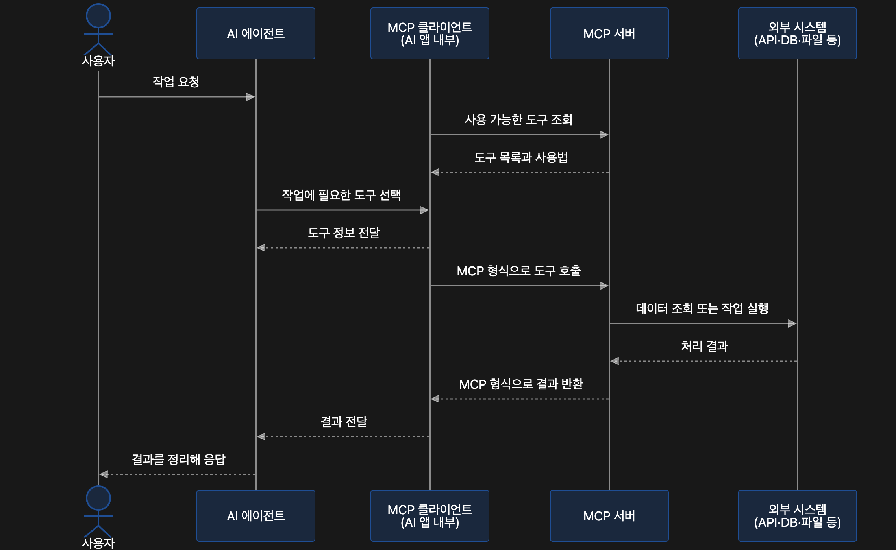

# 2026-10-23 (1)MCP(Host·Client·Server, Tool·Resource·Prompt, JSON-RPC, FastMCP, A2A)
> 작성일: 2026-10-23

## 🔗 관련 글

- [CS기본 지식(소프트웨어공학, 하드웨어, 네트워크 등)](2026-08-03%20CS기본%20지식(소프트웨어공학,%20하드웨어,%20네트워크%20등).md) — 1.4절에서 MCP를 "AI 전용 공통 규격(USB-C 포트)"으로 처음 정리했다. 이 글은 그 개념을 코드로 직접 구현하고 연결해 본 실습이다.
- [클로드 디자인 and MCP사용해보기](2026-08-04%20클로드%20디자인%20and%20MCP사용해보기.md) — Claude Code에 외부 MCP 서버를 장착해 쓰는 쪽을 다뤘다. 이 글 주제 8의 Claude Code 연결이 같은 일을 직접 만든 서버로 하는 것이다.
- [Tool + Agent(05)와 RAG 기초(06)](2026-09-02%20Tool%20Agent와%20RAG%20기초.md) — LangChain `@tool`로 함수를 도구로 만드는 방법이다. 이 글 주제 1의 비교표에서 "`@tool`로 만든 Tool" 쪽이 이것이다.
- [ReAct Agent(Tool, ToolNode, tools_condition, MessagesState)](2026-09-09_(1)_ReAct_Agent(Tool,_ToolNode,_tools_condition,_MessagesState).md) — 모델이 도구 호출을 요청하고 앱이 실행하는 흐름이다. MCP Tool도 Agent 안에서는 이 흐름과 같게 쓰인다.

## ❓ 아직 모르겠는 것

이 글은 강의 노트북(`36-mcp.ipynb`)과 서버 파일(`mcp_examples/weather_server.py`)을 읽고 정리했다. 대화 중 사용자가 질문하거나 막힌 부분은 없었다. 복습하면서 막히는 곳을 이 자리에 추가한다.

- (확인 필요) 노트북의 Resource 읽기(`get_resources`), Prompt 읽기(`get_prompt`), 읽어 온 내용을 Agent에 전달하는 셀의 **실행 결과가 노트북에 저장되어 있지 않다.** 이 글의 주제 7은 코드와 설명만 옮겼고 실제 출력은 직접 실행해 확인해야 한다.

## 주제 1: MCP란 무엇이고 Tool Calling과 어떻게 다른가

### MCP의 정의

**MCP(Model Context Protocol)** 는 AI 애플리케이션이 외부 도구와 데이터를 활용하기 위한 **표준 통신 규약**이다.

AI 애플리케이션마다 도구 연결 방식이 다르면 같은 기능도 앱에 맞춰 연결해야 한다. MCP는 이 연결 방식을 표준화하여, **하나의 서버가 제공하는 기능을 여러 MCP 지원 앱에서 재사용**할 수 있게 한다.

예를 들어 날씨 조회 기능을 MCP 서버로 만들면, LangGraph로 만든 Agent와 Claude Code가 같은 서버를 사용할 수 있다. 각 애플리케이션은 서버가 제공하는 Tool 목록과 입력 형식을 조회한 뒤 필요한 Tool을 호출한다.

```text
LangGraph Agent ──┐
                  ├── 날씨 MCP 서버 ── TOOL
Claude Code ──────┘
```

### Tool Calling과 MCP의 관계

- Tool Calling은 **LLM이 외부 도구를 활용하기 위한 기능**이다.
- MCP는 **AI 애플리케이션이 외부 도구와 데이터를 활용하기 위한 표준 통신 규약**이다.

| 비교 | LangChain `@tool`로 만든 Tool | MCP 서버가 제공하는 Tool |
|---|---|---|
| 등록 | Python 함수를 LangChain Tool로 등록 | 서버의 기능을 MCP Tool로 등록 |
| 호출 | 애플리케이션이 등록된 함수를 호출 | 애플리케이션의 요청을 받아 서버가 실행 |
| 재사용 | 함수나 패키지를 가져와 LangChain 앱에서 사용 | MCP 지원 앱에서 서버에 연결해 사용 |
| 적합한 경우 | LangChain 앱에 필요한 함수나 API를 직접 도구로 연결할 때 | 여러 MCP 지원 앱에서 같은 도구를 공유하거나 기존 MCP 서버의 도구를 사용할 때 |

## 주제 2: MCP의 구성 요소 (Host, Client, Server)

MCP의 연결 구조에는 **Host, Client, Server**라는 세 가지 역할이 있다. 사용자가 이용하는 AI 앱이 Host이고, Host 안의 Client가 도구와 데이터를 제공하는 Server와 통신한다.

| 구성 요소 | 역할 | 이 수업의 예 |
|---|---|---|
| Host | 모델·사용자 대화·도구 사용을 관리하는 앱 | LangGraph Agent 앱, Claude Code |
| Client | Host 안에서 MCP 서버와 통신 | `MultiServerMCPClient`가 관리하는 연결 |
| Server | Tool·Resource·Prompt를 제공하는 프로그램 | `weather_server.py` |

**모델은 서버와 직접 통신하지 않는다.** Host가 모델의 요청을 받아 Client를 통해 실행한다.

### 호출 흐름 그림

노트북에 붙어 있던 시퀀스 다이어그램이다. 사용자의 작업 요청이 AI 에이전트, MCP 클라이언트, MCP 서버, 외부 시스템(API·DB·파일 등)을 차례로 거쳐 결과가 되돌아오는 흐름이다.



그림의 순서를 글로 풀면 다음과 같다.

1. 사용자가 AI 에이전트에 **작업을 요청**한다.
2. MCP 클라이언트(AI 앱 내부)가 MCP 서버에 **사용 가능한 도구를 조회**하고, 서버가 **도구 목록과 사용법**을 돌려준다.
3. AI 에이전트가 **작업에 필요한 도구를 선택**하고, 클라이언트가 **도구 정보를 전달**한다.
4. 클라이언트가 **MCP 형식으로 도구를 호출**한다.
5. MCP 서버가 외부 시스템에서 **데이터 조회 또는 작업 실행**을 하고 **처리 결과**를 받는다.
6. 서버가 **MCP 형식으로 결과를 반환**하고, 클라이언트가 AI 에이전트에 **결과를 전달**한다.
7. AI 에이전트가 **결과를 정리해 사용자에게 응답**한다.

> 📝 **기사 시험 포인트** (정보처리기사)
> 프로토콜(Protocol)은 통신 당사자가 정보를 주고받기 위해 정한 규칙이고, 기본 요소는 **구문(Syntax), 의미(Semantics), 타이밍(Timing)** 세 가지다. MCP도 "도구 목록을 먼저 조회한 뒤 호출한다"는 순서와 메시지 형식을 정해 둔 프로토콜이라는 점에서 이 틀로 볼 수 있다. (MCP 자체가 시험 범위라는 뜻은 아니다.)

## 주제 3: Tool, Resource, Prompt

MCP 서버는 **Tool, Resource, Prompt**라는 세 가지 형태로 기능과 데이터를 제공할 수 있다. Tool은 실행 가능한 함수, Resource는 읽을 수 있는 데이터, Prompt는 재사용할 수 있는 메시지 템플릿이다.

| 기능 | 제공하는 것 | 주로 사용하는 주체 | 예 |
|---|---|---|---|
| Tool | 실행 가능한 함수 | 모델이 호출을 제안하고 앱이 실행 | 현재 날씨 조회, 예보 조회 |
| Resource | URI로 읽을 수 있는 데이터 | 앱이 필요한 데이터를 선택해 사용 | 지원 도시 목록 |
| Prompt | 인자를 받아 만드는 메시지 템플릿 | 사용자나 앱이 선택 | 도시별 날씨 요약 요청 |

- 서버가 세 기능을 모두 구현할 필요는 없다. Client마다 지원 범위도 다르다.
- `get_tools()`는 **Tool만** 가져온다. Resource와 Prompt는 따로 읽어 모델에 전달해야 하며, **Prompt를 가져오는 것만으로 모델이 실행되지는 않는다.**

## 주제 4: MCP 메시지의 구조 (JSON-RPC 2.0)

MCP의 Client와 Server는 **JSON-RPC(Remote Procedure Call) 2.0** 형식으로 메시지를 주고받는다. JSON-RPC는 JSON에 작업 이름과 입력값을 담아 요청하고, 결과를 응답하는 규칙이다. MCP는 여기에 도구 목록 조회를 위한 `tools/list`, 도구 실행을 위한 `tools/call` 등의 작업과 데이터 형식을 정의한다.

연결 초기화를 마치면 Client는 `tools/list`로 도구 목록과 입력 형식을 확인하고, 필요한 도구를 `tools/call`로 호출할 수 있다. 아래는 서울 날씨를 조회하는 요청과 응답의 구조를 단순화한 예다.

**Client → Server: 도구 실행 요청**

```json
{
  "jsonrpc": "2.0",
  "id": 1,
  "method": "tools/call",
  "params": {
    "name": "get_current_weather",
    "arguments": {
      "city": "서울"
    }
  }
}
```

**Server → Client: 실행 결과 응답**

```json
{
  "jsonrpc": "2.0",
  "id": 1,
  "result": {
    "content": [
      {
        "type": "text",
        "text": "서울의 현재 기온은 22°C, 습도는 50%입니다."
      }
    ]
  }
}
```

| 필드 | 의미 |
|---|---|
| `jsonrpc` | JSON-RPC 형식의 버전이며, MCP 자체의 버전과는 다름 |
| `id` | 어떤 요청에 대한 응답인지 연결하는 식별자 |
| `method` | MCP 작업 이름. `tools/call`은 도구 실행 요청 |
| `params.name` | 실행할 도구의 이름 |
| `params.arguments` | 도구에 전달할 입력값 |
| `result` | 요청이 정상 처리되었을 때 반환하는 결과 데이터 |
| `result.content` | 도구가 반환한 콘텐츠 목록. 위 예시는 텍스트 하나를 포함 |

> 📝 **기사 시험 포인트** (정보처리기사)
> RPC(Remote Procedure Call, 원격 프로시저 호출)는 **미들웨어(Middleware)** 의 한 종류로, 다른 컴퓨터에 있는 프로시저(함수)를 같은 컴퓨터의 함수처럼 호출하게 해 준다. 시험에서는 미들웨어의 종류를 RPC, MOM(메시지 지향 미들웨어), ORB, DB 접속, TP-Monitor, WAS 등으로 구분한다. JSON-RPC는 이 RPC 방식의 요청·응답을 JSON 형식으로 표현한 규약이다.

> ➕ **더 알아두기**
> 수업의 `tools/call` 예시 응답은 `result.content`에 `{"type": "text", "text": ...}` 목록이 들어 있는 구조이다. 주제 6에서 노트북이 출력한 도구 직접 호출 결과도 `[{'type': 'text', 'text': '{...}', 'id': ...}]` 모양이어서, 어댑터가 이 `content` 목록을 그대로 돌려주는 것으로 읽힌다. (수업에서 명시한 설명은 아니고 두 출력을 비교해 본 것이다.)

## 주제 5: 필요한 패키지와 날씨 MCP 서버

### 패키지 설치

`mcp`는 Python으로 MCP 서버를 만들고 서버와 통신할 수 있게 하는 SDK다. SDK에 포함된 `FastMCP`는 Python 함수에 데코레이터를 붙여 Tool·Resource·Prompt를 등록할 수 있게 해 준다.

`langchain-mcp-adapters`는 MCP 서버의 Tool을 LangChain Tool로 변환해 LangChain·LangGraph Agent에 연결해 주는 라이브러리다.

```bash
pip install "mcp==1.30.0" "langchain-mcp-adapters==0.3.2"
```

노트북이 있는 폴더를 작업 폴더로 두고 실행한다. 서버 파일은 같은 폴더의 `mcp_examples/weather_server.py`에 둔다.

### 노트북 준비 코드

```python
import json

from dotenv import load_dotenv
from langchain_mcp_adapters.client import MultiServerMCPClient

load_dotenv()
MODEL_NAME = "gemini-3.6-flash"
```

### 날씨 서버 실행하기

제공된 `mcp_examples/weather_server.py`는 서울·부산·제주의 날씨를 조회하는 Tool 두 개를 제공하는 MCP 서버다. 서버는 도시별로 정해 둔 **실습용 가상 날씨 데이터**를 반환한다. 실제 날씨를 조회하지 않으며, 외부 날씨 API나 API 키는 필요하지 않다.

| Tool | 입력 | 반환하는 정보 |
|---|---|---|
| `get_current_weather` | `city` | 현재 기온·습도 |
| `get_weather_forecast` | `city` | 예보의 최저·최고 기온, 강수 확률 |

노트북과 같은 Python 환경을 활성화한 **별도 터미널**에서 노트북이 있는 폴더로 이동한 뒤 실행한다.

```bash
python mcp_examples/weather_server.py
```

서버는 `http://127.0.0.1:8000/mcp`에서 요청을 받는다. 실습하는 동안 서버 터미널을 열어 두고, 실습이 끝나면 그 터미널에서 `Ctrl+C`로 종료한다.

### 서버 코드 살펴보기

`weather_server.py`의 전체 코드는 다음과 같다.

```python
"""날씨 데이터를 제공하는 MCP 서버."""

import json
from typing import Literal

from mcp.server.fastmcp import FastMCP

mcp = FastMCP(
    "weather",
    host="127.0.0.1",
    port=8000,
    stateless_http=True,
    json_response=True,
)

City = Literal["서울", "부산", "제주"]
WEATHER_DATA = {
    "서울": {
        "current": {"temperature": 22, "humidity": 50},
        "forecast": {"min_temperature": 18, "max_temperature": 25, "rain_probability": 20},
    },
    "부산": {
        "current": {"temperature": 24, "humidity": 65},
        "forecast": {"min_temperature": 20, "max_temperature": 27, "rain_probability": 30},
    },
    "제주": {
        "current": {"temperature": 23, "humidity": 70},
        "forecast": {"min_temperature": 19, "max_temperature": 26, "rain_probability": 60},
    },
}


@mcp.tool()
def get_current_weather(city: City) -> dict:
    """서울·부산·제주 중 한 도시의 현재 기온과 습도를 반환한다."""
    return {
        "city": city,
        "current": WEATHER_DATA[city]["current"],
        "units": {"temperature": "°C", "humidity": "%"},
    }


@mcp.tool()
def get_weather_forecast(city: City) -> dict:
    """서울·부산·제주 중 한 도시의 최저·최고 기온과 강수 확률을 반환한다."""
    return {
        "city": city,
        "forecast": WEATHER_DATA[city]["forecast"],
        "units": {"min_temperature": "°C", "max_temperature": "°C", "rain_probability": "%"},
    }


@mcp.resource("weather://cities")
def supported_cities() -> str:
    """조회할 수 있는 도시 목록을 반환한다."""
    return json.dumps(list(WEATHER_DATA), ensure_ascii=False)


@mcp.prompt()
def weather_briefing(city: City) -> str:
    """현재 날씨와 예보를 요청하는 메시지를 만든다."""
    return (
        f"{city}의 현재 날씨와 예보를 도구로 조회해 주세요. "
        "현재 값과 예보를 구분하고 단위를 포함해 정리해 주세요."
    )


if __name__ == "__main__":
    mcp.run(transport="streamable-http")
```

수업에서 확인하라고 한 부분은 다음과 같다.

| 코드 | 역할 |
|---|---|
| `FastMCP(...)` | MCP 서버 생성 |
| `@mcp.tool()` | 함수를 Tool로 등록 |
| `@mcp.resource(...)` | 읽을 데이터를 Resource로 등록 |
| `@mcp.prompt()` | 메시지 템플릿을 Prompt로 등록 |
| `mcp.run(...)` | 서버 실행 |

- Tool로 등록한 함수의 **이름과 docstring이 Tool의 이름과 설명이 된다.**
- 이 서버는 Tool 2개(`get_current_weather`, `get_weather_forecast`), Resource 1개(`weather://cities`), Prompt 1개(`weather_briefing`)를 등록한다. 주제 3의 세 가지 형태를 모두 한 서버에 담은 예이다.
- `city: City`처럼 `Literal["서울", "부산", "제주"]`로 입력 타입을 정했기 때문에, 주제 6에서 출력되는 Tool 입력 형식에는 `"enum": ["서울", "부산", "제주"]`가 나타난다. 지원하지 않는 도시는 처음부터 입력 형식에서 걸러진다.

> ➕ **더 알아두기**
> 서버 파일에는 수업에서 설명하지 않은 설정이 두 개 있다. `stateless_http=True`는 요청마다 세션을 따로 유지하지 않고 각 요청을 독립적으로 처리하는 설정이고, `json_response=True`는 응답을 스트림이 아니라 JSON으로 바로 돌려주는 설정이다. 간단한 실습 서버를 단순하게 만들기 위한 것으로 읽힌다.
>
> MCP의 연결(transport) 방식은 이 수업의 **streamable HTTP** 말고도, 서버를 로컬 프로세스로 띄워 표준 입출력으로 통신하는 **stdio** 방식이 있다. 이 수업은 서버를 별도 터미널에서 띄우고 주소로 연결하므로 HTTP 방식을 쓴 것이다.

## 주제 6: LangGraph Agent에서 MCP Tool 사용하기

### 서버에 연결하고 Tool 목록 가져오기

노트북에서 실행 중인 MCP 서버의 주소로 연결한다. 서버를 실행한 컴퓨터에서 셀을 실행한다. `get_tools()`는 서버의 Tool 목록을 가져온다. 이 단계에서는 날씨 Tool이나 LLM을 아직 호출하지 않는다.

```python
weather_connection = {
    "transport": "streamable_http",
    "url": "http://127.0.0.1:8000/mcp",
    "timeout": 10,
}

weather_client = MultiServerMCPClient({"weather": weather_connection})
weather_tools = await weather_client.get_tools()
weather_tool_map = {tool.name: tool for tool in weather_tools}

for tool in weather_tools:
    print("이름:", tool.name)
    print("설명:", tool.description)
    print("입력:", json.dumps(tool.args, ensure_ascii=False, indent=2))
    print()
```

실행하면 두 Tool의 이름, 설명, 입력 형식이 출력된다. 설명은 서버 함수의 docstring과 같다.

```text
이름: get_current_weather
설명: 서울·부산·제주 중 한 도시의 현재 기온과 습도를 반환한다.
입력: {
  "city": {
    "enum": [
      "서울",
      "부산",
      "제주"
    ],
    "title": "City",
    "type": "string"
  }
}

이름: get_weather_forecast
설명: 서울·부산·제주 중 한 도시의 최저·최고 기온과 강수 확률을 반환한다.
입력: {
  "city": {
    "enum": [
      "서울",
      "부산",
      "제주"
    ],
    "title": "City",
    "type": "string"
  }
}
```

- 서버 쪽 `mcp.run(transport="streamable-http")`은 하이픈(`-`)이고, 클라이언트 쪽 연결 설정 `"transport": "streamable_http"`는 밑줄(`_`)이다. 표기가 다르므로 주의한다.

> ➕ **더 알아두기**
> `await weather_client.get_tools()`처럼 셀 맨 위에서 `await`를 바로 쓸 수 있는 것은 **주피터 노트북**에서만 가능하다. 노트북은 이미 비동기 이벤트 루프가 돌고 있기 때문이다. 일반 `.py` 파일에서는 `async def main()` 안에 넣고 `asyncio.run(main())`으로 실행해야 한다. (수업에서 설명하지 않은 내용이다.)

### LLM 없이 Tool 직접 호출하기

도구의 이름과 입력 형식을 알고 있다면 **모델 없이 직접 호출**할 수 있다. 연결 문제와 모델의 도구 선택 문제를 나누어 확인할 때도 유용하다. 서울의 현재 날씨와 예보를 조회하면 반환값에 도시, 날씨 값과 단위가 포함된다. 어댑터의 반환값은 텍스트 또는 콘텐츠 블록 목록일 수 있다.

```python
current_result = await weather_tool_map["get_current_weather"].ainvoke({"city": "서울"})
print("현재 날씨:", current_result)

forecast_result = await weather_tool_map["get_weather_forecast"].ainvoke(
    {"city": "서울"}
)
print("예보:", forecast_result)
```

```text
현재 날씨: [{'type': 'text', 'text': '{\n  "city": "서울",\n  "current": {\n    "temperature": 22,\n    "humidity": 50\n  },\n  "units": {\n    "temperature": "°C",\n    "humidity": "%"\n  }\n}', 'id': 'lc_4d83fed8-0ebc-4bb7-9f1a-9497cd69e0a4'}]
예보: [{'type': 'text', 'text': '{\n  "city": "서울",\n  "forecast": {\n    "min_temperature": 18,\n    "max_temperature": 25,\n    "rain_probability": 20\n  },\n  "units": {\n    "min_temperature": "°C",\n    "max_temperature": "°C",\n    "rain_probability": "%"\n  }\n}', 'id': 'lc_bacacc89-8bde-444a-ab4f-db929f3f3561'}]
```

### Agent에 MCP Tool 연결하기

`create_agent`에 모델과 MCP 서버에서 가져온 Tool을 전달해 Agent를 만든다. Agent는 사용자 요청에 따라 필요한 Tool을 선택하고 실행한다. MCP 어댑터의 Tool은 **비동기**로 실행하므로 Agent를 호출할 때 `await agent.ainvoke(...)`를 사용한다.

```python
from langchain.agents import create_agent
from langchain_google_genai import ChatGoogleGenerativeAI

llm = ChatGoogleGenerativeAI(model=MODEL_NAME)
weather_agent = create_agent(
    model=llm,
    tools=weather_tools,
    system_prompt=(
        "날씨는 반드시 도구로 조회하세요. 현재 값과 예보를 구분하고 "
        "단위를 포함해 한국어로 답하세요. "
        "조회에 실패하거나 값이 없으면 추측하지 말고 확인할 수 없다고 안내하세요."
    ),
)

weather_response = await weather_agent.ainvoke(
    {"messages": [("user", "서울의 현재 날씨와 예보를 알려줘.")]},
    config={"recursion_limit": 12},
)
print(weather_response["messages"][-1].text)
```

```text
서울의 현재 날씨와 예보 정보입니다.

**현재 날씨**
- 기온: 22°C
- 습도: 50%

**날씨 예보**
- 최저 기온: 18°C
- 최고 기온: 25°C
- 강수 확률: 20%
```

- 시스템 프롬프트로 "도구로 조회하라", "현재 값과 예보를 구분하라", "단위를 포함하라", "실패하면 추측하지 말고 확인할 수 없다고 안내하라"를 지시했다.
> ➕ **더 알아두기**
> `config={"recursion_limit": 12}`는 수업에서 설명하지 않은 설정이다. LangGraph가 한 번의 호출에서 실행하는 단계 수의 상한으로, Agent가 도구 호출을 끝없이 반복하는 상황을 막는 안전장치로 쓰인다. `MultiServerMCPClient`도 이름처럼 딕셔너리에 서버를 여러 개 넣을 수 있는 구조이며, 이 수업은 `weather` 하나만 연결했다.

### 모델의 호출 요청과 Tool 실행 결과 확인하기

```python
for message in weather_response["messages"]:
    if getattr(message, "tool_calls", None):
        print("모델의 호출 요청:", message.tool_calls)
    elif message.type == "tool":
        print("Tool 실행 결과:", message.text)
```

```text
모델의 호출 요청: [{'name': 'get_current_weather', 'args': {'city': '서울'}, 'id': 'call_4162305', 'type': 'tool_call'}, {'name': 'get_weather_forecast', 'args': {'city': '서울'}, 'id': 'call_4162306', 'type': 'tool_call'}]
Tool 실행 결과: {
  "city": "서울",
  "current": {
    "temperature": 22,
    "humidity": 50
  },
  "units": {
    "temperature": "°C",
    "humidity": "%"
  }
}
Tool 실행 결과: {
  "city": "서울",
  "forecast": {
    "min_temperature": 18,
    "max_temperature": 25,
    "rain_probability": 20
  },
  "units": {
    "min_temperature": "°C",
    "max_temperature": "°C",
    "rain_probability": "%"
  }
}
```

한 번의 요청에서 모델이 **Tool 호출 요청 두 개(현재 날씨, 예보)를 한꺼번에** 냈다는 것을 대화 기록으로 확인할 수 있다. 모델은 호출을 "요청"만 하고, 실제 실행은 Host(Agent 앱)가 Client를 통해 서버에 맡긴다. (주제 2의 "모델은 서버와 직접 통신하지 않는다"가 이 출력에 그대로 나타난다.)

## 주제 7: Resource와 Prompt 읽어서 Agent에 전달하기

`get_tools()`는 Tool만 가져오므로 Resource와 Prompt는 따로 읽어야 한다.

### Resource 읽기

서버에서 지원 도시 목록을 읽는다. `get_resources()`는 목록을 반환하므로 첫 번째 항목을 문자열로 꺼낸다.

```python
resources = await weather_client.get_resources("weather", uris="weather://cities")
cities_text = resources[0].as_string()
print(cities_text)
```

### Prompt 읽기

`get_prompt()`에 도시를 전달해 날씨 요약 요청을 가져온다. 이 서버는 메시지 하나를 반환하므로 첫 번째 메시지의 `.text`를 확인한다. **아직 LLM은 호출하지 않는다.**

```python
weather_messages = await weather_client.get_prompt(
    "weather", "weather_briefing", arguments={"city": "서울"}
)
prompt_text = weather_messages[0].text
print(prompt_text)
```

### 읽어 온 내용을 Agent에 전달하기

지원 도시 정보와 Prompt의 문장을 합쳐 Agent에 전달한다.

```python
request = f"지원 도시:\n{cities_text}\n\n{prompt_text}"

briefing_response = await weather_agent.ainvoke(
    {"messages": [("user", request)]},
    config={"recursion_limit": 12},
)
print(briefing_response["messages"][-1].text)
```

- Resource는 `weather://cities`라는 URI로 읽고, Prompt는 서버에 등록된 이름(`weather_briefing`)과 인자(`city`)로 가져온다.
- 두 가지는 모두 **앱이 직접 읽어서 문장으로 합친 뒤** Agent에 전달한다. 가져오는 것만으로는 모델에 전달되지 않는다.

## 주제 8: Claude Code에서 같은 MCP 서버 사용하기

Claude Code는 **MCP Host** 역할을 한다. 앞에서 실행한 날씨 MCP 서버에 같은 주소로 연결할 수 있다. Claude Code를 설치하고 로그인한 뒤, 터미널을 노트북이 있는 폴더에서 연다.

```bash
claude --version
claude mcp add --help
```

Claude Code는 자체 모델과 인증을 사용한다. 앞에서 만든 LangGraph Agent나 `GOOGLE_API_KEY`를 Claude Code에 전달하는 과정은 필요하지 않다.

### 날씨 서버 등록하기

날씨 서버를 실행해 둔 상태에서 **다른 터미널**을 열고, 노트북이 있는 폴더에서 다음 명령을 실행한다.

```bash
claude mcp add --transport http --scope local weather http://127.0.0.1:8000/mcp
```

### 연결 확인하고 호출하기

터미널에서 등록 내용을 확인한 뒤 Claude Code를 실행한다.

```bash
claude mcp list
claude mcp get weather
claude
```

Claude Code 대화창에서 다음을 입력한다.

```text
/mcp
```

`weather`의 연결 상태와 제공 Tool을 확인한 뒤 요청한다.

```text
weather의 get_current_weather와 get_weather_forecast 도구를 사용해서
서울의 현재 날씨와 예보를 알려줘.
```

- 도구 실행 승인을 요청하면 **호출 이름과 인자를 확인**한다.
- 답변에 단위가 포함되는지, 대화에 두 Tool의 호출 기록이 남는지 확인한다.
- **핵심은 실행 중인 같은 MCP 서버의 Tool을 LangGraph Agent와 Claude Code가 각각 호출했다는 점이다.** 서버는 한 번만 만들었다.

> ➕ **더 알아두기**
> `claude mcp add`의 `--scope`는 등록 정보를 어디에 저장하느냐를 정한다. `local`은 현재 프로젝트에서 나만 쓰는 설정이고(기본값), `project`는 프로젝트 폴더의 `.mcp.json`에 저장해 팀과 공유하는 설정이며, `user`는 모든 프로젝트에서 나만 쓰는 설정이다. 이 수업은 `local`로 등록했다. (수업에서 설명하지 않은 내용이다.)

## 주제 9: Smithery와 A2A 프로토콜

### Smithery

**Smithery**는 MCP 서버를 검색하고 AI 애플리케이션에 연결할 수 있게 돕는 서비스다. 앞에서 만든 날씨 서버처럼, 다른 개발자가 공개한 MCP 서버의 기능도 가져와 사용할 수 있다.

- 웹 검색, 개발 문서 조회, 브라우저 제어 등 필요한 기능을 제공하는 서버를 찾는다.
- 서버의 설명과 제공 Tool, 연결 방법을 확인한다.
- 필요한 서비스 계정을 연결하고 인증 정보를 관리한다.

예를 들어 Agent에 웹 검색 기능을 추가하고 싶다면, Smithery에서 검색 기능을 제공하는 MCP 서버를 찾아 연결할 수 있다.

**MCP는 통신 규약이고, Smithery는 MCP 서버를 찾고 연결하는 서비스**다. MCP 서버에 직접 연결할 수도 있으므로 MCP를 사용하기 위해 Smithery가 반드시 필요한 것은 아니다.

### A2A 프로토콜

**A2A(Agent2Agent)** 는 독립적인 AI Agent가 서로 업무를 요청하고, 진행 상태와 결과를 주고받기 위한 표준 통신 규약이다. 사용하는 모델이나 개발 프레임워크가 달라도 양쪽이 A2A를 지원하면 같은 통신 규칙으로 협업할 수 있다.

예를 들어 여행 계획 Agent가 외부 서비스의 숙소 조사 Agent에게 "부산에서 예산에 맞는 숙소 후보를 비교해 줘"라고 요청할 수 있다. 숙소 조사 Agent는 필요한 정보를 찾고 비교한 뒤 결과를 전달하며, 조건이 부족하면 날짜나 예산을 추가로 물어볼 수 있다.

| 구분 | MCP | A2A |
|---|---|---|
| 주된 연결 대상 | AI 애플리케이션과 도구·데이터 | 독립적인 Agent 사이 |
| 주된 역할 | 외부 기능 호출과 데이터 활용 | 업무 위임, 진행 상태와 결과 교환 |
| 예시 | 숙소 검색 Tool에 지역과 날짜를 전달 | 숙소 조사 Agent에게 후보 비교를 요청 |

두 프로토콜은 **함께 사용할 수 있다.** 여행 계획 Agent와 숙소 조사 Agent는 A2A로 소통하고, 숙소 조사 Agent는 내부에서 MCP로 검색 도구를 사용할 수 있다.

## 정리

- MCP는 AI 앱이 외부 도구·데이터를 쓰기 위한 표준 통신 규약이다. 서버를 한 번 만들면 LangGraph Agent, Claude Code 같은 여러 MCP 지원 앱이 재사용한다.
- Tool Calling은 LLM의 도구 활용 기능이고, MCP는 앱과 도구 사이의 통신 규약이다. `@tool`은 LangChain 앱 안에서 쓸 함수에, MCP는 여러 앱이 공유할 도구에 적합하다.
- 구성은 Host(AI 앱) - Client(Host 안에서 통신) - Server(Tool·Resource·Prompt 제공)이다. 모델은 서버와 직접 통신하지 않고 Host가 Client를 통해 실행한다.
- 서버가 제공하는 기능은 Tool(실행 함수), Resource(URI로 읽는 데이터), Prompt(메시지 템플릿)이다. `get_tools()`는 Tool만 가져온다.
- 메시지는 JSON-RPC 2.0 형식이다. `tools/list`로 도구 목록을 조회하고 `tools/call`로 실행하며, `id`로 요청과 응답을 짝짓는다.
- FastMCP는 `@mcp.tool()`, `@mcp.resource()`, `@mcp.prompt()` 데코레이터로 함수를 등록하고 `mcp.run()`으로 실행한다. 함수의 이름과 docstring이 Tool의 이름과 설명이 된다.
- LangGraph에서는 `MultiServerMCPClient`로 연결해 `get_tools()`로 Tool을 가져오고 `create_agent`에 전달한다. MCP Tool은 비동기라서 `ainvoke`를 쓴다. 모델 없이 Tool을 직접 호출해 연결과 모델의 도구 선택을 나눠 확인할 수 있다.
- Claude Code는 `claude mcp add --transport http ...`로 같은 서버를 등록하고, `/mcp`로 상태를 확인한다.
- Smithery는 MCP 서버를 찾고 연결하는 서비스이고, 필수는 아니다. A2A는 독립적인 Agent끼리 업무를 위임하는 규약이며 MCP와 함께 쓸 수 있다.

## ✅ 확인 질문

1. MCP가 해결하려는 문제는 무엇인가요? 날씨 MCP 서버를 하나 만들었을 때 LangGraph Agent와 Claude Code가 그것을 함께 쓸 수 있는 이유를 설명해 보세요.
2. LangChain `@tool`로 만든 Tool과 MCP 서버가 제공하는 Tool은 등록, 호출, 재사용 면에서 어떻게 다른가요? 각각 어떤 경우에 적합한가요?
3. MCP의 Host, Client, Server는 각각 무엇이고, 이 수업의 LangGraph 실습에서는 무엇에 해당하나요?
4. "모델은 MCP 서버와 직접 통신하지 않는다"는 말의 의미를, 사용자 요청부터 결과 응답까지의 호출 흐름 순서로 설명해 보세요.
5. Tool, Resource, Prompt는 각각 무엇이고 누가 주로 사용하나요? 날씨 서버의 예로 하나씩 들어 보세요.
6. `get_tools()`로 Resource와 Prompt도 가져올 수 있나요? Prompt를 가져오면 모델이 자동으로 실행되나요?
7. MCP가 사용하는 JSON-RPC 2.0 메시지에서 `tools/list`와 `tools/call`은 무엇이고, 요청의 `id`와 응답의 `id`가 같아야 하는 이유는 무엇인가요?
8. `tools/call` 요청의 `params.name`, `params.arguments`와 응답의 `result.content`는 각각 무엇을 담나요? `jsonrpc` 필드의 값 `2.0`은 무엇의 버전인가요?
9. `weather_server.py`에서 `@mcp.tool()`, `@mcp.resource(...)`, `@mcp.prompt()`, `mcp.run(...)`은 각각 어떤 역할을 하나요? Tool의 이름과 설명은 어디에서 오나요?
10. 서버 코드에서 `city: City`를 `Literal["서울", "부산", "제주"]`로 정했을 때, 클라이언트가 가져온 Tool의 입력 형식에는 어떤 모습으로 나타났나요?
11. 서버를 실행한 터미널과 노트북 터미널을 왜 따로 열어야 하고, 서버 주소 `http://127.0.0.1:8000/mcp`는 어디에서 쓰이나요?
12. 모델 없이 `ainvoke`로 Tool을 직접 호출해 보는 것이 어떤 점에서 유용한가요? Agent 실행 시 `await agent.ainvoke(...)`처럼 비동기 호출을 쓰는 이유는 무엇인가요?
13. Agent의 대화 기록에서 모델의 "호출 요청"과 "Tool 실행 결과"는 어떻게 구분해 확인했고, 이번 질문에서는 Tool 호출 요청이 몇 개 나왔나요?
14. Resource는 어떤 URI로, Prompt는 어떤 이름과 인자로 가져왔나요? 가져온 두 내용을 Agent가 사용하려면 어떤 과정이 더 필요한가요?
15. Claude Code에 날씨 서버를 등록하는 명령과 연결 상태를 확인하는 방법을 설명해 보세요. Claude Code에는 `GOOGLE_API_KEY`나 LangGraph Agent를 전달할 필요가 없는 이유는 무엇인가요?
16. 이 수업의 핵심 메시지인 "같은 MCP 서버를 LangGraph Agent와 Claude Code가 각각 호출했다"가 왜 MCP의 장점을 보여 주나요?
17. Smithery는 무엇이고, "MCP를 쓰려면 Smithery가 반드시 필요한 것은 아니다"라는 말은 무슨 뜻인가요?
18. MCP와 A2A는 연결 대상과 역할이 어떻게 다른가요? 여행 계획 Agent와 숙소 조사 Agent 예시에서 두 프로토콜이 함께 쓰이는 방식을 설명해 보세요.
