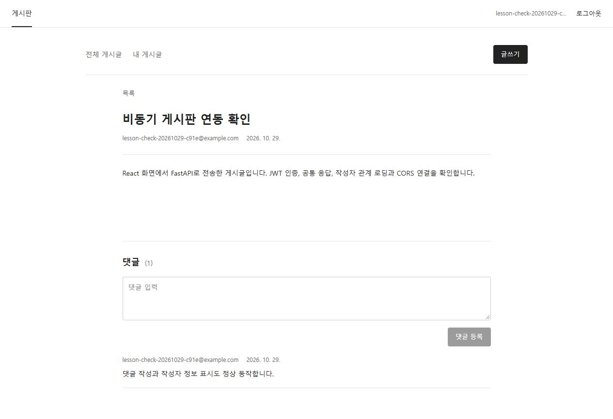

# 2026-10-29_비동기 CRUD와 공통 응답·예외 처리·CORS(React, JWT, 출처)
> 작성일: 2026-10-29

## 🔗 관련 글

- [오늘 첫 번째 글 — 비동기 DB와 Alembic](2026-10-29%20(1)FastAPI_비동기_DB와_Alembic_마이그레이션(lifespan,_관계_로딩).md) — 환경 설정·마이그레이션·lifespan과 관계 로딩 예제 뒤에 전체 CRUD와 화면 연결을 진행했다. 기존 본문을 덮어쓰지 않고 별도 파일로 이어 쓴다.
- [FastAPI 요청 흐름과 DTO](2026-10-28%20(1)FastAPI_요청흐름과_DTO(Depends,_Annotated,_yield,_CRUD).md) — Router·Depends·요청/응답 모델의 역할을 다시 구분한다.
- [N+1과 로딩 전략](2026-10-28%20(3)N+1과_로딩전략(Lazy,_Eager,_joinedload,_selectinload).md) — 비동기 응답 직렬화 전에 작성자·댓글 관계를 명시적으로 준비하는 이유를 연결한다.
- [쿠키와 인증](2026-10-28%20(4)쿠키와_인증(JWT,_회원가입,_로그인,_Bearer,_인증의존성).md) — 로그인·JWT와 CORS가 서로 다른 검사를 한다는 점을 연결한다.
- [작성자 권한과 AUTH 실습](2026-10-28%20(5)작성자_권한과_AUTH_실습(본인글,_401_403,_위시리스트).md) — 로그인했더라도 다른 사람의 글·댓글을 수정할 수 없는 이유를 이어 본다.

## ❓ 아직 모르겠는 것

아래 질문은 사용자가 실제로 묻거나 확인한 내용을 바탕으로 한다. 대부분 대화에서 개념을 정정했지만 복습 때 다시 확인한다. 아직 다루지 않은 고급 CORS 조건은 미해결로 구분한다.

- “라우터가 FastAPI인가? 아니면 AI인가?” — 라이브러리와 코드의 역할 이름은 어떻게 다른가? (주제 1 참고)
- “서비스는 Pydantic인 것 같고, Repository는 DB 아니었어?” — 입력 검증·업무 규칙·DB 접근 코드·실제 DB를 어떻게 나누는가? (주제 1 참고)
- “세션이 요청을 보내면 변경되는 게 아니었나?” — 등록·flush·commit·조회는 각각 무엇을 하는가? (주제 1·2 참고)
- “프론트·백엔드·DB를 연결하기 위한 검사야?” — CORS는 어느 경계에서 누가 검사하는가? (주제 6·8 참고)
- “세 가지가 다 맞아야 허용이야, 아니면 우리가 정해?” — 동일 출처 판정 기준과 다른 출처 허용 목록을 어떻게 구분하는가? (주제 7 참고)
- “프론트에서 요청이 오면 백엔드가 OK 하는 걸 기다리는 거지?” — 실제 응답 검사와 사전 요청의 순서는 어떻게 다른가? (주제 8·10 참고)
- “권한 없으면 데이터를 안 주면 되는데 왜 물어봐?” — 사용자 권한과 다른 출처 JavaScript의 응답 읽기 권한은 왜 다른가? (주제 9 참고)
- “다른 사이트에서 이쪽 쿠키를 못 읽도록 하는 거야?” — 쿠키 직접 읽기·자동 전송·응답 읽기는 어떻게 다른가? (주제 9 참고)
- “다른 출처 JavaScript가 내 응답을 읽는 걸 왜 걱정해?” — 내 브라우저에서 실행되는 악성 코드가 어떤 정보에 접근하려는 상황인가? (주제 9 참고)
- “도메인 URL 앞부분이 같으면 공개해도 된다는 거야?” — CORS는 비슷한 문자열을 허용하는가, 정확한 출처를 지정하는가? (주제 7·10 참고)
- “구글 URL로 지정하면 구글 페이지에서 내 것을 읽을 수 있어?” — CORS 허용과 실제 요청 코드·인증 토큰은 어떻게 구분하는가? (주제 10 참고)
- “쉬운 개념부터 전문가 수준까지 학습하자.” — 사전 요청의 세부 발생 조건, 쿠키 자격 증명 옵션, 운영 설정까지 설명할 수 있는가? (미해결: 기본 개요만 다뤘고 상세 학습은 아직 진행하지 않음, 주제 10 참고)

## 주제 1: 도구 이름과 코드 역할 이름을 구분한다

학습 기준은 [비동기 앱 초기 설정과 Alembic](https://ucanlabs.kr/classroom/aicampus-agent-python/lesson/1467/), [비동기 CRUD](https://ucanlabs.kr/classroom/aicampus-agent-python/lesson/1465/), [공통 응답과 예외 처리](https://ucanlabs.kr/classroom/aicampus-agent-python/lesson/1466/), [프론트엔드 연결과 CORS](https://ucanlabs.kr/classroom/aicampus-agent-python/lesson/1468/) 네 강의이다. 첫 강의와 관계 로딩 기초는 오늘 첫 글에 기록되어 있고, 이 글은 이후 구현·문답을 추가한다.

> ➕ **더 알아두기**
> 사용자는 라이브러리 이름과 계층의 역할 이름이 섞여 헷갈린다고 질문했다. FastAPI·Pydantic·SQLAlchemy·Alembic은 사용하는 도구 이름이다. Router·Service·Repository는 코드를 책임에 따라 나누는 역할 이름이다. 같은 층위의 목록으로 외우지 않는다.
>
> | 이름 | 종류와 역할 |
> |---|---|
> | FastAPI | HTTP API를 만드는 Python 라이브러리 |
> | Pydantic | 데이터의 타입·필드 조건과 응답 구조를 검증하는 라이브러리 |
> | SQLAlchemy | SQL 구성·실행, ORM 객체, DB 연결·세션을 제공하는 라이브러리 |
> | psycopg | PostgreSQL과 통신하는 DB 드라이버 |
> | Alembic | SQLAlchemy 모델을 바탕으로 DB 구조 변경 파일을 생성·적용·추적하는 도구 |
> | Router | 요청 주소·HTTP 메서드를 처리 함수에 연결하고 입력·응답을 선언하는 부분 |
> | Service | 로그인한 작성자 지정, 수정 권한, 존재 여부 등 업무 규칙을 처리하는 부분 |
> | Repository | SQLAlchemy를 이용한 DB 저장·조회 코드를 모아 둔 부분 |
> | PostgreSQL DB | 실제 테이블과 행 데이터가 저장된 곳 |

> ♻️ 처음엔 “Router가 FastAPI 또는 AI이고 Service는 Pydantic이다”로 이해했으나, Router는 FastAPI의 APIRouter 등을 사용해 작성하는 요청 처리 부분이고 Service는 우리가 작성하는 업무 규칙 코드라는 것이 맞다. Router 자체가 AI Agent를 뜻하지 않는다.

> ♻️ 처음엔 “Repository는 DB 그 자체”로 이해했으나, Repository는 DB에 접근하는 코드를 모은 부분이고 DB는 실제 데이터를 저장하는 시스템이라는 것이 맞다.

### 세션과 요청의 의미

> ➕ **더 알아두기**
> SQLAlchemy Session은 로그인 세션이 아니라, DB 작업과 변경한 객체를 관리하는 작업 공간이다. 프론트엔드의 HTTP 요청과 Session이 DB에 보내는 SQL 요청도 구분한다. 게시글 조회는 SELECT로 값을 가져오는 작업이고, 추가·수정·삭제는 DB 변경을 일으키는 작업이다.
>
> 1. 객체를 Session에 추가하거나 속성을 바꿔 변경 대상을 등록한다.
> 2. flush하면 해당 변경을 SQL로 DB에 실행한다.
> 3. commit하면 트랜잭션 변경을 확정한다. 필요한 flush도 먼저 수행한다.
> 4. 확정 전 rollback하면 트랜잭션 변경을 취소할 수 있다.
>
> “Session이 DB에 요청해서 변경한다”는 방향은 맞지만, add 시점·SQL 실행·확정 시점을 하나로 보지 않는다. 읽기 요청이 데이터 변경을 일으킨다는 뜻도 아니다.

## 주제 2: Router부터 DB까지 비동기 CRUD를 연결한다

### 모든 함수에 무조건 await를 붙이지 않는다

Router·Service·Repository에서 DB I/O가 필요한 작업을 async def와 await로 연결한다. 쓰기 트랜잭션은 Service에서 async with db.begin()으로 묶는다.

```text
Router → await Service → await Repository → await DB I/O
```

| 작업 | 비동기 코드에서의 호출 |
|---|---|
| 객체 등록 | db.add(post) |
| Python 객체의 속성 변경 | post.title = data.title |
| SQL 반영 | await db.flush() |
| 단일 조회 | await db.scalar(...), await db.get(...) |
| 목록 조회 | await db.scalars(...) |
| 이미 버퍼링한 결과 읽기 | result.all() |
| 삭제 등록 | await db.delete(post) |

add·속성 대입·이미 가져온 결과 읽기는 이 예제에서 await 대상이 아니다. delete는 관계 처리 중 I/O가 필요할 수 있어 await한다. async def 선언만 붙이고 동기 DB API를 그대로 호출하는 것은 제대로 된 비동기 전환이 아니다.

### 응답에서 읽을 관계를 먼저 로딩한다

게시글 상세 조회에서는 작성자와 댓글, 댓글 작성자까지 응답에 필요하다. Post.user는 joinedload로, Post.comments는 selectinload로, 각 Comment.user는 joinedload로 준비한다. 실제 저장된 Repository의 상세 조회 함수는 다음과 같다.

```python
    async def find_by_id(self, db: AsyncSession, post_id: int) -> Post | None:
        return await db.scalar(
            select(Post)
            .options(
                joinedload(Post.user),
                selectinload(Post.comments).joinedload(Comment.user),
            )
            .where(Post.id == post_id)
        )
```

저장 후 응답을 만들기 전 상세 조회로 관계를 준비한다. 실제 저장된 Service의 생성 함수는 다음과 같다.

```python
    async def create_post(
        self, db: AsyncSession, data: PostCreate, current_user: UserResponse
    ) -> Post:
        async with db.begin():
            post = Post(
                title=data.title,
                content=data.content,
                user_id=current_user.id,
                comments=[],
            )
            await post_repository.save(db, post)
            result = await self.get_post(db, post.id)
        return result
```

user_id는 클라이언트가 보낸 작성자 번호를 신뢰해서 넣지 않고 인증된 current_user.id로 지정한다. comments=[]는 새 게시글에 댓글이 없다는 컬렉션 값을 명시한다. 저장 과정에서 flush하여 생성된 게시글 ID를 얻고, 상세 조회를 await한 결과를 반환한다.

async with db.begin() 블록이 정상 종료되면 commit하고 예외가 나면 rollback한다. expire_on_commit=False이므로 commit 후 이미 로딩한 값을 응답 변환에 사용할 수 있다. 초기 설정·만료·일반 지연 로딩의 문제는 오늘 첫 글과 연결한다.

### 쓰기 권한과 조회 대상 확인

게시글·댓글 수정·삭제는 조회한 객체의 user_id와 인증된 사용자 ID를 비교한다. 다르면 ForbiddenException을 발생시킨다. 없는 게시글은 POST_NOT_FOUND, 없는 댓글은 COMMENT_NOT_FOUND로 구분한다. 댓글은 게시글 ID와 댓글 ID를 함께 조건으로 조회해 다른 글의 댓글을 잘못 다루지 않게 한다.

> ➕ **더 알아두기**
> 이번에는 원본 프로젝트의 users·posts·comments에 있는 schemas·Repository·Service·Router를 현재 작업 폴더로 가져와 연결했다. 기존 모델·마이그레이션은 유지했다. posts 응답 스키마에는 화면에 필요한 created_at을 포함해 작성 시각이 표시되게 했다. 회원가입 중복 검사 뒤 다른 요청이 먼저 저장하는 경쟁 상황도 고려해 DB 고유 제약조건 위반을 409로 변환하는 처리를 추가했다.

> 📝 **기사 시험 포인트** (정보처리기사·정보보안기사)
> 트랜잭션(Transaction)의 COMMIT·ROLLBACK과 원자성(Atomicity)을 연결한다. 애플리케이션의 사전 중복 조회와 DB의 고유 제약조건(UNIQUE)은 역할이 다르다. 동시에 처리되는 요청 사이에서는 조회 이후 데이터가 바뀔 수 있으므로 무결성 제약도 필요하다. SQL이 실행된 시점과 트랜잭션이 확정된 시점을 구분한다.

## 주제 3: 인증 조회·JWT·비밀번호 연산

인증 의존성도 비동기 세션을 열고 비동기 Service를 await한다. 인증 결과는 비밀번호 해시를 제외한 UserResponse로 변환해 Router에 전달한다. 실제 get_current_user는 다음과 같다.

```python
async def get_current_user(
    credentials: Annotated[HTTPAuthorizationCredentials | None, Depends(bearer_scheme)],
) -> UserResponse:
    if credentials is None:
        raise UnauthorizedException(
            message="로그인이 필요합니다.", code="AUTHENTICATION_REQUIRED"
        )
    async with SessionLocal() as db:
        user = await user_service.get_current_user(db, credentials.credentials)
        return UserResponse.model_validate(user)
```

HTTPBearer는 Authorization 헤더의 Bearer 토큰을 읽는다. auto_error=False로 두어 토큰이 없을 때도 프로젝트의 공통 UnauthorizedException으로 응답 형식을 맞춘다. 검증한 토큰의 사용자 ID로 회원을 조회하며, 회원이 없다면 INVALID_TOKEN으로 처리한다.

비밀번호 해싱과 검증은 동기 연산이므로 async def 안에서 직접 오래 실행하면 이벤트 루프를 점유한다. 강의는 run_in_threadpool로 별도 스레드에서 실행하고 완료를 await하는 방법을 사용한다.

```python
hashed_password = await run_in_threadpool(hash_password, data.password)
```

```python
verify_password, data.password, user.hashed_password
```

두 번째 코드는 로그인 Service에서 run_in_threadpool에 전달하는 함수와 인자들이다. 실제 전체 호출은 아래 저장 파일 발췌에서 확인한다.

```python
    async def login(self, db: AsyncSession, data: UserLogin) -> str:
        email = str(data.email).lower()
        async with db.begin():
            user = await user_repository.find_by_email(db, email)
            if user is None or not await run_in_threadpool(
                verify_password, data.password, user.hashed_password
            ):
                raise UnauthorizedException(
                    message="이메일 또는 비밀번호가 올바르지 않습니다.", code="INVALID_CREDENTIALS"
                )

            user_id = user.id

        return create_access_token(user_id)
```

> ➕ **더 알아두기**
> JWT는 로그인 후 서버가 서명해 발급하는 증표이며 암호화된 보관함과 같은 뜻은 아니다. 현재 코드는 HS256 알고리즘을 고정하고 sub·iat·exp를 요구한다. 토큰의 서명과 만료를 검증한 뒤 사용자를 조회한다. 비밀번호는 Argon2 기반 해시로 저장하며 응답에 해시를 포함하지 않는다. 토큰 응답에는 no-store 헤더를 붙인다. 이 프로젝트의 SQLAlchemy Session, 로그인 상태, 브라우저 sessionStorage는 각각 별개의 개념이다.

> 📝 **기사 시험 포인트** (정보처리기사·정보보안기사)
> 인증(Authentication)은 누구인지 확인하는 것이고, 인가(Authorization)는 그 주체가 작업을 해도 되는지 판단하는 것이다. 비밀번호 해싱(Hashing)과 복호화 가능한 암호화(Encryption)도 구분한다. JWT를 가지고 있다는 사실만으로 다른 사람의 게시글을 수정할 권한이 생기지 않는다.

## 주제 4: 공통 성공 응답과 제네릭

### 클라이언트가 일정한 위치에서 결과를 읽게 한다

공통 응답은 성공 데이터·안내 문구·오류 정보를 일정한 위치에 담는 규칙이다. 성공 데이터는 data, 안내 문구는 message, 오류 정보는 error로 읽게 한다. FastAPI는 response_model에 맞게 응답을 검증하고 API 문서에 구조를 표시한다.

| 상황 | HTTP 상태 | 응답 형식 |
|---|---|---|
| 조회·수정·로그인 성공 | 200 | data와 message |
| 생성 성공 | 201 | data와 message |
| 삭제 성공 | 200 | data는 null, message는 삭제 안내 |
| 실패 | 4xx·5xx | error |

성공 여부는 HTTP 상태 코드로 구분한다. 삭제 시 공통 안내 본문을 반환하므로 이 강의에서는 204 대신 200을 사용한다.

실제 공통 모델과 API 문서용 함수가 저장된 responses.py는 다음과 같다.

```python
from typing import Any

from pydantic import BaseModel, Field


class SuccessResponse[T](BaseModel):
    data: T
    message: str | None = None


class ValidationIssue(BaseModel):
    loc: list[str | int]
    msg: str
    type: str


class ErrorDetail(BaseModel):
    code: str
    message: str
    details: list[ValidationIssue] = Field(default_factory=list)


class ErrorResponse(BaseModel):
    error: ErrorDetail


ERROR_EXAMPLES = {
    401: ("UNAUTHORIZED", "인증이 필요합니다."),
    403: ("FORBIDDEN", "접근 권한이 없습니다."),
    404: ("NOT_FOUND", "요청한 리소스를 찾을 수 없습니다."),
    409: ("CONFLICT", "요청이 현재 상태와 충돌합니다."),
    422: ("VALIDATION_ERROR", "입력값을 확인해 주세요."),
    500: ("INTERNAL_SERVER_ERROR", "서버에서 오류가 발생했습니다."),
}


def error_responses(*status_codes: int) -> dict[int, dict[str, Any]]:
    responses = {}
    for status_code in status_codes:
        code, message = ERROR_EXAMPLES[status_code]
        example = ErrorResponse(error=ErrorDetail(code=code, message=message))
        responses[status_code] = {
            "model": ErrorResponse,
            "description": message,
            "content": {"application/json": {"example": example.model_dump()}},
        }
    return responses
```

SuccessResponse[T]는 제네릭(Generic) 선언이다. T는 사용할 데이터 타입을 전달받는 타입 매개변수이다. 같은 포장 구조를 쓰면서 data의 형태만 바꾼다. message를 지정하지 않으면 기본값 None이 JSON의 null로 나온다.

| 모델 | data에 담는 것 |
|---|---|
| SuccessResponse[UserResponse] | 회원 한 명 |
| SuccessResponse[PostDetailResponse] | 게시글 한 개 |
| SuccessResponse[list[PostListResponse]] | 게시글 목록 |
| SuccessResponse[TokenResponse] | 토큰과 토큰 타입 |
| SuccessResponse[None] | 삭제 성공 시 null |

Router는 Service가 반환한 객체를 data에 넣고 필요하면 message를 설정한다. 다음은 실제 게시글 생성 Router이다.

```python
@router.post(
    "",
    response_model=SuccessResponse[PostDetailResponse],
    status_code=status.HTTP_201_CREATED,
    responses=error_responses(401),
)
async def create_post(
    data: PostCreate,
    db: Annotated[AsyncSession, Depends(get_db)],
    current_user: Annotated[UserResponse, Depends(get_current_user)],
):
    post = await post_service.create_post(db, data, current_user)
    return SuccessResponse[PostDetailResponse](data=post, message="게시글이 등록되었습니다.")
```

error_responses는 우리가 정의한 **API 문서용 함수**이다. responses=error_responses(401)은 문서에 오류 모델과 예시를 표시한다. 이 선언 자체가 인증을 검사하거나 오류를 발생시키는 것은 아니다. 실제 인증은 Depends가 연결한 함수가 수행하고 실제 오류 응답은 핸들러가 만든다.

게시글이 없을 때 목록 응답은 성공한 빈 배열이다.

```json
{"data": [], "message": null}
```

> ➕ **더 알아두기**
> 대화에서는 “회원 정보든 게시글 목록이든 포장 모양은 같고 안에 담기는 내용만 달라진다”고 설명했다. 공통 응답은 DB 테이블 구조가 아니라 HTTP 응답의 모양이다. Pydantic은 이 모양과 필드를 검증하고, Service는 실제 업무 규칙을 처리한다.

## 주제 5: 예외와 전역 오류 처리

### 문제를 발견하는 곳과 응답을 만드는 곳을 나눈다

공통 오류 처리는 클라이언트가 어느 API의 오류든 같은 방식으로 읽게 한다. Service는 업무 조건에 맞는 예외를 발생시키고, 전역 핸들러는 HTTP 상태·헤더·본문으로 변환하고 필요한 로그를 남긴다.

| 파일 | 역할 |
|---|---|
| core/responses.py | 성공·오류 모델과 문서용 예시 |
| core/exceptions.py | 공통 부모와 오류 종류별 예외 클래스 |
| core/exception_handlers.py | 예외를 공통 HTTP 응답으로 변환 |
| main.py | 앱에 전역 핸들러 등록 |
| 각 router.py | 성공 모델과 문서용 오류 응답 선언 |
| 각 service.py | 업무 조건을 검사하고 예외 발생 |

오류 모델도 역할이 다르다.

| 구성 요소 | 역할 |
|---|---|
| ValidationIssue | 입력 검증 오류 한 건의 위치·설명·종류 |
| ErrorDetail | 오류 코드·메시지·검증 오류 목록 |
| ErrorResponse | 전체 error 응답 본문 |
| ApiException | 상태 코드·오류 코드·메시지·헤더를 보관하는 공통 부모 예외 |
| NotFoundException 등 | 오류 종류에 맞는 기본값을 갖는 자식 예외 |
| api_exception_handler | 예외를 응답 본문·상태·헤더로 변환하는 함수 |

code는 프로그램이 오류를 구분하는 값이고 message는 사용자에게 표시할 설명이다. details는 검증 오류 목록이며 일반 업무 오류에서는 빈 배열을 사용한다.

```json
{
  "error": {
    "code": "POST_NOT_FOUND",
    "message": "게시글을 찾을 수 없습니다.",
    "details": []
  }
}
```

### 커스텀 예외는 공통 부모를 상속한다

| 예외 | 상태 | 상황 |
|---|---|---|
| NotFoundException | 404 | 대상 없음 |
| UnauthorizedException | 401 | 인증 정보 없음·검증 실패 |
| ForbiddenException | 403 | 작업 권한 없음 |
| ConflictException | 409 | 이메일 중복 등 현재 상태와 충돌 |

실제 저장된 exceptions.py이다.

```python
class ApiException(Exception):
    def __init__(
        self,
        status_code: int,
        code: str,
        message: str,
        headers: dict[str, str] | None = None,
    ):
        super().__init__(message)
        self.status_code = status_code
        self.code = code
        self.message = message
        self.headers = headers


class NotFoundException(ApiException):
    def __init__(
        self, message: str = "요청한 리소스를 찾을 수 없습니다.", *, code: str = "NOT_FOUND"
    ):
        super().__init__(status_code=404, code=code, message=message)


class UnauthorizedException(ApiException):
    def __init__(self, message: str = "인증이 필요합니다.", *, code: str = "UNAUTHORIZED"):
        super().__init__(
            status_code=401,
            code=code,
            message=message,
            headers={"WWW-Authenticate": "Bearer"},
        )


class ForbiddenException(ApiException):
    def __init__(self, message: str = "접근 권한이 없습니다.", *, code: str = "FORBIDDEN"):
        super().__init__(status_code=403, code=code, message=message)


class ConflictException(ApiException):
    def __init__(
        self, message: str = "요청이 현재 상태와 충돌합니다.", *, code: str = "CONFLICT"
    ):
        super().__init__(status_code=409, code=code, message=message)
```

부모 예외에 등록한 핸들러는 자식 예외도 처리한다. NotFoundException은 기본 메시지로 사용할 수도 있고 code·message를 지정해 POST_NOT_FOUND와 COMMENT_NOT_FOUND를 구분할 수도 있다. 쓰기 트랜잭션 안에서 예외가 발생하면 rollback 후 핸들러가 오류 응답을 만든다.

### 업무·검증·서버 오류를 함께 처리한다

| 예외 | 처리 |
|---|---|
| ApiException과 자식 | 지정한 상태·코드·메시지·헤더 |
| Starlette HTTPException | 없는 경로 404·잘못된 메서드 405 등 |
| RequestValidationError | 입력 검증 실패를 422 공통 응답으로 변환 |
| 그 밖의 Exception | 서버 로그를 남기고 500 공통 응답 |

FastAPI HTTPException도 Starlette HTTPException을 상속하므로 같은 핸들러로 처리된다. JSONResponse를 직접 반환할 때는 오류 모델을 만들고 model_dump(mode="json")으로 JSON용 값으로 바꾼다.

```python
import logging

from fastapi import FastAPI, Request
from fastapi.exceptions import RequestValidationError
from fastapi.responses import JSONResponse
from starlette.exceptions import HTTPException

from fastapi_agent.core.exceptions import ApiException
from fastapi_agent.core.responses import ErrorDetail, ErrorResponse, ValidationIssue

logger = logging.getLogger(__name__)


async def api_exception_handler(request: Request, exc: ApiException) -> JSONResponse:
    body = ErrorResponse(error=ErrorDetail(code=exc.code, message=exc.message))
    return JSONResponse(
        status_code=exc.status_code,
        content=body.model_dump(mode="json"),
        headers=exc.headers,
    )


async def http_error_handler(request: Request, exc: HTTPException) -> JSONResponse:
    code = {
        400: "BAD_REQUEST",
        401: "UNAUTHORIZED",
        403: "FORBIDDEN",
        404: "NOT_FOUND",
        405: "METHOD_NOT_ALLOWED",
        422: "VALIDATION_ERROR",
    }.get(exc.status_code, "HTTP_ERROR")
    message = exc.detail if isinstance(exc.detail, str) else "요청을 처리할 수 없습니다."
    return await api_exception_handler(
        request, ApiException(exc.status_code, code, message, headers=exc.headers)
    )


async def validation_error_handler(
    request: Request, exc: RequestValidationError
) -> JSONResponse:
    details = [
        ValidationIssue(loc=list(error["loc"]), msg=error["msg"], type=error["type"])
        for error in exc.errors()
    ]
    body = ErrorResponse(
        error=ErrorDetail(
            code="VALIDATION_ERROR", message="입력값을 확인해 주세요.", details=details
        )
    )
    return JSONResponse(status_code=422, content=body.model_dump(mode="json"))


async def unexpected_error_handler(request: Request, exc: Exception) -> JSONResponse:
    logger.error("처리하지 못한 요청 오류: %s %s", request.method, request.url.path, exc_info=exc)
    return await api_exception_handler(
        request, ApiException(500, "INTERNAL_SERVER_ERROR", "서버에서 오류가 발생했습니다.")
    )


def register_exception_handlers(app: FastAPI) -> None:
    app.add_exception_handler(ApiException, api_exception_handler)
    app.add_exception_handler(HTTPException, http_error_handler)
    app.add_exception_handler(RequestValidationError, validation_error_handler)
    app.add_exception_handler(Exception, unexpected_error_handler)
```

필수 title이 없을 때는 다음처럼 위치와 이유를 담는다.

```json
{
  "error": {
    "code": "VALIDATION_ERROR",
    "message": "입력값을 확인해 주세요.",
    "details": [
      {"loc": ["body", "title"], "msg": "Field required", "type": "missing"}
    ]
  }
}
```

loc는 오류 위치, msg는 설명, type은 종류이다. body는 본문, path는 경로 입력을 가리킨다. 원본 입력을 통째로 응답하지 않고 필요한 세 필드만 골라 비밀번호 같은 값의 노출을 막는다.

| 인증·권한 코드 | 상태 | 의미 |
|---|---|---|
| AUTHENTICATION_REQUIRED | 401 | 인증 정보 없음 |
| INVALID_CREDENTIALS | 401 | 로그인 정보 불일치 |
| INVALID_TOKEN | 401 | 유효하지 않은 토큰·사용자 없음 |
| POST_FORBIDDEN | 403 | 다른 사람의 글 수정·삭제 |
| COMMENT_FORBIDDEN | 403 | 다른 사람의 댓글 수정·삭제 |

401 응답의 WWW-Authenticate: Bearer 헤더도 예외에서 핸들러로 전달한다. 예상하지 못한 오류와 응답 모델 불일치는 INTERNAL_SERVER_ERROR로 응답하고 상세 원인은 서버 로그에 남긴다.

> 📝 **기사 시험 포인트** (정보처리기사·정보보안기사)
> 인증 실패와 권한 부족을 구분하고 오류 응답에 내부 구현·비밀번호·추적 정보를 노출하지 않는 이유를 설명한다. 예외 처리(Exception Handling)는 오류를 무시하는 것이 아니라 실패를 통제된 응답과 기록으로 처리하는 것이다. 특정 프레임워크 함수의 출제 빈도는 여기서 단정하지 않는다.

## 주제 6: React 화면과 FastAPI 실행, 미들웨어

### 화면과 API는 별도 프로그램이다

백엔드는 fastapi_agent 프로젝트에서 실행한다.

```powershell
uv run fastapi dev
```

프론트엔드의 .env에는 API 주소를 둔다.

```dotenv
VITE_API_BASE_URL=http://127.0.0.1:8000
```

별도 터미널에서 프론트엔드를 실행한다.

```powershell
cd frontend
npm install
npm run dev
```

브라우저는 `http://127.0.0.1:5173`에서 화면을 연다. API 서버는 `http://127.0.0.1:8000`에 있고, API 문서는 /docs에서 볼 수 있다.

> ➕ **더 알아두기**
> 실제 React 화면은 사용자가 알려준 원본 프로젝트의 frontend에서 게시판·로그인 화면을 재사용했다. Agent 화면은 이 강의 범위에 포함하지 않았다. 의존성 설치 때 보안 문제가 보고된 패키지를 수정 버전으로 갱신한 뒤 npm audit 결과 0건과 빌드 성공을 확인했다. 이는 당시 확인 결과이며 이후에도 취약점이 영원히 없다는 보장은 아니다.

### 미들웨어는 공통 처리를 담당한다

미들웨어(Middleware)는 요청이 Router에 도달하기 전과 응답이 클라이언트로 전달되는 경로에서 공통 작업을 수행한다. CORS·공통 로그 같은 기능을 여러 Router에 반복해서 작성하지 않아도 된다.

강의의 CORS 설정은 다음과 같다. 출처 문자열에 꺾쇠를 붙이지 않는다.

```python
from fastapi.middleware.cors import CORSMiddleware

app.add_middleware(
    CORSMiddleware,
    allow_origins=["http://127.0.0.1:5173", "http://localhost:5173"],
    allow_methods=["GET", "POST", "PUT", "PATCH", "DELETE"],
    allow_headers=["Authorization", "Content-Type"],
)
```

allow_origins는 허용할 화면 출처, allow_methods는 허용 메서드, allow_headers는 브라우저가 보낼 요청 헤더이다. Origin을 확인하고 허용된 출처에는 Access-Control-Allow-Origin 등의 응답 헤더를 붙인다.

> ➕ **더 알아두기**
> 첫 글에서 다룬 lifespan은 앱 시작·종료 시 공용 자원을 관리한다. 미들웨어는 요청·응답 공통 처리, get_db는 요청의 DB 세션 제공, Depends는 세션·현재 사용자 등 필요한 값을 준비하는 연결 기능이다. 서로 실행 시점과 책임이 다르다.

## 주제 7: 같은 출처 판정과 CORS 허용 목록

### Origin은 프로토콜·호스트·포트의 조합이다

CORS(Cross-Origin Resource Sharing, 교차 출처 리소스 공유)는 서버가 응답 헤더로 허용 출처를 알려 브라우저가 다른 출처의 응답을 JavaScript에서 사용할 수 있게 하는 방식이다. 출처(Origin)는 URL 전체가 아니라 프로토콜·호스트·포트의 조합이다.

| 주소 | 프로토콜 | 호스트 | 포트 |
|---|---|---|---|
| http://127.0.0.1:5173 | http | 127.0.0.1 | 5173 |
| http://127.0.0.1:8000 | http | 127.0.0.1 | 8000 |
| http://localhost:5173 | http | localhost | 5173 |

화면의 5173과 API의 8000은 포트가 다르므로 다른 출처이다. localhost와 127.0.0.1은 같은 컴퓨터를 가리키더라도 호스트 표기가 다르므로 다른 출처이다. /posts·/auth/login 같은 경로는 출처 판정 요소가 아니다.

> ➕ **더 알아두기**
> 대화에서는 `http://127.0.0.1:5173`을 기준으로 다음을 비교했다.
>
> | 비교 주소 | 판정 | 이유 |
> |---|---|---|
> | http://127.0.0.1:5173/posts | 같은 출처 | 경로만 다름 |
> | http://127.0.0.1:5173/login | 같은 출처 | 경로만 다름 |
> | http://127.0.0.1:8000/posts | 다른 출처 | 포트 다름 |
> | http://localhost:5173 | 다른 출처 | 호스트 다름 |
> | https://127.0.0.1:5173 | 다른 출처 | 프로토콜 다름 |

> ♻️ 처음엔 “세 항목이 모두 같아야 허용되는 것인가, 조건을 우리가 정하는 것인가”로 혼동했으나, 세 항목이 같아야 한다는 것은 브라우저의 동일 출처 판정 기준이고, 서로 다른 출처 중 무엇을 CORS로 허용할지는 서버 운영자가 정한다는 것이 맞다.

> ➕ **더 알아두기**
> 우리 백엔드와 프론트엔드 주소를 같게 바꾸어서 해결한 것이 아니다. 둘은 계속 다른 출처이며, 백엔드가 두 프론트엔드 출처를 명시적으로 허용했다. “같은 출처로 판정됨”과 “다른 출처지만 읽기가 허용됨”은 서로 다른 상태이다.

## 주제 8: 요청·응답 헤더를 통한 허용 전달

### CORS는 DB 연결 검사가 아니다

> ♻️ 처음엔 “프론트엔드·백엔드·DB를 연결하기 위한 검사”로 이해했으나, CORS는 브라우저에서 실행되는 JavaScript가 다른 출처 응답을 읽는 것을 허용하는 방식이며 백엔드와 DB 연결 검사는 아니라는 것이 맞다.

> ➕ **더 알아두기**
> 등장인물은 다음처럼 구분한다.
>
> | 담당 | 하는 일 |
> |---|---|
> | 프론트엔드 JavaScript | 데이터를 요청하고 화면에 표시 |
> | 브라우저 | JavaScript를 실행하고 출처 보안 규칙 적용 |
> | 백엔드 | 요청을 처리하고 데이터 응답 |
> | DB | 백엔드가 접근하는 데이터를 저장 |
>
> CORS 때문에 브라우저에서 오류가 나더라도 DB 연결이 끊겼다고 단정할 수 없다. 브라우저가 응답 읽기를 차단한 것과 DB 접속 실패는 별도로 확인해야 한다.

### 브라우저가 출처를 알리고 서버가 허용을 알린다

> ➕ **더 알아두기**
> 대화에서는 헤더(header)를 HTTP 본문에 붙는 부가 정보로 설명했다. 편지의 내용이 본문이라면 봉투에 적는 정보에 비유할 수 있지만, 실제로는 HTTP 메시지의 필드이다.
>
> 1. 화면의 JavaScript가 다른 출처 API에 요청한다.
> 2. 브라우저는 요청에 Origin을 붙여 화면 출처를 알린다.
> 3. 서버의 CORS 미들웨어가 허용 목록과 비교한다.
> 4. 허용한 출처라면 응답에 Access-Control-Allow-Origin을 붙인다.
> 5. 브라우저가 응답 헤더를 검사하고 JavaScript에 응답을 읽게 한다.

```http
Origin: http://127.0.0.1:5173
```

```http
Access-Control-Allow-Origin: http://127.0.0.1:5173
```

위 두 줄은 각각 요청 헤더·응답 헤더의 설명용 예시이다. 서버가 허용 정보를 보내지만, 응답을 화면 코드에 공개할지 검사하고 적용하는 주체는 브라우저이다.

> ➕ **더 알아두기**
> 브라우저의 CORS 제한은 curl·일반 Python HTTP 클라이언트·서버 간 통신에 동일하게 적용되지 않는다. 서버는 CORS만 믿고 데이터를 보호할 수 없다. 사용자 인증·작업 권한·입력 검증을 따로 구현해야 한다.

## 주제 9: 왜 다른 사이트의 JavaScript를 걱정하는가

### 사용자 권한과 화면 출처의 허용은 다르다

브라우저는 동일 출처 정책(Same-Origin Policy, SOP)으로 한 출처의 JavaScript가 다른 출처의 응답을 마음대로 읽는 것을 제한한다. 악성 사이트가 로그인한 다른 서비스의 정보를 읽는 것을 막는 보안 경계이다. CORS는 그 기본 제한에 대해 서버가 특정 다른 출처의 읽기를 허용하는 방법이다.

> ➕ **더 알아두기**
> 사용자는 “권한 없으면 서버가 데이터를 안 주면 되는데 왜 물어보느냐”고 질문했다. 서버가 인증·권한을 검사해야 한다는 말은 맞다. 다만 사용자가 권한을 갖고 있어도, 사용자가 방문한 모든 사이트의 JavaScript에 그 사용자 응답을 공개할 이유는 없다.
>
> 예시는 다음과 같다.
>
> 1. 사용자가 메일 사이트에 로그인해 둔다.
> 2. 같은 브라우저의 다른 탭에서 악성 사이트를 연다.
> 3. 악성 JavaScript가 메일 서버에 요청을 시도한다.
> 4. 쿠키·요청 옵션 등 조건에 따라 브라우저가 메일 사이트의 쿠키를 함께 보낼 수 있다.
> 5. 서버는 로그인한 사용자로 확인하고 메일 목록을 응답할 수도 있다.
> 6. 악성 JavaScript가 응답을 읽을 수 있다면 그 내용을 공격자에게 전송할 수 있다.
>
> 여기서 문제는 “공격자가 자기 계정의 데이터를 읽는 것”이 아니라 “내 브라우저에서 실행되는 악성 코드가 내 계정 응답을 읽는 것”이다. SOP는 기본적으로 이 읽기를 제한한다. 모든 교차 출처 요청에 쿠키가 자동으로 붙는다는 뜻은 아니다.

| 검사·규칙 | 질문 |
|---|---|
| 인증 | 이 요청의 사용자는 누구인가? |
| 인가·권한 | 이 사용자가 이 작업·데이터에 접근해도 되는가? |
| 쿠키 접근 규칙 | 어떤 문서·스크립트가 해당 쿠키 값을 읽을 수 있는가? |
| SOP와 CORS | 이 출처 JavaScript가 다른 출처 응답을 읽어도 되는가? |

> ♻️ 처음엔 “CORS는 그냥 인증 이야기이고 다른 사이트가 쿠키를 못 읽게 하는 것”으로 이해했으나, 사용자 인증·쿠키 직접 접근·다른 출처 응답 읽기는 별개의 문제이며 CORS는 마지막의 읽기 허용을 다룬다는 것이 맞다.

> ➕ **더 알아두기**
> 악성 사이트가 쿠키 값을 직접 알아내지 못해도, 브라우저가 조건에 따라 쿠키를 요청에 실어 보낼 수 있다. “쿠키 직접 읽기”와 “쿠키가 포함된 요청 보내기”, “그 응답 읽기”를 한 동작으로 보지 않는다. 이번 게시판은 sessionStorage의 JWT를 JavaScript가 Authorization 헤더에 직접 붙이는 방식이다. 위 쿠키 사례는 CORS의 필요성을 설명하는 예시이며 현재 게시판이 쿠키 로그인을 사용한다는 뜻은 아니다.

> 📝 **기사 시험 포인트** (정보보안기사)
> 사용자 인증(Authentication)과 인가(Authorization), 웹의 동일 출처 정책(Same-Origin Policy)을 구분한다. 요청을 발생시키는 것과 응답을 읽는 것은 다른 능력이다. CORS 허용을 사용자 인증이나 모든 부정 요청을 차단하는 접근 통제 수단으로 보지 않는다. 기밀성(Confidentiality)은 허가받지 않은 주체에게 정보가 노출되지 않게 하는 성질이며, 이 사례에서는 어떤 웹 출처의 코드에 응답을 공개하는지와 연결된다.

## 주제 10: 사전 요청과 허용할 다른 사이트의 의미

### 항상 허락을 먼저 묻는 것은 아니다

> ♻️ 처음엔 “프론트엔드 요청이 오면 백엔드의 OK를 먼저 기다린다”로 이해했으나, 실제 요청·응답에서 허용 헤더를 검사하는 경우와, 실제 요청 전에 사전 요청으로 허락을 확인하는 경우가 나뉜다는 것이 맞다.

> ➕ **더 알아두기**
> 사전 요청(Preflight)의 기본 개요만 대화에서 다뤘다. 브라우저가 “이 출처에서 이런 메서드와 헤더로 요청해도 되는가?”를 먼저 확인하고 허용되면 실제 요청을 보낸다. 실제 요청에는 다시 사용자 인증·권한 검사가 필요하다. CORS 오류가 보였다고 실제 요청이 항상 서버에 도착하지 않았다고 판단할 수 없다. 요청이 실행됐지만 브라우저가 응답 읽기를 막는 경우도 있다.
>
> 어떤 요청이 사전 요청을 발생시키는지에 대한 세부 조건과 OPTIONS·캐시·쿠키 자격 증명 옵션은 이번 문답에서 아직 단계적으로 학습하지 않았다. 따라서 전문가 수준의 CORS 학습을 모두 마쳤다고 기록하지 않는다. 해당 항목은 다음 학습 과제이다.

### URL이 비슷한 것이 아니라 정확한 출처를 지정한다

> ♻️ 처음엔 “내 도메인 URL의 앞부분이 같으면 공개해도 된다”로 이해했으나, 이 프로젝트의 명시적 allow_origins 목록은 지정한 출처와 일치하는지를 기준으로 하며 단순한 문자열 앞부분 유사성으로 허용하지 않는다는 것이 맞다.

> ➕ **더 알아두기**
> 현재 목록은 http://127.0.0.1:5173과 http://localhost:5173이다. localhost:9999는 같은 컴퓨터라도 목록에 없다. 백엔드 주소와 같아야 하는 것도 아니다. 화면은 5173, 백엔드는 8000으로 다르지만 백엔드가 그 화면의 출처를 허용한 것이다.

### 구글의 출처를 지정하면 무엇이 달라지는가

> ➕ **더 알아두기**
> 사용자는 “구글 URL로 허용하면 구글 페이지에서 내 것을 읽을 수 있는가?”라고 질문했다. 예를 들어 https://www.google.com을 허용하면, 정확히 그 출처에서 실행되는 JavaScript가 우리 API를 호출할 때 CORS 기준으로 읽기를 허용할 수 있다. 다만 다음 조건은 별개이다.
>
> - 목록에 넣었다고 구글 페이지에 우리 API 호출 코드가 자동으로 생기지 않는다.
> - 실제 페이지에 우리 API를 요청하는 코드가 있어야 한다.
> - API가 JWT 등을 요구하면 유효한 인증 정보와 필요한 권한도 갖춰야 한다.
> - 출처 한 개의 허용을 google의 모든 서브도메인에 대한 자동 허용으로 이해하지 않는다.
>
> 따라서 “구글이 데이터를 자동으로 가져간다”가 아니라 “그 출처의 코드가 요청한다면 CORS로는 읽기를 막지 않겠다”라는 의미이다. 실제 프로젝트의 허용 목록에 구글을 추가한 것은 아니며 로컬 화면 두 출처를 유지했다.

이 구간의 보충 근거는 [MDN CORS](https://developer.mozilla.org/en-US/docs/Web/HTTP/Guides/CORS)와 [MDN 동일 출처 정책](https://developer.mozilla.org/en-US/docs/Web/Security/Defenses/Same-origin_policy)이다. 강의 내용·문답과 공식 문서에서 확인한 원리를 연결했다.

## 주제 11: React의 API 호출·상태·로그인·입력 폼

### 화면 구성 요소의 역할

HTML은 구조, CSS는 스타일, JavaScript는 입력 처리와 API 호출을 담당한다. 강의 프론트엔드는 React로 화면을 만들고 Vite로 개발 서버를 실행한다.

| 개념 | 화면에서 하는 일 |
|---|---|
| 컴포넌트(Component) | PostListPage·AuthPage처럼 화면을 나누는 단위 |
| JSX | JavaScript 안에서 HTML과 비슷한 화면을 표현하는 문법 |
| props | 컴포넌트에 전달하는 값. mine 같은 조건 |
| useState | 입력값·목록·로딩 상태를 보관 |
| useEffect | 화면 표시·의존 값 변화에 맞춰 API 조회 등 실행 |
| React Router | 주소에 맞는 화면 표시 |
| onSubmit | 폼 제출 이벤트 처리 |
| onChange | 입력값 변경 이벤트 처리 |

> ➕ **더 알아두기**
> FastAPI Router는 서버에서 요청을 어느 함수로 보낼지 결정한다. React Router는 브라우저에서 주소에 따라 어떤 화면을 보여줄지 결정한다. 이름이 비슷하지만 실행 위치와 목적이 다르다. useState의 상태는 React가 기억하는 값이며, 이를 바꾸는 setter가 호출되면 화면 갱신이 일어난다.

### 공통 요청 함수에서 data를 꺼낸다

브라우저의 fetch는 HTTP 요청을 보내고 response.json은 JSON을 JavaScript 값으로 읽는다. 기본 흐름은 응답 본문의 data를 사용하는 것이다. 실제 client.js의 공통 request 함수는 JSON 변환·Bearer 헤더·오류·취소·시간 제한과 data 추출을 묶는다.

```javascript
export async function request(path, { method = 'GET', body, token, signal, timeoutMs = 15000 } = {}) {
  const controller = new AbortController()
  const abort = () => controller.abort()
  const timeout = setTimeout(abort, timeoutMs)
  signal?.addEventListener('abort', abort, { once: true })
  if (signal?.aborted) abort()

  try {
    const response = await fetch(`${API_BASE_URL}${path}`, {
      method,
      signal: controller.signal,
      headers: {
        Accept: 'application/json',
        ...(body !== undefined ? { 'Content-Type': 'application/json' } : {}),
        ...(token ? { Authorization: `Bearer ${token}` } : {}),
      },
      ...(body !== undefined ? { body: JSON.stringify(body) } : {}),
    })
    notifySessionExpired(response.status, token)
    const text = await response.text()
    let payload = null
    try {
      payload = text ? JSON.parse(text) : null
    } catch {
      throw new ApiError('서버 응답을 읽을 수 없습니다. API 주소를 확인해 주세요.', response.status)
    }
    if (!response.ok) {
      throw new ApiError(errorMessage(payload, response.status), response.status)
    }
    return unwrapResponse(payload)
  } catch (error) {
    if (signal?.aborted || error instanceof ApiError) throw error
    if (controller.signal.aborted) throw new ApiError('서버 응답이 늦어지고 있습니다. 다시 시도해 주세요.', 0)
    throw new ApiError('서버에 연결할 수 없습니다. 서버 실행 상태와 연결 설정을 확인해 주세요.', 0)
  } finally {
    clearTimeout(timeout)
    signal?.removeEventListener('abort', abort)
  }
}
```

api.login·api.post 등을 호출한 화면에서는 공통 함수가 이미 data를 꺼냈기 때문에 .data를 다시 꺼내지 않는다. 실패 시 error.message를 읽어 화면에 표시한다.

게시글 목록의 상태는 items와 total을 가진다. /posts 자체는 전체 배열을 반환하지만 api.posts가 화면의 검색·정렬·페이지 조건에 따라 변환한다.

```text
목록 화면 표시 → api.posts 호출 → GET /posts 응답
→ setData로 상태 변경 → items를 반복해 목록 렌더링
```

JSX의 중괄호에는 JavaScript 표현식을 쓰고 map으로 게시글을 화면 요소로 바꾼다. key는 항목을 구분하는 값이다. Link는 상세 화면으로 이동시킨다. 화면은 loading·error·결과 목록에 따라 표시를 나눈다.

### 로그인 상태는 저장·전송·검증이 따로 있다

로그인 폼은 JSON 이메일·비밀번호를 /auth/login에 보낸다. 서버 응답 본문은 data.access_token이며 api.login이 data를 꺼낸 결과에서는 result.access_token으로 읽는다. 이어서 그 토큰으로 /me를 호출해 사용자 정보를 확인한 뒤 저장한다.

| 위치·작업 | 역할 |
|---|---|
| sessionStorage | access_token 키로 저장해 새로고침 후 재사용 |
| React의 token·user 상태 | 요청에 토큰을 전달하고 로그인 화면 표시 |
| AuthProvider·Context | 여러 컴포넌트에 로그인 상태 공유 |
| useAuth | 각 화면에서 사용자·토큰·로그아웃 함수 사용 |
| RequireAuth | 로그인하지 않았다면 로그인 화면으로 이동 |
| Authorization 헤더 | 실제 HTTP 요청에 토큰 전달 |
| get_current_user | 서명·만료·회원 존재를 확인 |

sessionStorage에 저장하는 것만으로 토큰이 자동 전송되는 것은 아니다. 공통 요청 함수가 Authorization에 Bearer 토큰을 넣는다. CORS의 allow_headers에서 Authorization을 허용하는 것과, 토큰 내용의 유효성을 검사하는 것은 별개이다.

```http
POST /posts
Content-Type: application/json
Authorization: Bearer <JWT>

{"title": "제목", "content": "본문"}
```

| 상황 | 처리 |
|---|---|
| 새로고침 | 저장된 토큰을 읽고 /me로 사용자 복원 |
| 로그아웃 | 저장 토큰과 React의 token·user를 비움 |
| 탭 세션 종료 | sessionStorage가 탭 세션 수명에 따라 사라짐 |
| 현재 토큰을 보낸 요청의 401 | 로그인 상태를 지우고 재로그인 안내 |

토큰 자동 갱신은 없으므로 만료되면 다시 로그인한다. sessionStorage가 SQLAlchemy Session을 뜻하는 것은 아니다.

### 글쓰기 폼의 처리 순서

제목과 내용은 상태로 관리하고, value·onChange로 입력란과 연결한다. onSubmit에서 event.preventDefault()를 호출해 기본 폼 이동을 막고 JavaScript로 API에 JSON을 보낸다. 실제 NewPostPage의 제출 함수는 다음과 같다.

```javascript
  async function submit(event) {
    event.preventDefault()
    if (pending) return
    if (!title.trim() || !content.trim()) { setError('제목과 내용을 입력해 주세요.'); return }
    setPending(true)
    setError('')
    try {
      const post = await api.createPost({ title: title.trim(), content: content.trim() }, token)
      navigate(`/posts/${post.id}`, { replace: true })
    } catch (reason) {
      setError(reason.message)
    } finally {
      setPending(false)
    }
  }
```

pending은 요청 중인지, error는 오류 메시지를 보관한다. 요청 중에는 버튼을 비활성화해 반복 제출을 막고 안내 문구를 바꾼다. 성공하면 받은 게시글 ID로 상세 화면에 이동한다. 실패하면 현재 화면에 오류를 표시하고 입력값을 유지한다. 인증 만료로 로그인 화면으로 이동하면 글쓰기 입력값이 유지되지 않을 수 있다.

| 상황 | 화면 처리 |
|---|---|
| 요청 중 | 버튼 비활성화·처리 중 문구 |
| 성공 | 반환된 게시글의 상세 화면으로 이동 |
| 실패 | 오류 표시, 일반 실패에서는 입력값 유지 |

## 주제 12: 구현 범위·검증 증거·현재 파일 상태

> ➕ **더 알아두기**
> 실제 앱 작업 폴더는 `C:/Users/USER/Desktop/fastapi_agent`이다. 초기 설정과 두 마이그레이션, 비동기 회원·게시글·댓글 API, 공통 응답·예외 처리, React 게시판과 CORS 연결까지 적용했다. 인증·댓글 없이 단순히 화면만 띄운 것으로 기록하지 않는다. 채팅 모델은 앞선 초기 마이그레이션에 포함되어 있지만 AI·RAG 실행 기능과 전체 채팅 API는 이번 네 강의 구현 범위에 포함하지 않았다.
>
> | 검증 | 당시 결과 |
> |---|---|
> | 백엔드 테스트 | 7개 통과, 실제 PostgreSQL 통합 테스트 포함 |
> | 프론트엔드 요청 함수 테스트 | 10개 통과 |
> | Vite 빌드 | 성공 |
> | npm audit | 확인 시점 0건 |
> | alembic check | 새로 필요한 upgrade 작업 없음 |
> | 인증·권한 | 로그인·토큰 검증·본인 글·댓글만 수정·삭제 확인 |
> | 오류 | 401·403·404·409·422 및 서버 내부 내용 비노출 검사 |
> | CORS | 허용된 로컬 출처·거부할 다른 출처의 사전 요청 검사 |
> | 브라우저 | 가입 → 로그인 → 글쓰기 → 상세 → 댓글 → 새로고침 복원 → 로그아웃 |
>
> PostgreSQL 통합 테스트는 임시 스키마·세이브포인트를 사용하고 전체를 롤백했다. 브라우저 테스트에서 만든 임시 계정·글·댓글도 식별하여 정리했다. 기존 사용자 데이터까지 지운 것으로 기록하지 않는다. 자동 증가 번호는 롤백·정리 후에도 건너뛸 수 있다.

다음은 정리 전에 실제 브라우저에서 확인한 게시글·댓글 화면이다. 테스트용 이메일만 표시되며 실제 비밀번호·JWT·DB 접속 정보는 기록하지 않는다.



> ➕ **더 알아두기**
> **TIL 작성 시점의 파일 확인과 이전 실행 결과는 구분한다.** 앞선 테스트·브라우저 검증 후 현재 main.py를 다시 읽었을 때 미들웨어 등록 인자에 `-CORSMiddleware`라는 편집 상태가 확인됐다. 정상적인 등록 인자는 주제 6의 `CORSMiddleware`이며 앞의 `-`는 설정을 끄는 문법이 아니라 Python 단항 연산자가 된다. 이 상태의 앱을 다시 실행해 정상 동작을 확인했다고 기록하지 않는다. 이번 요청은 TIL 별도 파일 작성·커밋·푸시이므로 앱 코드는 수정하지 않았다. 재실행 전 해당 한 줄 확인이 필요하다.

> ➕ **더 알아두기**
> 이번 TIL은 이미 저장된 첫 글을 덮어쓰지 않는 별도 두 번째 파일이다. 저장소 규칙에 따라 첫 파일명에 (1)을 붙이고 본문은 바이트 단위로 보존하며, 새 글에는 (2)를 붙인다. 복습 노트의 첫 글 임베드 경로를 맞추고 두 번째 글의 질문도 연결한다. TIL 저장소의 커밋과 앱 저장소의 커밋은 별개이며 이번 요청으로 앱 코드까지 커밋한 것으로 기록하지 않는다.

## 정리

- Router·Service·Repository는 코드 역할이고 FastAPI·Pydantic·SQLAlchemy는 사용하는 도구이다.
- 비동기 DB 작업은 await로 연결하되 객체 등록·속성 대입·버퍼링 결과 읽기에 무조건 await를 붙이지 않는다.
- 쓰기 트랜잭션은 정상 종료 시 확정하고 예외 시 취소한다. 응답에 필요한 관계는 미리 로딩한다.
- 공통 응답은 data·message 또는 error로 모양을 통일하며, 제네릭으로 data의 타입을 지정한다.
- Service가 예외를 발생시키고 핸들러가 HTTP 오류 응답으로 바꾼다. 문서용 오류 선언은 실제 오류 처리와 다르다.
- React는 API 응답을 상태에 넣어 화면을 갱신하고 JWT를 요청 헤더에 명시적으로 전달한다.
- 동일 출처는 프로토콜·호스트·포트로 판정한다. 다른 출처라도 서버가 명시적으로 허용할 수 있다.
- SOP는 다른 출처의 응답 읽기를 제한하고, CORS는 서버가 그 읽기를 허용하는 방식이다.
- 사용자 인증·권한·쿠키 접근·쿠키 전송·응답 읽기는 같은 검사가 아니다.
- CORS의 고급 사전 요청 조건과 자격 증명 설정은 아직 남은 학습 범위이다.

## ✅ 확인 질문

1. Router·Service·Repository와 FastAPI·Pydantic·SQLAlchemy가 서로 다른 종류의 이름인 이유를 설명하라.
2. HTTP 요청, Session의 DB 요청, flush·commit·rollback의 시점은 어떻게 다른가?
3. db.add와 속성 대입에는 await가 없는데 flush·조회·delete에는 await가 필요한 이유는 무엇인가?
4. 게시글 상세 응답을 만들기 전에 작성자·댓글·댓글 작성자를 어떻게 로딩하며 왜 필요한가?
5. Depends로 현재 사용자를 준비할 때 토큰 읽기·검증·회원 조회·DTO 변환은 어떤 순서인가?
6. 비밀번호 해싱·검증을 async def 안에서 바로 실행하지 않고 스레드 풀에 맡기는 이유는 무엇인가?
7. 공통 성공 응답의 data·message와 제네릭의 T는 각각 어떤 역할인가?
8. response_model·error_responses·실제 인증 검사는 무엇이 다르며 삭제 성공은 왜 200인가?
9. Service의 예외 발생과 전역 예외 핸들러의 책임을 구분해 설명하라.
10. 검증 오류에서 loc·msg·type만 선택하는 이유와 401·403·404·409·422의 차이는 무엇인가?
11. React 화면·FastAPI 서버·DB·브라우저는 각각 어디에서 어떤 역할을 하는가?
12. 미들웨어·lifespan·get_db·Depends는 실행 시점과 책임이 어떻게 다른가?
13. Origin을 구성하는 세 항목은 무엇이며 경로만 다른 두 주소는 같은 출처인가?
14. 같은 출처 판정 기준을 우리가 바꿀 수 있는가? CORS 허용 목록과 구분하라.
15. Origin과 Access-Control-Allow-Origin은 각각 어느 메시지에 있으며 누가 검사하는가?
16. CORS 오류가 났다고 DB 연결 실패나 실제 요청 미전송으로 단정하면 왜 안 되는가?
17. 사용자 인증에 성공했어도 악성 사이트의 JavaScript가 그 응답을 읽으면 안 되는 이유는 무엇인가?
18. 쿠키 직접 읽기·쿠키 자동 전송·다른 출처 응답 읽기는 어떻게 다른가?
19. 실제 요청 전에 허락을 확인하는 경우와 실제 응답에서 읽기 허용을 확인하는 경우는 어떻게 다른가?
20. 구글 출처를 허용하면 무엇이 허용되며, 자동 요청·인증 통과까지 보장하지 않는 이유는 무엇인가?
21. 공통 request 함수가 data를 꺼냈다면 화면에서 .data를 다시 꺼낼 필요가 있는가?
22. React 상태·useEffect·sessionStorage·Authorization 헤더는 로그인 유지와 화면 갱신에서 각각 무엇을 하는가?
23. 실제 검증한 항목과 아직 구현·학습하지 않은 항목을 구분해 설명할 수 있는가?
24. 과거 테스트 통과와 현재 main.py의 편집 상태를 같은 증거로 보면 왜 안 되며 재실행 전 무엇을 확인해야 하는가?
