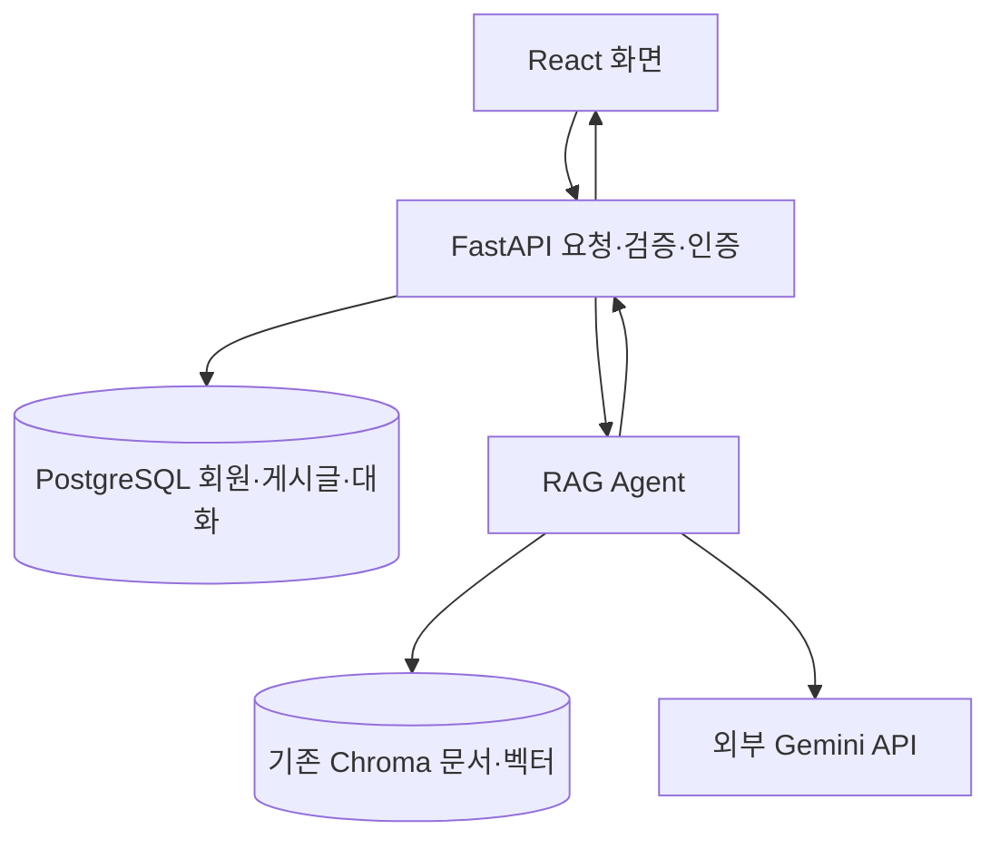

# 2026-10-30_FastAPI_Agent_도커전환_준비(실행구조,_TOML,_환경설정,_Alembic,_pgvector)
> 작성일: 2026-10-30

## 🔗 관련 글

- [Docker와 Compose 기초](2026-10-30%20(1)Docker와_Compose_실습(WSL2,_볼륨,_pgvector,_FastAPI,_바인드마운트).md) — 작은 backend에서 학습한 내용을 기존 RAG 앱으로 확장한다.
- [FastAPI 시작](2026-10-23%20(2)FastAPI_시작(uv,_엔드포인트,_Swagger_UI,_자동_문서화).md) — 서버 실행·엔드포인트·문서 화면을 복습한다.
- [비동기 DB와 Alembic](2026-10-29%20(1)FastAPI_비동기_DB와_Alembic_마이그레이션(lifespan,_관계_로딩).md) — ORM·엔진·세션과 마이그레이션을 연결한다.
- [동기와 비동기 실행 구조](2026-10-29%20(3)동기와_비동기의_실행구조(이벤트루프,_스레드풀,_스케줄링,_CPU,_코루틴).md) — 비동기 연결과 자원 정리를 복습한다.

## ❓ 아직 모르겠는 것

실제 질문·반박·이해 확인을 정리했다. 풀린 것도 복습 대상으로 남기며 실행 확인이 없는 것은 미해결로 표시한다. 설명이 불명확해서 생긴 혼란을 사용자의 실수로만 취급하지 않는다.

- “바탕화면의 fastapi 폴더인데 같은 내용인가?” — 별도 fastapi_agent와 fastapi/fastapi_agent는 무엇이 달랐는가? (주제 1)
- “app.state는 리스트? DB에 저장되나?” — 객체·메모리·DB를 구분하는가? (주제 3)
- “시작·종료 부분에 적으면 되지 왜 lifespan?” — 파일 import와 실제 서버 수명은 왜 다른가? (주제 4)
- “lifespan은 Uvicorn 시스템?”, “ASGI는 어떤 데이터? return 0인가?” — 시작 메시지와 프로세스 종료 코드의 차이는 무엇인가? (주제 4)
- “TOML과 lock은 왜 둘?”, “uv.lock이 현재 환경?”, “갱신 안 되나?”, “.venv는 빈 폴더?” — 요구 조건·잠금 기록·실제 설치를 구분하는가? (주제 5)
- “python -c가 파일 없이 실행? 위험하지 않나?”, “secrets는 기본 라이브러리?” — 실행 방법·권한·난수 생성을 설명할 수 있는가? (주제 6)
- “공용 파일이 있는데 왜 키 복사? 경로로 하고 싶다.” — 공용 키만 읽고 다른 설정은 보존하는 방법은? (주제 7)
- “env도 이미지에 구워지나? Compose와 관계?” — 빌드·실행 시점의 설정 전달은 어떻게 다른가? (주제 8)
- “DB 켠 기억이 없는데?”, “실시간으로 바꿀 수 있나?” — DB 프로세스와 앱의 설정 읽기를 구분하는가? (주제 9)
- “fastapi dev도 만든 명령?”, “왜 project.scripts가 아니라 tool.fastapi?” — 명령 생성·도구 설정을 구분하는가? (주제 10)
- “tool 함수·폴더·파일이 없는데 뭘 말해?”, “내부 동작은?” — 설정을 딕셔너리로 변환하는 과정은 무엇인가? (주제 11)
- “main.py를 하위 폴더로 옮기면?”, “main.py 기준 경로인가?” — import 문자열은 어떻게 찾는가? (주제 12)
- “ingest도 tool.madebyme로 하면 되지?”, “왜 우리는 두 구역?”, “entrypoint에 그냥 대입?” — 도구 제작자와 사용자 설정은 어떻게 연결되는가? (주제 11·12)
- “VS Code에서 해서 WinError 10013?” — 실제 확인한 포트 점유 원인은 무엇인가? (주제 13)
- “새 폴더라 계정 없을 듯”, “로그인 된 듯” — 기존 DB·토큰 발급·Authorize를 구분하는가? (주제 13)
- “Alembic은 체크포인트?”, “ORM이 생성하는데 왜 Alembic?”, “세션인가 엔진인가?” — 데이터와 구조 변경은 어떻게 다른가? (주제 15)
- “이력 관리면 SQLAlchemy를 쓰면 안 되나?”, “ORM 객체를 Alembic이 SQL로 실행?” — 우회 구조 변경과 정상 데이터 작업을 구분하는가? (주제 15)
- “upgrade 실행? head는?”, “DateTime 시간순?”, “연결 리스트네.” — revision 연결·시간 자료형·head의 차이는 무엇인가? (주제 16)
- “코드 전부 전후 비교해줘.” — pgvector 전환에서 어떤 호출부들이 바뀌었는가? (주제 17)
- 새 벡터 마이그레이션·PDF 재등록·실제 pgvector RAG가 끝났는가? — 코드·테스트는 준비했으나 실행 결과는 대화에서 아직 확인하지 않았다. (미해결, 주제 18)

## 주제 1: 대상 폴더 확인과 8단계 계획

목표는 기존 RAG 앱을 Docker로 실행하고 Chroma를 pgvector로 바꾸는 것이다. 사용자는 RAG 기본만 알고 FastAPI·Docker를 처음 복습하는 기준의 튜터링을 요청했다. 각 단계는 할 일·도구를 먼저 설명하고 실행 결과를 확인한 뒤 진행한다.

| 단계 | 작업 | 기준 |
|---|---|---|
| 1 | 요청부터 RAG까지 구조 이해 | 파일 역할·흐름 설명 |
| 2 | 변경 전 로컬 앱 실행 | 설정·Chroma·API 확인 |
| 3 | 도커 pgvector DB 준비 | healthy·접속 |
| 4 | DB 주소·키 경로 연결 | 실행 위치별 설정 구분 |
| 5 | Chroma→pgvector | 등록·검색 코드 전환 |
| 6 | 앱 테이블·체크포인트 | 마이그레이션·초기화 |
| 7 | FastAPI 컨테이너화 | 이미지·Compose 실행 |
| 8 | 전체 확인·개발 모드 | 인증·RAG·스트리밍·reload |

새 DB 연결 직후 테이블이 필요하므로 초기 Alembic 적용은 앞당겼다. 저장소 선택 기능은 추가하지 않고 pgvector 전용으로 전환하되 기존 Chroma 자료는 남겼다.

> ➕ **더 알아두기 — 폴더 혼동 정정**
> 처음 확인한 별도 fastapi_agent 폴더가 아니라 바탕화면 fastapi/fastapi_agent가 실습 대상이다. 원본의 같은 하위 프로젝트와 비교한 62개 파일이 일치했다. 비밀 설정·가상환경·캐시는 비교에서 제외했다. 별도 fastapi_agent에는 변경된 코드가 많아 섞지 않는다. 공개 기록에서는 개인 절대 경로 대신 상대 위치를 사용한다.

```text
fastapi/
├─ fastapi_agent/   backend·RAG·Alembic
├─ frontend/        React 화면
├─ fastapi_basic/
└─ fastapi_prac/
```

## 주제 2: 요청·RAG·두 저장소의 관계

수업 Docker 실행 방식을 기존 앱에 적용한다. 화면은 HTTP 요청을 보내고 FastAPI는 입력·인증을 확인해 RAG를 실행한 뒤 답변·출처를 반환한다. HTTP는 클라이언트와 서버가 요청·응답을 주고받는 규칙이다.



목표는 검색 문서도 같은 PostgreSQL 인스턴스의 별도 벡터 테이블에서 관리하는 것이다. 회원 테이블을 벡터로 바꾸지 않으며 Gemini는 외부 API로 남는다.

```text
src/
├─ fastapi_agent/
│  ├─ main.py          앱·시작/종료·기능 연결
│  ├─ core/            설정·DB·보안·공통 처리
│  └─ domains/chat/    채팅·RAG 요청·스트리밍
├─ agents/rag/graph.py 검색→생성의 순서
└─ rag/               PDF·청킹·임베딩·저장소·검색기
```

app.include_router(chat_router)는 주소 연결표를 앱에 등록한다. Router의 prefix=/chat과 @router.post('/rag/stream')을 합친 최종 엔드포인트는 POST /chat/rag/stream이다. 엔드포인트는 메서드·주소로 구분하는 기능 접점이다.

```json
{"question": "이 문서에서 다루는 AI 산업 동향을 두 가지 알려줘."}
```

get_current_user 의존성으로 RAG도 인증이 필요하다. RagChatService는 그래프 스트림을 status·sources·token·done 이벤트로 변환한다. SSE는 서버가 이벤트를 이어 보내는 방식이다. 200 응답을 시작한 뒤 실패할 수 있으므로 done의 실제 answer까지 확인한다.

## 주제 3: app과 app.state

> ➕ **더 알아두기**
> app은 FastAPI()로 만든 객체, app.state는 그 객체에 이름을 붙여 값을 보관할 메모리 공간이다. 리스트나 DB 자체가 아니다. 리스트도 넣을 수 있지만 현재는 준비한 RAG·챗봇 객체를 넣는다.

```python
app.state.rag_agent = create_rag_agent()
app.state.chat_agent = create_chat_agent(checkpointer)
agent = request.app.state.rag_agent
```

```text
app
└─ state
   ├─ rag_agent  준비된 RAG 객체
   └─ chat_agent 준비된 챗봇 객체
```

> ➕ **더 알아두기**
> 질문마다 초기 객체를 다시 만들지 않고 시작 시 준비해 재사용한다. state는 DB에 자동 저장되지 않으며 프로세스 종료 후 lifespan에서 다시 채운다. worker가 여러 개라면 프로세스별 메모리도 따로다. 대화 내용을 DB에 보존하는 체크포인터와 구분한다.

> ♻️ 처음엔 state가 리스트이거나 DB에 저장된 목록이라고 알았으나, 앱 메모리에 객체를 이름으로 보관하는 공간이라는 것이 맞다.

## 주제 4: lifespan·Uvicorn·ASGI

lifespan은 실제 앱 시작·종료 시점에 준비·정리를 실행한다. 파일 위쪽은 import 시점에 실행되고 파일 아래쪽은 서버 종료 시점을 의미하지 않는다. 테스트나 다른 모듈의 import에서도 최상위 코드가 실행될 수 있다.

```python
@asynccontextmanager
async def lifespan(app: FastAPI):
    # 시작 준비
    yield
    # 종료 정리

app = FastAPI(lifespan=lifespan)
```

실제 코드는 예외 시에도 정리되도록 finally·컨텍스트 관리자를 사용한다. create_rag_agent는 RAG 흐름을 준비하고 실제 질문이 들어오면 노드를 실행한다.

> ➕ **더 알아두기 — 숫자 0 대신 메시지**
> ASGI는 서버와 앱 사이의 통신 규칙이며 lifespan도 포함한다. Uvicorn은 서버, FastAPI는 앱 프레임워크다. 시작·종료는 Python 딕셔너리 메시지로 전달한다.

```python
{"type": "lifespan.startup"}
{"type": "lifespan.startup.complete"}
{"type": "lifespan.startup.failed", "message": "시작 준비 실패"}
{"type": "lifespan.shutdown"}
{"type": "lifespan.shutdown.complete"}
```

> ➕ **더 알아두기**
> Uvicorn은 시작 완료 메시지 뒤 요청 처리를 진행한다. C의 return 0은 정상 종료 코드지만 startup.complete는 준비를 마치고 서비스를 계속한다는 의미다. yield 자체가 ASGI 메시지는 아니다. FastAPI/Starlette가 함수 진행에 맞춰 메시지를 처리한다. [ASGI 명세](https://asgi.readthedocs.io/en/stable/specs/lifespan.html)

## 주제 5: pyproject.toml·uv.lock·.venv

| 항목 | 뜻 |
|---|---|
| pyproject.toml | 프로젝트 정보·의존성 조건·도구 설정 |
| uv.lock | 호환되는 정확한 의존성 버전 기록 |
| .venv | 실제 Python 실행 환경과 패키지 폴더 |

TOML은 설정 문법이다. sqlalchemy[asyncio]>=2.0,<2.1은 허용 범위, lock은 선택한 정확한 버전과 간접 의존성 기록이다. lock은 uv sync·uv lock 등으로 생성·갱신한다. 이번 복사본에는 이미 lock이 있었다.

```bash
uv sync --locked
```

--locked는 잠금 갱신이 필요하면 오류를 내도록 한다. 일반 sync는 필요 시 갱신하고 환경을 맞춘다. 기존 기록이 조건을 만족하면 우선 유지하며 항상 최신으로 전체 갱신하지 않는다.

| 명령 | 프로젝트 조건 | lock | 환경 |
|---|---|---|---|
| uv add 패키지 | 반영 | 갱신 가능 | 설치·동기화 |
| uv pip install 패키지 | 자동 반영 안 함 | 자동 반영 안 함 | 직접 설치 |
| uv sync | 확인 | 필요 시 갱신 | 맞춤 |

> ➕ **더 알아두기**
> lock은 실시간 설치 감시 목록이 아니므로 직접 설치·미동기화 시 실제 환경과 다를 수 있다. .venv는 디스크 폴더라 종료·재부팅해도 남는다. 실행 전 반드시 없거나 빈 것은 아니다. 이번에는 없던 폴더가 설치 후 생긴 것을 확인했다. app.state의 메모리 수명과 다르다. [uv 공식 문서](https://docs.astral.sh/uv/concepts/projects/sync/)

## 주제 6: .env·JWT·python -c·secrets

프로젝트 설정 예시를 복사해 실제 설정 파일을 만들었다.

```bash
cp .env.example .env
uv run python -c "import secrets; print(secrets.token_hex(32))"
```

| 부분 | 뜻 |
|---|---|
| uv run | 프로젝트 환경으로 실행 |
| python -c | 파일 대신 뒤 문자열을 코드로 실행 |
| import secrets | 표준 보안용 난수 도구 불러오기 |
| token_hex(32) | 무작위 32바이트를 64글자 16진수로 표현 |
| print | 터미널 출력 |
| ; | 한 줄의 두 문장 구분 |

> ➕ **더 알아두기**
> 파일 실행과 -c는 입력 위치가 다를 뿐 권한 격리가 생기지 않는다. 위험성은 코드·권한에 달렸고 파일 실행도 무조건 안전하지 않다. 이 명령은 생성·출력만 했고 .env 저장은 사용자가 복사해 수행했다. 명령은 셸 기록에 남을 수 있다. secrets는 표준 라이브러리이므로 uv add가 필요 없다.
>
> JWT_SECRET_KEY는 서버 서명·검증용 비밀키, 로그인 응답 access_token은 사용자 증표다. JWT_EXPIRE_MINUTES=3000은 예시 만료 분, DB_ECHO=false는 SQL 로그 끄기다. 공개 기록에는 실제 키·비밀번호 대신 자리표시자를 쓴다.

> 📝 **기사 시험 포인트** (정보보안기사)
> 인증(Authentication), 비밀키 관리, 암호학적으로 안전한 난수(CSPRNG)를 연결한다. 서명 키와 토큰을 구분하고 공개 코드·문서에 비밀값을 넣지 않는다.

## 주제 7: 공용 키를 경로로 읽기

사용자가 복사 대신 경로 지정을 요청해 프로젝트 설정에 키 파일 위치만 넣었다.

```dotenv
GEMINI_ENV_FILE=<공용 키 파일 경로>
```

get_api_key는 프로젝트 .env를 dotenv_values로 읽고, 실행 환경의 GEMINI_ENV_FILE을 우선해 공용 파일을 찾는다. 파일 존재를 확인하고 GEMINI_API_KEY 또는 GOOGLE_API_KEY만 선택한다. 없으면 오류를 낸다.

```python
values = dotenv_values(key_file)
key = (values.get("GEMINI_API_KEY") or "").strip() or (
    values.get("GOOGLE_API_KEY") or ""
).strip()
```

> ➕ **더 알아두기**
> dotenv_values는 딕셔너리로 읽으므로 공용 DATABASE_URL 등 전체 값을 환경에 덮어쓰지 않는다. 임베딩·RAG 답변·챗봇 세 클라이언트에 api_key=get_api_key()를 전달했다. 예시 설정·챗봇 readme도 갱신했다. 실제 키를 출력하지 않고 이름 대체·빈 키·없는 파일·환경 불변을 검사했다. 이 검증에서는 Gemini 실제 호출을 하지 않았다.

## 주제 8: .env·이미지·Compose

COPY . .는 제외 설정이 없으면 .env도 복사할 수 있다. .dockerignore에 .env·.env.*·.venv를 넣어 비밀 설정과 Windows 환경이 이미지에 들어가지 않게 한다.

> ➕ **더 알아두기 — 적용 예정 예시**
> 실행 시 프로젝트 설정은 env_file/environment로 전달하고 공용 키 파일은 읽기 전용 마운트로 연결한다. Windows 경로를 Linux 컨테이너가 그대로 쓸 수 없어 내부 경로를 지정해야 한다. 아래는 설명용으로 이번 앱에 적용 완료한 backend 설정은 아니다.

```yaml
services:
  backend:
    env_file:
      - .env
    environment:
      GEMINI_ENV_FILE: /run/secrets/gemini.env
    volumes:
      - <호스트의 공용 키 파일>:/run/secrets/gemini.env:ro
```

> ➕ **더 알아두기**
> env_file은 값을 환경변수로 전달하고 volumes는 실행 중 파일을 보이게 한다. 둘 다 이미지에 굽는 것과 다르다. :ro는 읽기 전용이지만 앱에는 키 읽기 권한이 있다. 키가 완전히 보이지 않는다는 뜻은 아니다.

## 주제 9: DB 주소·기존 데이터·자동 시작 추정

초기 .env의 your_password는 예시 값이었다. 기존 로컬 PostgreSQL 127.0.0.1:5432에 접속하고 fastapi_agent DB 존재를 확인했다. 비밀번호는 공개 기록에서 대체한다.

```dotenv
DATABASE_URL=postgresql+psycopg://postgres:<DB_PASSWORD>@127.0.0.1:5432/fastapi_agent
```

| 부분 | 뜻 |
|---|---|
| postgresql | DB 종류 |
| +psycopg | 연결 드라이버 |
| 사용자·비밀번호 | 인증 정보 |
| 127.0.0.1:5432 | 주소·포트 |
| /fastapi_agent | 서버 안의 DB |

설정 수정은 DB 재설치·복사가 아니다. 앱이 꺼져 있으면 다음 시작에 읽고 실행 중이면 보통 재시작해야 한다. DB는 별도 프로그램이므로 FastAPI 시작 전에도 실행될 수 있다.

> ➕ **더 알아두기**
> 사용자는 켠 기억이 없다고 했다. Windows 서비스 자동 시작 가능성을 설명했지만 시작 유형을 직접 확인하지 않았다. 확인한 것은 접속 성공·DB 존재뿐이다. 새 코드 폴더라도 기존 DB에 연결하면 기존 회원·데이터가 보인다.

## 주제 10: rag-ingest와 fastapi dev의 차이

PDF 등록 명령은 프로젝트가 정의한 명령이다.

```toml
[project.scripts]
rag-ingest = "rag.ingest:main"
```

프로젝트 설치·동기화 때 실행용 명령이 준비되고 uv run rag-ingest로 사용한다. 함수 위치는 rag 패키지의 ingest 모듈 안 main 함수다. main.py 파일이라는 뜻이 아니다.

FastAPI 개발 서버는 도구가 제공하는 명령으로 실행한다.

```bash
uv run fastapi dev
```

```toml
[tool.fastapi]
entrypoint = "fastapi_agent.main:app"
```

| 구분 | 역할 |
|---|---|
| project.scripts | 프로젝트가 제공할 명령 이름과 함수 등록 |
| tool.fastapi | 이미 있는 FastAPI 명령이 사용할 설정 |
| fastapi dev | 개발 서버·reload 실행 |
| entrypoint | 불러올 앱 객체 위치 |

> ➕ **더 알아두기**
> FastAPI 쪽 명령은 패키지 설치 시 이미 제공된다. 사용자 프로젝트에 명령 생성 등록이 보이지 않는다고 과정 자체가 없는 것은 아니다. 제작자 패키지의 명령 진입점과 사용자 프로젝트의 앱 위치 설정을 구분한다. 프로젝트 패키징 구성이 필요하며 단순 셸 명령 문자열을 scripts에 적는 범용 단축키 기능은 아니다.

## 주제 11: tool·project.scripts는 파일·함수가 아니라 설정 데이터

사용자는 tool이라는 파일·폴더가 없는데 계속 도구라고 설명해서 이해하기 어렵다고 했다. 핵심은 TOML 내용이 파싱되면 딕셔너리가 된다는 것이다. 파일 구조를 훑어 자동으로 딕셔너리를 만드는 것이 아니다.

```toml
[tool.fastapi]
entrypoint = "fastapi_agent.main:app"

[project.scripts]
rag-ingest = "rag.ingest:main"
```

```python
{
    "tool": {
        "fastapi": {
            "entrypoint": "fastapi_agent.main:app"
        }
    },
    "project": {
        "scripts": {
            "rag-ingest": "rag.ingest:main"
        }
    }
}
```

- 대괄호는 TOML의 설정 표를 선언한다.
- tool·project·scripts는 키 이름이지 실행 함수·파일 이름이 아니다.
- rag-ingest는 만들 명령 이름이며 rag.ingest:main은 그 값인 import 문자열이다.
- tool은 pyproject.toml 표준의 도구별 설정 자리다. 단순 암묵적 취향만은 아니다.
- 도구별 세부 키와 동작은 그 도구가 구현한다. tool 아래 모든 것을 실행하는 공통 엔진은 없다.

> ♻️ 처음엔 tool이라는 파일·함수 또는 실행 엔진이 따로 있다고 생각했으나, TOML에 적힌 설정 키이고 FastAPI 도구가 그 키를 읽는 코드를 가지고 있다는 것이 맞다.

사용자가 제안한 [tool.madebyme]도 가능하다. 단, 우리 코드가 직접 읽어야 한다. 다음은 설명용 예시로 실제 프로젝트에 이 구역을 추가한 것은 아니다.

```toml
[project.scripts]
rag-ingest = "rag.ingest:main"

[tool.madebyme]
message = "문서 등록을 시작합니다!"
```

```python
import tomllib

# pyproject.toml이 있는 작업 폴더에서 실행하는 설명용 예시
with open("pyproject.toml", "rb") as file:
    settings = tomllib.load(file)
options = settings["tool"]["madebyme"]
print(options["message"])
```

> ➕ **더 알아두기**
> project.scripts는 명령 생성, tool.madebyme는 실행된 코드가 읽을 옵션이다. 둘은 함께 쓸 수 있지만 반드시 둘 다 필요하지 않다. 별도 옵션이 없으면 scripts만으로 충분하다. 이미 있는 FastAPI 명령은 제작자가 준비했으므로 사용자에게는 tool.fastapi만 보일 수 있다. 임의의 딕셔너리 이름을 쓰면 데이터는 읽히지만 설치 도구가 자동으로 실행 명령을 만들지는 않는다.

### 실제 설치 코드를 따라간 과정

fastapi_cli/config.py에서 아래 코드가 설정을 읽는다.

```python
with open(pyproject_path, "rb") as f:
    data = tomllib.load(f)
return data.get("tool", {}).get("fastapi", {})
```

get의 두 번째 인자 {}는 키가 없을 때 사용할 빈 딕셔너리다. 읽은 설정은 Pydantic 설정 객체로 검증된다. 실제 클래스에는 entrypoint 필드가 있다.

```python
class FastAPIConfig(BaseModel):
    entrypoint: StrictStr | None = None
    from_pyproject: bool = False
```

> ➕ **더 알아두기**
> TOML을 저장하는 순간 FastAPI 내부 변수에 값이 들어가는 것이 아니다. 명령 실행 → 파일 읽기 → 딕셔너리 변환 → 설정 필드 검증·생성 → 실행에 사용 순서다. 특정 함수에 값을 그냥 대입한다는 설명도 정확하지 않다. 설정 객체의 속성에 읽은 값이 들어간다.

FastAPI CLI는 문자열을 Uvicorn에 전달하고 Uvicorn은 다음과 같이 import한다.

```python
module = importlib.import_module("fastapi_agent.main")
app = getattr(module, "app")
```

모듈을 불러오면 그 안의 최상위 코드가 실행되고 app=FastAPI(...)로 만든 객체를 찾는다. 이후 Uvicorn이 앱에 lifespan 신호를 보낸다. 설명 중 실제 확인한 파일은 설치 패키지 fastapi_cli/config.py·cli.py·uvicorn/importer.py다. 이때는 읽기만 했고 서버를 대신 켜지 않았다.

## 주제 12: import 문자열·파일 이동·명령 등록

```text
fastapi_agent.main : app
모듈 이름              객체 이름

rag.ingest : main
모듈 이름      호출 함수 이름
```

main.py를 하위 web 폴더로 옮기면 entrypoint도 fastapi_agent.web.main:app으로 수정해야 한다. 자동으로 이사 위치를 추적해서 설정을 고치지 않는다. 객체 이름이 my_app이면 콜론 뒤도 my_app으로 바꾼다.

```text
src/
├─ fastapi_agent/
│  └─ web/
│     ├─ __init__.py
│     └─ main.py
└─ rag/
   └─ ingest.py
```

> ➕ **더 알아두기**
> 이 문자열은 TOML 위치 기준의 파일 상대 경로나 FastAPI main.py 기준의 경로가 아니다. Python이 import할 수 있는 모듈 이름이다. 프로젝트 설치 설정이 src 안의 패키지를 불러올 수 있게 구성한다. rag-ingest는 FastAPI main.py를 거치지 않고 rag.ingest의 main 함수를 호출한다. 점을 쓰는 TOML 표 이름과 Python 모듈 문자열은 문법이 비슷하지만 역할이 다르다.
>
> 새 Python 파일을 만들었다고 모두 scripts에 등록하지 않는다. 직접 uv run python hello.py로 실행할 수도 있고 터미널 명령으로 제공할 함수만 등록한다. 모듈은 설치에 포함되거나 Python이 찾을 수 있어야 한다. tool.madebyme도 읽는 코드를 작성하면 쓸 수 있으나 그 자체로 명령은 생기지 않는다.

## 주제 13: Chroma 70개 적재·서버·인증 확인

사용자가 uv run rag-ingest 실행 후 70개 조각 저장 완료를 보고했다. PDF 추출 → 700자 기준 청킹·100자 겹침 → Gemini 임베딩 → Chroma 저장 흐름이다. Gemini 요청 시 문서 조각은 외부 API로 전달된다. 당시 등록 코드는 기존 컬렉션을 먼저 삭제하고 새로 생성하는 방식이었다.

서버 실행 중 WinError 10013이 발생했다. VS Code 때문이라고 단정하지 않고 포트를 확인했다. 이전 docker-practice-backend-1이 127.0.0.1:8000을 점유하고 있었다. 해당 이전 backend만 중지하고 소켓 bind 성공으로 비워진 것을 확인했다. 그 조치로 DB나 데이터는 삭제하지 않았다. Windows 예약 포트 확인 명령 하나는 실패했지만 점유 확인으로 원인을 특정했으며 예약 범위 결과를 얻은 것처럼 기록하지 않는다.

```bash
uv run fastapi dev
```

Server started 안내만으로 성공을 단정하지 않고 Application startup complete와 응답을 본다. 실제 읽기 확인에서 /는 200과 Hello World 공통 응답, /openapi.json은 200과 FastAPI Agent 제목·인증·RAG 경로를 반환했다. 이 결과는 실제 RAG 생성 성공과는 다르다.

기존 DB의 회원 수를 조회하니 1명이 있었다. 새 코드 폴더지만 기존 DB였기 때문이다. 이메일·비밀번호는 조회하지 않았다. 사용자가 로그인 후 GET /me 확인을 보고했다.

```text
POST /auth/login → access_token 발급
Authorize        → 토큰을 이후 요청에 첨부
GET /me          → 인증 통과 확인
POST /chat/rag/stream → 실제 RAG 요청
```

| 개념 | 역할 |
|---|---|
| JWT_SECRET_KEY | 서버의 서명·검증 비밀키 |
| access_token | 로그인 후 발급된 사용자 증표 |
| Authorize | Swagger 요청에 토큰을 붙이는 설정 |

HTTPBearer 입력창에는 토큰 문자열만 넣으며 Bearer 접두어를 별도로 붙이지 않도록 안내했다. 기존 계정이 없거나 기억나지 않으면 signup 후 login할 수 있지만 실제 새 가입 수행 여부는 이 대화에서 확정하지 않았다. RAG 질문 안내 후 사용자가 다음 단계로 진행했으나 done 이벤트의 답변·출처 결과는 직접 확인하지 않았다.

> 📝 **기사 시험 포인트** (정보보안기사)
> 인증(Authentication)·인가(Authorization)·서버 비밀키·접근 토큰을 구분한다. 포트 점유를 권한 문제 일반론으로 단정하거나 관리자 실행으로 먼저 우회하지 않는다.

## 주제 14: pgvector DB를 별도 Compose로 준비

기존 로컬 5432와 수업 프로젝트 5433을 구분하기 위해 새 프로젝트는 호스트 5434를 선택했다. 이름은 fastapi-agent로 이전 docker-practice와 분리했다. 포트 번호 자체에 pgvector라는 의미가 있는 것은 아니다.

```yaml
name: fastapi-agent

services:
  db:
    image: pgvector/pgvector:pg17-trixie
    environment:
      POSTGRES_USER: postgres
      POSTGRES_PASSWORD: "<DB_PASSWORD>"
      POSTGRES_DB: fastapi_agent
    ports:
      - "127.0.0.1:5434:5432"
    volumes:
      - postgres_data:/var/lib/postgresql/data
    healthcheck:
      test: ["CMD-SHELL", "pg_isready -h 127.0.0.1 -U postgres -d fastapi_agent"]
      interval: 5s
      timeout: 3s
      retries: 10
      start_period: 10s

volumes:
  postgres_data:
```

이 예시는 공개 기록용으로 비밀번호를 대체한 것이다. 실제 작성한 파일은 backend 최상위 compose.yaml이며 config -q 검사를 통과했다. 사용자가 up 후 healthy를 보고했다.

```bash
docker compose config -q
docker compose up -d db
docker compose ps
```

이 시점은 DB 연결 준비 완료이지 회원 테이블·임베딩 준비 완료는 아니다. FastAPI는 아직 Windows에서 실행하므로 .env를 127.0.0.1:5434/fastapi_agent로 바꾸고 서버를 멈췄다. 뒤에 backend도 컨테이너가 되면 db:5432로 바꿀 계획이다. 기존 DB의 데이터는 새 DB로 자동 복사되지 않는다.

## 주제 15: SQLAlchemy·ORM·Engine·Session·Alembic

사용자가 구조를 반복해서 확인한 핵심이다.

```text
SQLAlchemy — DB 작업용 라이브러리
├─ ORM 모델: Python에 테이블·컬럼 구조 표현
├─ Engine/Connection: DB 연결·SQL 실행 기반
└─ Session: 객체 조회·저장·수정과 트랜잭션 관리

Alembic — SQLAlchemy를 활용하는 별도 도구
└─ 구조 변경 파일·적용 버전 관리
```

```text
일반 데이터 작업:
FastAPI → 앱의 Session → 앱의 Engine/Connection → PostgreSQL

구조 변경:
alembic 명령 → env.py가 연결 준비 → 변경 파일의 upgrade 실행 → PostgreSQL
```

> ➕ **더 알아두기**
> 이전 그림은 앱의 엔진과 Alembic 연결을 한 노드로 합쳐 같은 객체를 공유해야 하는 것처럼 보였다. 실제로 같은 주소에 접속해도 같은 엔진 객체일 필요는 없다. Alembic은 앱의 Session으로 게시글을 저장하는 도구가 아니다.

| 작업 | 담당 |
|---|---|
| 사용할 테이블 구조를 Python에 정의 | ORM 모델 |
| 테이블·컬럼 생성·변경 적용 | Alembic 변경 파일 |
| 회원 가입·게시글 추가·수정·삭제 | 앱 코드와 SQLAlchemy |
| 게시글 수정 전 값의 이력 | 필요 시 별도 감사·이력 기능 |

Base.metadata.create_all(engine)은 없는 테이블을 만들 수 있지만 기존 테이블의 새 컬럼 변경을 전부 자동 반영하지 않는다. SQLAlchemy로 ALTER TABLE SQL을 실행할 수도 있지만 버전 관리 프로젝트에서는 구조 변경을 Alembic으로 통일한다. Alembic도 내부에서 SQLAlchemy를 활용하므로 SQLAlchemy 사용 자체를 금지하는 것이 아니다.

```text
모델에 created_at 작성
    ↓ 자동 생성 명령을 사용할 경우 비교
Alembic 변경 파일 초안·검토
    ↓ upgrade head
실제 DB에 컬럼 추가·버전 기록
```

> ♻️ 처음엔 사용자 데이터 객체를 ORM이 만들면 Alembic이 받아 SQL로 저장한다고 알았으나, 일반 데이터 작업은 SQLAlchemy가 하고 Alembic은 주로 스키마 변경을 적용하는 것이 맞다.

> ➕ **더 알아두기**
> ORM에 컬럼을 적는 것과 DB를 변경하는 것은 다르다. 새 코드가 요구하는 컬럼이 DB에 없으면 오류가 난다. Alembic은 개발·테스트·운영 DB 각각의 적용 버전을 보고 필요한 변경만 순서대로 적용한다. 모델 수정 후 migration 파일 자동 생성은 revision --autogenerate이며, upgrade head는 이미 있는 파일의 적용이다. 구조 변경에 딸린 기존 값 채우기 같은 데이터 마이그레이션도 가능하므로 값을 절대로 못 바꾸는 도구라고 일반화하지 않는다.

> 📝 **기사 시험 포인트** (정보처리기사)
> 스키마(Schema)는 구조, 데이터(Data)는 실제 값이다. CREATE·ALTER·DROP은 DDL, INSERT·UPDATE·DELETE는 DML의 대표 명령이다. SQLAlchemy는 둘을 실행할 기반을 제공하며 Alembic의 주목적은 스키마 버전 관리다. 마이그레이션 버전은 데이터 전체의 백업·스냅샷과 다르다.

## 주제 16: upgrade head와 revision 연결

```bash
uv run alembic upgrade head
```

uv run은 프로젝트 환경, alembic은 도구, upgrade는 변경 적용 방향, head는 최신 끝 지점이다. PostgreSQL 프로그램 자체 버전을 올리는 명령이 아니다.

```text
빈 DB
  ↓ baf7f893b4bf  초기 테이블 생성
  ↓ 49a700e5107c  게시글 created_at 추가
기존 head
  ↓ d3b8e7c21a90  새로 작성한 벡터 테이블 변경
새 head
```

현재 적용 위치는 DB의 alembic_version에 기록된다. 첫 번째만 적용됐다면 이후 변경만 실행하고 최신이면 새 작업이 없다. 파일 이름·생성 날짜·DateTime 컬럼 값으로 순서를 정하지 않는다.

```python
revision = "49a700e5107c"
down_revision = "baf7f893b4bf"
```

DateTime(timezone=True)은 날짜·시간 컬럼 자료형이며 Create Date 주석은 파일 작성 기록이다. down_revision은 이전 변경 ID를 가리킨다. 한 줄 이력은 연결 리스트처럼 보이지만 분기·병합이 가능한 전체 구조는 그래프다. 중간 파일 삭제·ID 수정은 연결을 끊을 수 있다.

실제 프로젝트의 alembic.ini는 script_location으로 alembic 폴더를 지정하고 env.py는 DB 주소·모델 메타데이터·연결 실행을 준비한다. versions에는 초기 테이블·작성일 추가 변경 파일이 이미 있었다. 누가 최초 작성했는지는 파일만으로 확정하지 않았다. upgrade head가 현재 모델을 보고 즉석으로 변경을 생성한 것이 아니라 이 파일들을 실행했다.

실제 새 DB를 읽어 users·posts·comments·chat_rooms·chat_messages·alembic_version과 적용 ID 49a700e5107c를 확인했다. 새 벡터 변경 적용은 별도 확인이 필요하다.

## 주제 17: pgvector 코드 전환에서 바뀐 파일 전체

확장을 설치한 이미지와 특정 DB에서 활성화하는 것은 다르다. 처음 조회는 vector가 없었고, 아래 명령 수행 후 vector 0.8.7을 확인했다.

```bash
docker compose exec db psql -U postgres -d fastapi_agent -c "CREATE EXTENSION IF NOT EXISTS vector;"
uv add langchain-postgres
```

Python 코드에서 직접 사용할 asyncpg·pgvector도 의존성에 추가했다. 설치된 langchain-postgres는 0.0.19였다. 아래는 저장된 변경 요약이며 다음 학습일 글에서 설정·임베딩·모델을 전후 비교한다.

| 파일 | 이전 → 변경과 이유 |
|---|---|
| pyproject.toml / uv.lock | PostgreSQL 저장소·비동기 드라이버·Vector 자료형 추가 |
| rag/config.py | Chroma 폴더·컬렉션 → 테이블 이름·768차원 |
| rag/embeddings.py | 기본 차원 → output_dimensionality 명시 |
| rag/models.py | 없음 → RagChunk ORM 정의 |
| rag/vectorstore.py | 로컬 Chroma 열기 → 비동기 PostgreSQL 연결 관리 |
| rag/retriever.py | 내부에서 저장소 열기 → 연결된 저장소 받기 |
| rag/__init__.py | get_vectorstore → open_vectorstore 내보내기 |
| rag/ingest.py | 컬렉션 선삭제 → ID 기반 저장 후 오래된 ID 정리 |
| agents/rag/graph.py | 저장소를 내부 생성 → 인자로 받아 검색기 구성 |
| fastapi_agent/main.py | RAG 단독 준비 → lifespan에서 저장소·체크포인터 수명 관리 |
| alembic/env.py | RagChunk import로 모델 메타데이터 등록 |
| 새 migration 파일 | 확장 확인·벡터 테이블 생성·이전 revision 연결 |
| tests/test_pgvector.py | 새 등록 흐름과 차원 검사 4개 |

### 저장소 연결과 수명

open_vectorstore는 .env의 DB 주소를 읽어 드라이버만 postgresql+asyncpg로 바꾸고 SQLAlchemy 비동기 Engine을 만든다. PGEngine.from_engine은 이를 langchain-postgres에 연결하는 객체이며 새로운 DB 서버가 생기는 것이 아니다. 먼저 to_regclass로 테이블 존재를 확인하고 없으면 Alembic 적용을 안내한다. 테이블을 자동 생성해 이력을 우회하지 않는다.

```python
store = await PGVectorStore.create(
    engine=engine, table_name=TABLE_NAME, id_column="id",
    embedding_service=embeddings,
)
```

create는 기존 테이블에 사용할 Python 저장소 객체를 만든다는 뜻이지 테이블 생성이 아니다. async with 범위의 yield로 store를 제공하고 finally에서 Gemini 클라이언트·DB 엔진을 정리한다.

### 등록 방식의 차이

기존 ingest는 Chroma 컬렉션을 먼저 삭제하고 새 등록을 시도했다. 변경 후 빈 문서를 거부하고 기존 ID를 읽은 뒤 같은 chunk_id로 저장·갱신한다. 새 저장 성공 후 이번 문서에 없는 예전 ID를 삭제한다.

```python
ids = [chunk.metadata["chunk_id"] for chunk in chunks]
await store.aadd_documents(chunks, ids=ids)
stale_ids = old_ids - set(ids)
if stale_ids:
    await store.adelete(ids=list(stale_ids))
```

기존 ID 조회는 psycopg의 짧은 연결로 수행하고 sql.Identifier로 스키마·테이블 이름을 안전하게 구성한다. ID가 같으면 갱신하므로 동일 문서 재실행 시 계속 중복 행이 늘지 않는다. 이 로직은 현재 단일 PDF 테이블에 맞춘 것이며 여러 문서 집합의 범위 분리까지 구현한 것은 아니다.

> ➕ **더 알아두기**
> 먼저 전체를 지우지 않는다고 등록 전체가 원자적이라는 뜻은 아니다. 현재 코드는 단일 전체 트랜잭션이 아니어서 실패하면 일부 행만 갱신됐을 수 있다. 기존 조각 삭제는 새 저장 성공 후에만 진행하도록 한 범위의 개선이다.

ingest_documents가 async가 되어 main은 asyncio.run으로 실행한다. rag-ingest 명령 등록은 그대로다. retriever는 store.as_retriever(k=4), graph는 create_rag_agent(vectorstore)로 받는다. retrieve→generate·프롬프트·스트리밍 주소는 유지했다.

### 서버의 lifespan 변경

AsyncExitStack에 open_vectorstore와 체크포인터 연결을 등록한다. 시작 시 저장소를 열어 RAG에 전달하고 종료·오류 시 등록된 자원을 정리한다. 회원·게시글 Router는 바꾸지 않았다. SQLAlchemy 앱 Engine과 벡터용 Engine이 같은 DB 주소를 사용할 수 있지만 각 연결 관리 객체는 구분한다.

## 주제 18: 확인한 결과·미완료 작업·다음 순서

| 항목 | 근거와 상태 |
|---|---|
| 패키지 설치 | .venv 생성·langchain-postgres 설치 버전 확인 |
| 공용 키 경로 | 실제 파일 읽기·누락 오류·환경 불변 검사 |
| Chroma 등록 | 사용자가 70개 완료 보고 |
| 기존 앱 서버 | /와 /openapi.json 200 직접 확인 |
| 인증 | 사용자가 로그인·GET /me 확인 보고 |
| 기존 Chroma 실제 RAG | done 답변·출처 결과는 미확인 |
| 새 DB | 사용자 healthy 보고, 5434 접속·테이블·초기 head 직접 확인 |
| pgvector 확장 | vector 0.8.7 직접 조회 |
| 코드 전환 | 파일 저장 완료 |
| 코드 검증 | 문법·테스트 4개·오프라인 migration SQL 통과 |
| 새 벡터 migration 적용 | 이 대화에서 확인 안 됨 |
| pgvector PDF 재등록·검색 | 아직 결과 확인 안 됨 |
| 이번 앱의 FastAPI Docker 실행 | 아직 미진행 |

테스트는 ID·출처 전달, 임베딩 실패 시 기존 조각 삭제 미실행, 빈 문서 거부, 임베딩 차원 일치를 확인했다. DB·Gemini 대신 가짜 객체를 사용하므로 실제 저장·검색 성능 검증과 다르다. Alembic SQL 출력 모드는 실행할 SQL을 생성할 뿐 DB를 바꾸지 않는다.

다음 진행 순서는 새 head 적용 → PDF 재등록 → 실제 DB 행·벡터 크기·검색 확인 → 서버·새 DB 인증 준비 → FastAPI 이미지·Compose → 전체 검증이다. 마지막 자세한 설명은 ORM 모델까지 진행했으며 나머지 코드도 저장된 상태다. 작은 수업 backend의 Docker 완료와 이번 앱의 진행 상태를 혼동하지 않는다.

## 정리

FastAPI의 요청·수명 관리와 TOML 설정 해석을 코드 수준으로 확인했다. 환경 설정은 프로젝트 요구·lock·실제 설치를 구분하고 공용 키를 복사하지 않고 경로로 읽게 했다. 기존 DB와 새 도커 DB를 포트로 분리하고 초기 마이그레이션·vector 확장을 확인했다. Alembic은 일반 데이터 저장 경유지가 아니라 스키마 변경 적용·이력 관리 도구다. pgvector 전환 코드는 준비됐지만 실제 재등록·검색·FastAPI 컨테이너 실행은 아직 검증이 남아 있다.

## ✅ 확인 질문

1. 실제 실습 폴더와 이름이 비슷한 별도 프로젝트를 어떻게 구분했는가?
2. 8단계 계획에서 초기 마이그레이션을 앞당긴 이유와 남은 단계를 설명하라.
3. 화면 요청이 FastAPI·인증·RAG·검색 저장소·Gemini를 거치는 흐름을 설명하라.
4. 회원 DB와 벡터 저장소를 같은 PostgreSQL에서 쓰면 기존 테이블은 어떻게 구분되는가?
5. app.state에 무엇이 들어가고 서버를 재시작하면 어떻게 되는가?
6. app.state의 객체와 DB에 저장한 대화 체크포인트는 어떻게 다른가?
7. 모듈 최상위 코드·lifespan·서버 요청 처리의 실행 시점을 설명하라.
8. ASGI startup.complete와 C의 return 0이 의미하는 차이를 설명하라.
9. pyproject.toml·uv.lock·.venv의 관계와 불일치 가능성을 설명하라.
10. uv add·uv pip install·uv sync --locked의 차이를 설명하라.
11. python -c·secrets.token_hex(32)·세미콜론을 설명하라.
12. JWT 서명 키·access_token·CSPRNG의 목적을 구분하라.
13. 공용 키 파일의 경로만 지정했을 때 코드가 실제로 무엇을 읽어야 하는가?
14. dotenv_values를 사용하면 공용 DB 설정이 덮이지 않는 이유는 무엇인가?
15. .env가 이미지에 들어갈 수 있는 조건과 .dockerignore의 역할을 설명하라.
16. env_file·environment·읽기 전용 마운트의 차이를 설명하라.
17. FastAPI 실행 전 DB가 켜져 있을 수 있는 이유와 실제 확인한 범위를 설명하라.
18. 프로젝트 복사·.env 수정이 기존 DB 데이터에 미치는 영향을 설명하라.
19. project.scripts와 tool.fastapi의 처리 목적·시점을 비교하라.
20. rag-ingest가 가리키는 대상과 FastAPI entrypoint의 대상을 구분하라.
21. TOML 설정이 딕셔너리로 변환되는 과정과 실제 파일 구조를 구분하라.
22. tool.madebyme를 적었을 때 실행 명령까지 자동으로 생기지 않는 이유는 무엇인가?
23. main.py 위치·객체 이름을 바꿀 때 import 문자열을 어떻게 바꾸는가?
24. 파일 읽기·설정 객체 생성·Uvicorn import의 순서를 설명하라.
25. WinError 10013에서 실제 확인한 원인과 서버 성공 판정 기준은 무엇인가?
26. 새 폴더에도 기존 계정이 보인 이유와 Authorize의 역할을 설명하라.
27. 포트 5432·5434와 컨테이너 내부 5432의 관계를 설명하라.
28. healthy가 회원 테이블·문서 준비 완료와 다른 이유는 무엇인가?
29. SQLAlchemy·ORM·Engine·Session·Alembic의 역할을 구분하라.
30. DDL·DML·감사 이력·마이그레이션 버전의 차이를 설명하라.
31. upgrade head와 revision --autogenerate의 차이는 무엇인가?
32. revision·down_revision·DateTime·Create Date의 역할은 무엇인가?
33. pgvector 전환에서 저장소·등록·검색·서버 수명 코드를 함께 바꾼 이유는 무엇인가?
34. ID 기반 저장 후 오래된 ID 정리가 전체 트랜잭션 보장과 다른 이유는 무엇인가?
35. 테스트 4개·오프라인 SQL 검증으로 확인한 것과 확인하지 못한 것은 무엇인가?
36. 다음 실습을 재개할 때 어떤 명령과 확인부터 진행해야 하는가?
