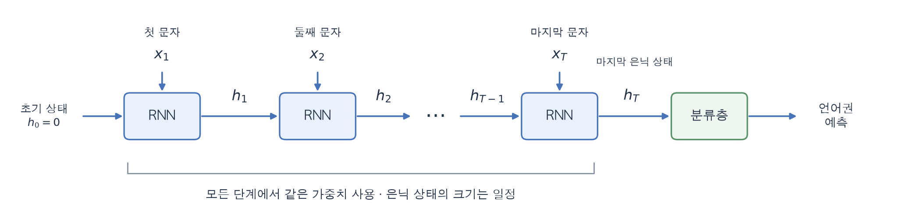
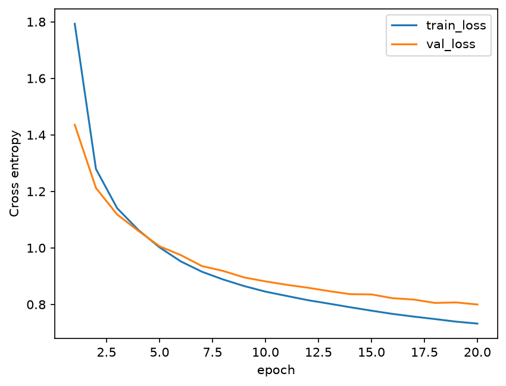
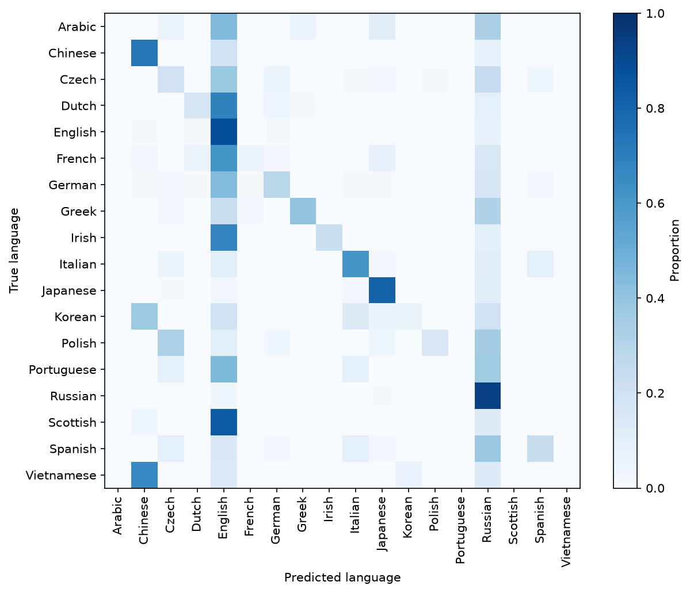

# RNN과 성씨 언어권 분류
> 작성일: 2026-11-17

## 🔗 관련 글

- [신경망 학습과 평가](2026-11-16%20%282%29%EC%8B%A0%EA%B2%BD%EB%A7%9D_%ED%95%99%EC%8A%B5%EA%B3%BC_%ED%8F%89%EA%B0%80.md) — 손실과 역전파를 문자 순서에 따른 상태 갱신으로 확장한다.
- [CNN과 이미지 분류](2026-11-16%20%283%29CNN_%ED%95%A9%EC%84%B1%EA%B3%B1_%ED%92%80%EB%A7%81%EA%B3%BC_%EC%9D%B4%EB%AF%B8%EC%A7%80_%EB%B6%84%EB%A5%98.md) — 공간 패턴을 읽는 CNN과 문자 순서를 읽는 RNN을 비교한다.

## ❓ 아직 모르겠는 것

- 

강의 원문은 15-rnn.ipynb다. 보충 설명은 인용 블록에, 이번 실행에서 확인한 출력은 **실행 확인**에 담았다.

데이터 출처는 [PyTorch 공식 성씨 분류 튜토리얼](https://docs.pytorch.org/tutorials/intermediate/char_rnn_classification_tutorial.html)이다.

## 주제 1 · RNN과 은닉 상태

### RNN

> ➕ **더 알아두기**
> PyTorch는 숫자 배열로 신경망을 만들고 학습시키는 라이브러리다. 시드(seed)는 무작위 계산의 시작값으로, 같은 환경에서 실험을 다시 비교하기 쉽게 한다.

```python
from pathlib import Path
from urllib.request import urlretrieve
import string
import unicodedata
import zipfile
import numpy as np
import pandas as pd
import matplotlib.pyplot as plt
import torch
from torch import nn
from torch.nn.utils.rnn import pad_sequence
from torch.utils.data import Dataset, DataLoader
from sklearn.metrics import accuracy_score, confusion_matrix, f1_score
from IPython.display import display

SEED = 42
torch.manual_seed(SEED)
```

### 순환 신경망이란

RNN은 Recurrent Neural Network의 약자로, 순환 신경망이라고 한다. 문장의 단어나 시간별 기온처럼 순서가 있는 데이터를 다루며, 이러한 데이터를 시퀀스라고 한다.
RNN은 데이터를 순서대로 하나씩 읽고, 앞서 읽은 정보를 현재 입력을 처리하는 데 사용한다.

### 은닉 상태와 정보 전달

은닉 상태는 RNN이 지금까지 읽은 입력의 정보를 담아 두는 숫자 벡터다. 앞서 읽은 정보를 다음 입력을 처리하는 데 사용할 수 있게 한다.
은닉 크기가 32라면 이 정보는 32개의 숫자로 표현된다. 이 숫자들은 입력을 읽을 때마다 갱신되며, 어떤 정보를 담을지는 학습을 통해 정해진다.

RNN은 현재 입력과 이전 단계의 은닉 상태를 함께 사용해 새로운 은닉 상태를 만든다. 기본 RNN의 계산식은 다음과 같다.

$$
h_t = \tanh(W_x x_t + W_h h_{t-1} + b)
$$

$t$는 입력 단계, $x_t$는 현재 입력 벡터이며, $h_{t-1}$과 $h_t$는 이전 단계와 현재 단계의 은닉 상태다.
$W_x$와 $W_h$는 입력과 이전 상태에 적용하는 가중치 행렬이고, $b$는 편향 벡터다. $\tanh$는 각 값을 −1~1 사이로 바꾸는 활성화 함수다.

각 단계에서 같은 가중치와 편향으로 은닉 상태를 갱신하며, 학습할 때는 예측과 정답 사이의 손실을 줄이도록 가중치와 편향을 조정한다.
이 상태를 다음 단계에 전달하는 구조가 반복되기 때문에 ‘순환’이라고 부른다.



`x₁`, `x₂`는 시퀀스의 첫 번째와 두 번째 입력 벡터다. `h₀`는 첫 입력을 처리하기 전의 초기 상태이며, 여기서는 0 벡터로 둔다. `T`는 시퀀스의 길이다.

1. 첫 입력 `x₁`과 초기 상태 `h₀`를 함께 사용해 첫 입력의 정보를 반영한 `h₁`을 계산한다.
2. 다음 입력 `x₂`와 앞에서 계산한 `h₁`을 함께 사용해 `h₂`를 계산한다. 첫 입력의 정보가 `h₁`을 통해 전달되므로, `h₂`에는 앞서 읽은 정보와 현재 입력의 정보가 함께 반영된다.
3. 같은 방식으로 다음 입력과 직전 상태를 받아 상태를 갱신한다. 마지막에는 `x_T`와 `h_{T-1}`로 `h_T`를 계산한다.
4. 시퀀스 전체를 분류하는 경우, 마지막 상태 `h_T`를 분류층에 넣어 클래스별 점수를 계산한다.

시퀀스가 길어지면 상태를 갱신하는 횟수가 늘어나며, 상태 벡터의 크기는 유지된다.

### RNN의 활용

| 활용 | 순서가 있는 데이터를 사용하는 방법 |
| --- | --- |
| 시퀀스 분류 | 이름의 문자나 리뷰의 단어를 순서대로 읽고, 언어권이나 긍정·부정 같은 라벨을 예측한다 |
| 시계열 예측 | 시간 순서로 기록한 기온·전력 사용량 등의 과거 값을 읽고, 이후의 값을 예측한다 |
| 문자·문장 생성 | 앞서 읽은 문자나 단어를 바탕으로 다음 문자나 단어를 예측한다. 예측한 내용을 다시 입력해 뒤에 이어질 내용을 만든다 |

> ➕ **더 알아두기**
> 벡터는 숫자를 순서대로 나열한 것이다. 그림에서 가로 화살표가 이전 문자까지 읽은 정보를 다음 단계로 전달한다. 가중치는 입력을 얼마나 반영할지 학습하는 숫자이고 편향은 계산에 더하는 조정값이다. 활성화 함수는 계산한 값을 변환한다. 입력 문자가 더 길어져도 은닉 상태가 담는 숫자의 개수는 그대로다.


## 주제 2 · 성씨 데이터와 분할

### 이름 데이터 불러오기

PyTorch 공식 튜토리얼의 18개 언어권 성씨 데이터를 사용한다. 각 파일의 한 줄은 이름 하나이며, 파일 이름이 정답 언어권이다.
이름의 문자 조합과 순서에는 언어권별로 나타나는 패턴이 있어, RNN으로 이러한 패턴을 학습해 언어권을 분류한다.

| 역할 | 열 | 의미 |
| --- | --- | --- |
| 입력 | `name` | 정리한 이름의 철자 |
| 정답 | `language` | 이름에 붙은 언어권 라벨 |

이름은 악센트를 제거하고 영문 대소문자·공백·일부 문장 부호만 남긴다. 정리한 이름과 언어권이 모두 같은 중복 행은 하나만 남긴다.

> ➕ **더 알아두기**
> 언어권 라벨은 분류 모델에 가르치는 정답 범주다. NFD는 `à` 같은 글자를 기본 문자와 악센트 기호로 분리한다. 그 기호를 빼면 `a`를 남길 수 있다.

```python
data_dir = Path("rnn_data")
data_dir.mkdir(exist_ok=True)
zip_path = data_dir / "names.zip"
if not zip_path.exists():
    urlretrieve("https://download.pytorch.org/tutorial/data.zip", zip_path)

rows = []
with zipfile.ZipFile(zip_path) as archive:
    files = sorted(name for name in archive.namelist()
                   if name.startswith("data/names/") and name.endswith(".txt"))
    for filename in files:
        language = Path(filename).stem
        for name in archive.read(filename).decode("utf-8").splitlines():
            rows.append({"raw_name": name, "language": language})
raw = pd.DataFrame(rows)

CHARACTERS = string.ascii_letters + " .,;'"

def normalize_name(name):
    # NFD는 악센트 문자를 기본 문자와 결합 기호로 분해한다.
    decomposed = unicodedata.normalize("NFD", name)
    return "".join(char for char in decomposed
                   if unicodedata.category(char) != "Mn" and char in CHARACTERS).strip()

names = raw.assign(name=raw["raw_name"].map(normalize_name))
names = names.loc[names["name"].str.len() > 0]
names = names.drop_duplicates(["name", "language"]).reset_index(drop=True)
languages = sorted(names["language"].unique())
language_to_id = {language: index for index, language in enumerate(languages)}
names["label"] = names["language"].map(language_to_id)
print("문자 정리:", normalize_name("Ślusàrski"))
print("정리 후 이름·언어권 쌍:", len(names))

display(names[["raw_name", "name", "language"]].head())
```

**실행 확인**

| raw_name | name | language |
| --- | --- | --- |
| Khoury | Khoury | Arabic |
| Nahas | Nahas | Arabic |
| Daher | Daher | Arabic |
| Gerges | Gerges | Arabic |
| Nazari | Nazari | Arabic |

Ślusàrski는 Slusarski로 정리됐고 이름·언어권 쌍은 17,994개였다.

### 학습·검증·테스트 분리

고유한 이름 철자를 무작위로 섞어 학습·검증·테스트에 약 70%·15%·15%로 배정한다.
같은 철자는 언어권 라벨이 달라도 한 구간에만 넣어, 학습과 평가 데이터에 같은 이름이 섞이지 않게 한다.

> ➕ **더 알아두기**
> 검증 세트는 설정을 비교하는 데 쓰고 테스트 세트는 선택이 끝난 뒤 평가에 쓴다. 같은 철자를 묶어 나누면 평가 전에 그 철자를 이미 학습하는 데이터 누수를 줄인다. 비율은 정리된 행 전체가 아니라 고유 철자 기준이다.

```python
unique_names = names["name"].unique()
rng = np.random.default_rng(SEED)

# 고정한 시드로 고유한 철자의 순서를 섞는다.
shuffled = rng.permutation(unique_names)
train_end, val_end = int(len(shuffled) * 0.7), int(len(shuffled) * 0.85)
name_groups = {"train": shuffled[:train_end], "validation": shuffled[train_end:val_end],
               "test": shuffled[val_end:]}

# 같은 철자에 속한 행을 모두 같은 구간으로 가져온다.
frames = {split: names.loc[names["name"].isin(group)].reset_index(drop=True)
          for split, group in name_groups.items()}
display(pd.DataFrame({split: frame["language"].value_counts()
                      for split, frame in frames.items()}).reindex(languages))
```

**실행 확인**

| train | validation | test |
| --- | --- | --- |
| 71 | 18 | 19 |
| 175 | 37 | 34 |
| 364 | 65 | 73 |
| 200 | 44 | 42 |
| 2556 | 563 | 549 |
| 193 | 39 | 41 |
| 499 | 101 | 90 |
| 127 | 35 | 31 |
| 149 | 40 | 37 |
| 493 | 98 | 110 |
| 699 | 139 | 152 |
| 71 | 16 | 7 |
| 88 | 28 | 22 |
| 51 | 11 | 12 |
| 6541 | 1400 | 1400 |
| 63 | 24 | 13 |
| 211 | 34 | 48 |
| 39 | 15 | 17 |


## 주제 3 · 원핫 인코딩과 패딩

### 문자를 원핫 벡터로 표현하기

RNN은 각 단계에서 숫자 벡터를 입력받으므로, 이름의 각 문자를 벡터로 바꿔야 한다.
원핫 벡터를 사용하면 문자 번호의 크기에 따른 대소 관계 없이 각 문자를 구별할 수 있다.

이름의 문자들을 원핫 벡터로 바꾸고 원래 순서대로 쌓는다. RNN은 이 벡터를 한 문자씩 읽으며 은닉 상태를 갱신한다.

> ➕ **더 알아두기**
> 원핫(one-hot)은 해당 문자 칸만 1로 켜고 나머지는 0으로 둔다. 문자 번호 자체에는 크고 작음이 의미가 없다. `Kim`은 `K`, `i`, `m`의 순서로 세 행을 쌓는다.

```python
char_to_id = {char: index for index, char in enumerate(CHARACTERS)}
N_CHARACTERS = len(CHARACTERS)
N_CLASSES = len(languages)

def encode_name(name):
    indices = torch.tensor([char_to_id[char] for char in name], dtype=torch.long)

    # one_hot: (문자 수,) 정수 → (문자 수, 문자 종류 수). RNN 입력은 float32다.
    return nn.functional.one_hot(indices, num_classes=N_CHARACTERS).float()

example_name = "Kim"
encoded = encode_name(example_name)
display(pd.DataFrame({"character": list(example_name),
                      "index": [char_to_id[char] for char in example_name]}))
print("원핫 입력 모양:", encoded.shape)

# 행은 이름의 각 문자, 열은 입력으로 사용할 수 있는 문자다.
one_hot_df = pd.DataFrame(encoded.numpy(), index=list(example_name), columns=list(CHARACTERS))
with pd.option_context("display.max_columns", None):
    display(one_hot_df)
```

**실행 확인**

| character | index |
| --- | --- |
| K | 36 |
| i | 8 |
| m | 12 |

Kim의 원핫 입력은 3행 57열이다. 아래 문자 번호에 해당하는 열만 1이고 나머지는 0이다.

### 입력과 정답 준비

이름의 원핫 벡터와 정답 언어권 번호를 한 쌍으로 묶어, 이름별로 꺼낼 수 있게 준비한다.

> ➕ **더 알아두기**
> `Dataset`은 인덱스로 개별 입력과 정답을 꺼내는 객체다. 텐서는 여기서 모델에 넘기는 여러 축의 숫자 배열이다.

```python
class NamesDataset(Dataset):
    def __init__(self, frame):
        self.inputs = [encode_name(name) for name in frame["name"]]
        self.labels = frame["label"].to_numpy()

    def __len__(self):
        return len(self.labels)

    # dataset[index]로 접근할 때 해당 이름의 입력과 정답 한 쌍을 꺼낸다.
    def __getitem__(self, index):
        # (이름 길이, 문자 종류 수), 정수 정답
        return self.inputs[index], int(self.labels[index])

datasets = {split: NamesDataset(frame) for split, frame in frames.items()}
```

### 길이가 다른 이름을 배치로 묶기

여러 이름을 한 배치로 묶어 처리한다. 이름마다 길이가 달라 짧은 이름 뒤에 0 벡터를 붙인다.
이처럼 길이를 맞추는 처리를 패딩이라고 한다. 각 배치에서 가장 긴 이름에 맞춰 패딩하므로, 배치마다 입력의 최대 길이는 달라질 수 있다.
각 이름의 실제 길이도 함께 보관한다.

> ➕ **더 알아두기**
> 배치는 한꺼번에 처리하는 샘플 묶음이다. 예를 들어 `Kim`과 `Lee`를 네 글자 이름과 묶으면 두 이름의 네 번째 위치가 0으로 채워진다. 원핫 벡터에는 1이 하나 있지만 패딩에는 없다.

```python
def collate_names(batch):
    sequences, labels = zip(*batch)
    lengths = torch.tensor([len(sequence) for sequence in sequences], dtype=torch.long)

    # 입력 모양: (배치, 배치 안의 최대 길이, 문자 종류 수).
    inputs = pad_sequence(
        sequences,
        # 배치 축을 맨 앞에 둔다.
        batch_first=True,
        # 짧은 이름의 뒤쪽을 0 벡터로 채운다.
        padding_value=0.0,
    )
    return inputs, lengths, torch.tensor(labels, dtype=torch.long)

BATCH_SIZE = 64
def make_train_loader():
    return DataLoader(
        datasets["train"],
        batch_size=BATCH_SIZE,
        # 이름 샘플의 순서를 섞는다.
        shuffle=True,
        # 샘플 목록을 패딩된 한 배치로 변환한다.
        collate_fn=collate_names,
        # 두 모델의 학습에서 같은 순서로 배치를 만든다.
        generator=torch.Generator().manual_seed(SEED),
    )

val_loader = DataLoader(datasets["validation"], batch_size=BATCH_SIZE, collate_fn=collate_names)
test_loader = DataLoader(datasets["test"], batch_size=BATCH_SIZE, collate_fn=collate_names)
inputs, lengths, labels = next(iter(make_train_loader()))
print("입력·길이·정답 모양:", inputs.shape, lengths.shape, labels.shape)
```

**실행 확인**

입력·길이·정답 모양: torch.Size([64, 13, 57]) torch.Size([64]) torch.Size([64])


## 주제 4 · RNN의 출력과 분류 지표

### RNN 모델 구성

문자를 순서대로 읽는 RNN 층과 언어권별 점수를 계산하는 선형층을 연결한다.
한 번 호출하면 배치 안의 입력을 첫 문자부터 패딩을 포함한 마지막 위치까지 순서대로 처리한다. 문자 위치를 따라 은닉 상태를 갱신하는 반복은 RNN 내부에서 이루어진다.
출력에는 각 입력 위치의 은닉 상태가 담긴다.
이름의 실제 길이를 기준으로 마지막 문자의 은닉 상태를 골라 선형층에 넣는다. 선형층이 계산한 언어권별 점수를 로짓이라고 한다.

> ➕ **더 알아두기**
> 선형층은 은닉 상태의 숫자들을 가중합해 범주별 점수를 만든다. `lengths - 1`은 위치 번호가 0부터 시작하므로 길이가 3인 이름의 세 번째 문자 위치 2를 가리킨다. `outputs`에 패딩 뒤 상태도 존재하므로 실제 길이를 사용한다.

```python
class NameRNN(nn.Module):
    def __init__(self, hidden_size=32):
        super().__init__()
        self.rnn = nn.RNN(
            # 문자 하나를 나타내는 벡터의 크기.
            input_size=N_CHARACTERS,
            # 은닉 상태 벡터의 크기.
            hidden_size=hidden_size,
            # 입력과 출력에서 배치 축을 맨 앞에 둔다.
            batch_first=True,
        )
        self.head = nn.Linear(hidden_size, N_CLASSES)

    def forward(self, inputs, lengths):
        # outputs에는 각 입력 위치의 은닉 상태가 담긴다. 패딩 위치의 상태도 포함된다.
        # 모양: (배치, 최대 길이, 은닉 크기).
        outputs, _ = self.rnn(inputs)

        # 배치 안의 이름 번호.
        batch_indices = torch.arange(inputs.size(0))

        # 실제 길이를 기준으로 이름마다 마지막 문자의 은닉 상태를 고른다.
        last_outputs = outputs[batch_indices, lengths - 1]

        # 로짓: (배치, 언어권 수)
        return self.head(last_outputs)
```

### 분류 손실

교차 엔트로피는 정답 클래스에 높은 확률을 줄수록 작아지는 분류 손실이다.
모델이 출력한 로짓과 정답 언어권을 이용해 손실을 계산한다.

### 정확도와 macro F1

정확도와 함께 macro F1을 사용한다. macro F1은 18개 언어권 각각의 F1을 구한 뒤 같은 비중으로 평균 낸 값이다.
언어권별 표본 수가 달라도 각 언어권의 분류 성능을 동일한 비중으로 평가한다.

> ➕ **더 알아두기**
> 손실은 예측이 정답에서 얼마나 벗어났는지를 수치로 나타낸다. F1은 정밀도(해당 언어권이라고 예측한 것 중 정답 비율)와 재현율(실제로 해당 언어권인 것 중 찾아낸 비율)의 조화평균이다. `argmax(dim=1)`은 이름마다 가장 점수가 높은 클래스 번호를 골라낸다.

```python
# 로짓 (배치, 언어권 수), long 정답 (배치,) → 평균 손실 하나.
criterion = nn.CrossEntropyLoss()

def classification_scores(truth, predicted):
    return {
        "accuracy": accuracy_score(truth, predicted),
        "macro_F1": f1_score(
            truth,
            predicted,
            labels=list(range(N_CLASSES)),
            # 언어권별 F1을 같은 비중으로 평균 낸다.
            average="macro",
            # 분모가 0인 지표는 0으로 둔다.
            zero_division=0,
        ),
    }

@torch.no_grad()
def evaluate_names(model, loader):
    model.eval()
    total_loss, count = 0.0, 0
    truth, predicted = [], []
    for inputs, lengths, labels in loader:
        logits = model(inputs, lengths)
        total_loss += criterion(logits, labels).item() * len(labels)
        count += len(labels)
        truth.extend(labels.cpu().tolist())

        # 가장 큰 로짓의 클래스 번호.
        predicted.extend(logits.argmax(dim=1).cpu().tolist())
    return {"loss": total_loss / count, **classification_scores(truth, predicted)}, np.array(predicted)
```


## 주제 5 · 학습과 모델 선택

### 모델 학습

마지막 예측에서 계산한 손실을 바탕으로, 문자 순서를 거슬러 은닉 상태 계산을 따라 기울기를 구한다. 이 기울기로 모든 문자 위치에서 공유하는 가중치를 갱신한다.
학습을 안정적으로 진행하기 위해 기울기 크기에 상한을 둔다.

Adam으로 20에포크 학습한다. 매 에포크의 학습·검증 손실과 검증 지표를 기록하고 마지막 에포크의 모델을 평가한다.

> ➕ **더 알아두기**
> 에포크는 학습 데이터를 한 바퀴 도는 단위다. 기울기는 파라미터를 어느 방향으로 바꾸면 손실이 변하는지 알려준다. 시간 방향으로 거슬러 계산하는 것을 BPTT(시간 역전파)라고 한다. Adam은 기울기를 이용해 파라미터를 갱신하는 최적화 알고리즘이다. 기울기 제한은 전체 크기가 1을 넘을 때 줄여 큰 갱신을 완화한다.

```python
def fit_names(model, epochs=20):
    optimizer = torch.optim.Adam(model.parameters(), lr=0.001)
    loader = make_train_loader()
    history = []
    for epoch in range(epochs):
        model.train()
        total_loss, count = 0.0, 0
        for inputs, lengths, labels in loader:
            optimizer.zero_grad()
            loss = criterion(model(inputs, lengths), labels)
            loss.backward()

            # 전체 파라미터 기울기를 모은 벡터의 길이를 최대 1로 제한한다.
            nn.utils.clip_grad_norm_(model.parameters(), max_norm=1.0)
            optimizer.step()
            total_loss += loss.item() * len(labels)
            count += len(labels)
        scores, _ = evaluate_names(model, val_loader)
        history.append({"epoch": epoch + 1, "train_loss": total_loss / count,
                        "val_loss": scores["loss"], "val_accuracy": scores["accuracy"],
                        "val_macro_F1": scores["macro_F1"]})
        print(f"epoch={epoch+1}, val_loss={scores['loss']:.3f}, macro_F1={scores['macro_F1']:.3f}")
    model.eval()
    return pd.DataFrame(history)

torch.manual_seed(SEED)
base_model = NameRNN(hidden_size=32)
base_history = fit_names(base_model)
base_scores, _ = evaluate_names(base_model, val_loader)
display(pd.DataFrame([{
    "model": "RNN 32",
    "accuracy": base_scores["accuracy"],
    "macro_F1": base_scores["macro_F1"],
}]))
```

**실행 확인**

| model | accuracy | macro_F1 |
| --- | --- | --- |
| RNN 32 | 0.7610 | 0.2841 |

### 학습·검증 손실 해석

가로축은 에포크, 세로축은 교차 엔트로피 손실이다.
학습 손실이 줄어드는 동안 검증 손실이 커지면 학습 이름에 과도하게 맞추는 과적합을 의심할 수 있다.
두 곡선의 변화를 비교하고 학습이 진행되면서 검증 손실도 함께 줄어드는지 설명한다.

> ➕ **더 알아두기**
> 과적합은 학습 데이터에 지나치게 맞춰 새로운 데이터에 대한 성능이 나빠지는 현상이다. 두 곡선의 높이와 함께 에포크가 지날 때 어느 방향으로 움직이는지 본다.

```python
base_history.plot(x="epoch", y=["train_loss", "val_loss"], ylabel="Cross entropy")
plt.show()
```

**실행 확인**



에포크가 진행되면서 두 손실이 어떻게 달라지고, 끝부분에서 두 곡선 사이 간격이 어떻게 바뀌는지 확인한다.

### RNN 모델 비교와 선택

### 은닉 상태 크기 바꾸기

은닉 상태 크기는 각 문자 위치에서 정보를 담는 벡터의 차원 수다. 크기를 늘리면 학습할 파라미터 수도 늘어난다.
데이터 분할·배치 크기·학습률·학습 횟수 20에포크를 유지하고 은닉 상태 크기만 64로 바꾸어 새 모델을 학습한다.

- 두 모델의 검증 정확도와 macro F1은 어떻게 달라졌는가?
- 파라미터 수가 늘어난 정도와 검증 지표의 변화를 함께 설명한다. 성능 차이가 작거나 나빠진 결과도 해석한다.

> ➕ **더 알아두기**
> 은닉 크기를 키우면 다음 상태를 만드는 가중치 행렬도 커진다. 학습 가능한 숫자가 늘면 더 많은 패턴을 표현할 수 있고 검증 점수는 실제 데이터에서 비교해야 한다.

```python
torch.manual_seed(SEED)
wide_model = NameRNN(hidden_size=64)
wide_history = fit_names(wide_model)
models = {32: base_model, 64: wide_model}
rows = []
for width, candidate in models.items():
    scores, _ = evaluate_names(candidate, val_loader)
    rows.append({"hidden_size": width, "val_accuracy": scores["accuracy"],
                 "val_macro_F1": scores["macro_F1"],
                 "parameters": sum(parameter.numel() for parameter in candidate.parameters())})
comparison = pd.DataFrame(rows)
display(comparison)
```

**실행 확인**

| hidden_size | val_accuracy | val_macro_F1 | parameters |
| --- | --- | --- | --- |
| 32 | 0.7610 | 0.2841 | 3506 |
| 64 | 0.7736 | 0.3430 | 9042 |

은닉 크기를 늘리자 파라미터가 늘었고 검증 정확도와 macro F1이 모두 높아졌다. 파라미터는 3,506개에서 9,042개로 약 2.58배 늘었다.

### 검증 결과로 모델 선택

두 RNN 중 검증 macro F1이 큰 모델을 선택한다.
언어권별 표본 수의 차이를 고려해 각 언어권에 같은 비중을 두는 기준이다.

```python
selected_width = int(comparison.loc[comparison["val_macro_F1"].idxmax(), "hidden_size"])
selected_model = models[selected_width]
print("선택한 은닉 상태 크기:", selected_width)
```

**실행 확인**

검증 macro F1이 높은 은닉 크기 64를 선택했다.


## 주제 6 · 오류 분석과 최종 평가

### 언어권별 오류 사례

오류가 있는 언어권마다 최대 두 개의 이름을 표시한다.
검증 이름의 철자와 오류를 함께 살펴보고, 표본 수와 비슷한 철자 패턴이 결과에 미쳤을 가능성을 설명한다.

> ➕ **더 알아두기**
> 여기 나오는 표는 각 언어권에서 위쪽 오류 두 개를 골라 보여준다. 이 표만으로 오류 빈도를 판단하기는 어렵다.

```python
_, val_predictions = evaluate_names(selected_model, val_loader)
truth = frames["validation"]["label"].to_numpy()
examples = frames["validation"][["name", "language"]].copy()
examples["prediction"] = [languages[index] for index in val_predictions]
errors = examples.loc[truth != val_predictions]

error_examples = errors.groupby("language", sort=True).head(2)
display(error_examples.reset_index(drop=True))
```

**실행 확인**

| name | language | prediction |
| --- | --- | --- |
| Gerges | Arabic | English |
| Maalouf | Arabic | Russian |
| AuYong | Chinese | English |
| Bian | Chinese | English |
| Buchta | Czech | Russian |
| Cernohous | Czech | English |
| Amersvoort | Dutch | Russian |
| Amstel | Dutch | English |
| Abraham | English | Russian |
| Alexander | English | Russian |
| Abraham | French | Russian |
| Augustin | French | Russian |
| Ackermann | German | English |
| Augustin | German | Russian |
| Adamidis | Greek | Russian |
| Adamou | Greek | Russian |
| Bradach | Irish | English |
| Cathan | Irish | English |
| Abatangelo | Italian | Russian |
| Adimari | Italian | Japanese |
| Arato | Japanese | Italian |
| Arihyoshi | Japanese | Russian |
| Ahn | Korean | Chinese |
| Bang | Korean | Chinese |
| Bobienski | Polish | Russian |
| Chlebek | Polish | Russian |
| Basurto | Portuguese | Russian |
| Belo | Portuguese | Russian |
| Abels | Russian | English |
| Adlerberg | Russian | German |
| Murray | Scottish | English |
| Walker | Scottish | English |
| Armando | Spanish | Russian |
| Basurto | Spanish | Russian |
| Hoang | Vietnamese | English |
| an | Vietnamese | Chinese |

검증 데이터에서 Korean으로 표시된 Ahn과 Bang은 Chinese로 예측했다. 철자가 비슷하거나 언어권별 표본 수가 달랐을 가능성이 있지만 사례만으로 원인을 확정할 수 없다.

### 언어권별 혼동 행렬

혼동 행렬의 행은 실제 언어권, 열은 예측 언어권이다. 각 행의 합을 1로 맞추어 언어권별 예측 비율을 표시한다.
대각선은 맞힌 비율이고, 나머지는 다른 언어권으로 분류한 비율이다.
검증 이름이 어떤 언어권으로 자주 혼동되는지 확인한다.

> ➕ **더 알아두기**
> 예를 들어 실제 A 10개 중 B로 2개를 예측하면 A행 B열은 0.2다. 양방향 혼동은 각각 다른 행에 표시되므로 값이 서로 다를 수 있다.

```python
# normalize="true": 실제 클래스별 행을 정규화한다. 결과: (언어권 수, 언어권 수).
matrix = confusion_matrix(truth, val_predictions, labels=list(range(N_CLASSES)), normalize="true")
fig, ax = plt.subplots(figsize=(9, 7))
plot = ax.imshow(matrix, vmin=0, vmax=1, cmap="Blues")
ax.set_xticks(range(N_CLASSES), languages, rotation=90)
ax.set_yticks(range(N_CLASSES), languages)
ax.set_xlabel("Predicted language")
ax.set_ylabel("True language")
fig.colorbar(plot, ax=ax, label="Proportion")
plt.tight_layout()
plt.show()
```

**실행 확인**



각 행에서 대각선 칸과 진한 비대각선 칸을 비교하면 해당 언어권을 어느 쪽과 혼동했는지 볼 수 있다.

### 이름 한 개 분류하기

이름을 학습 데이터와 같은 방식으로 정리하고 문자 순서대로 모델에 넣는다.
언어권별 로짓을 합이 1인 확률로 바꾸고, 확률이 가장 높은 세 언어권을 확인한다.

> ➕ **더 알아두기**
> 소프트맥스(softmax)는 로짓을 합이 1인 분포로 바꾼다. 상위 세 값은 이 모델이 해당 후보에 준 점수의 비중이다. 사람의 국적을 확인하는 근거로 사용할 수 없다.

```python
@torch.no_grad()
def predict_name(name):
    cleaned = normalize_name(name)
    if not cleaned:
        raise ValueError("영문자로 표현할 수 있는 이름을 입력하세요.")
    selected_model.eval()
    inputs = encode_name(cleaned).unsqueeze(0)
    lengths = torch.tensor([len(cleaned)])
    probabilities = selected_model(inputs, lengths).softmax(dim=1)[0].cpu()

    # topk(3): 가장 큰 값 3개와 그 위치를 반환한다.
    values, indices = probabilities.topk(3)
    return pd.DataFrame({"name": cleaned, "language": [languages[i] for i in indices.tolist()],
                         "probability": values.numpy()})

display(predict_name("Kim"))
```

**실행 확인**

| name | language | probability |
| --- | --- | --- |
| Kim | Chinese | 0.3524 |
| Kim | Korean | 0.2989 |
| Kim | Russian | 0.2017 |

### 최종 테스트

검증 결과로 선택을 마친 RNN을 테스트 데이터에서 평가한다.
테스트 점수는 이후 설정을 고르는 데 사용하지 않는다.

```python
test_scores, _ = evaluate_names(selected_model, test_loader)
display(pd.DataFrame([{
    "model": f"RNN {selected_width}",
    "accuracy": test_scores["accuracy"],
    "macro_F1": test_scores["macro_F1"],
}]))
```

**실행 확인**

| model | accuracy | macro_F1 |
| --- | --- | --- |
| RNN 64 | 0.7831 | 0.3650 |

## 정리

문자 순서대로 은닉 상태를 갱신하고 실제 마지막 문자의 상태로 분류한다. 검증 macro F1으로 은닉 크기를 정하고 최종 테스트에서 선택된 모델을 평가한다.

## ✅ 확인 질문

1. 시퀀스의 순서가 바뀌면 RNN의 은닉 상태 계산은 왜 달라질 수 있는가?
2. 그림을 보고 첫 상태에서 마지막 상태까지 무엇이 다음 위치로 전달되는지 설명할 수 있는가?
3. 성씨를 정리할 때 악센트와 중복을 각각 어떻게 처리하는가?
4. 같은 철자가 다른 라벨로 존재할 때도 한 구간에 넣는 이유는 무엇인가?
5. 문자 번호를 그대로 입력하는 방식과 원핫 벡터는 어떤 차이가 있는가?
6. 이름의 실제 길이를 패딩과 함께 보관하는 이유는 무엇인가?
7. 마지막 문자의 상태를 선택하는 `lengths - 1`에서 왜 1을 빼는가?
8. 언어권별 표본 수가 다를 때 정확도와 macro F1이 서로 다르게 나올 수 있는 이유는 무엇인가?
9. 손실의 기울기가 마지막 문자에서 앞 문자로 어떻게 이어지는가?
10. 은닉 크기 32와 64를 공정하게 비교하려면 무엇을 같게 두고 어떤 점수로 고르는가?
11. 혼동 행렬의 행·열과 대각선은 각각 무엇을 나타내는가?
12. 이름 한 개의 상위 세 후보를 만든 과정과 선택된 모델의 최종 테스트 목적을 어떻게 구분하는가?
